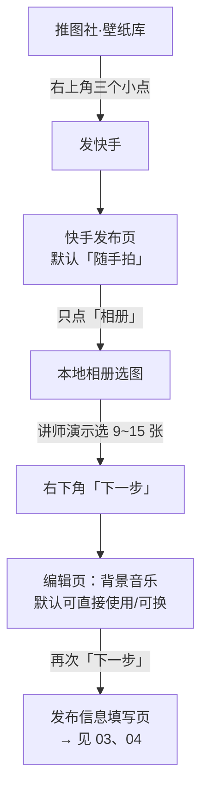

# 02 · 快手端发布全流程：从「发快手」到编辑页

> 本文覆盖「点开发快手 → 进入编辑页结束」。**文案与话题**见 [03](03-traffic-copy-and-hashtags.md)，**权限设置与发布**见 [04](04-pre-publish-settings.md)。

## 一、流程图

## 二、分步说明

### 步骤 1 · 触发「发快手」

- 位置：壁纸库界面**右上角「三个小点」**（更多菜单）（F-011）；
- 动作：点选「发快手」；
- 结果：跳转到快手发布页（F-012）。

> **信源等级**：`video_claim`（讲师口播）＋ `official_doc`（「发快手」能力存在，F-048）。

### 步骤 2 · 绕过「随手拍」，只点「相册」

进入发布页后**默认落在「随手拍」模式**（F-013）。图集发布**应只点「相册」**进入本地相册选图，**不使用随手拍**（F-014）。

> **为什么**：本案发布的是**壁纸图集（多张图片）**，需要从相册批量选图；「随手拍」是即时拍摄入口，与图集发布目标不符。

### 步骤 3 · 选图

- 在本地相册中选取壁纸图片（F-015）；
- **讲师实际演示选取约 9~15 张**（F-015、F-016）。

> ⚠️ **口径警示（必读）**：**「9~15 张」是讲师演示值，不是平台上限**。第三方来源给出 **9 张 / 12 张 / 31 张** 三个互相冲突的口径，**均无快手官方口径**（F-050、F-051）；本包**不得**把「9~15 张」表述为平台限制。详见 [06 · 风险与未闭环项](06-risks-and-open-questions.md)。

### 步骤 4 · 点「下一步」进入编辑页

选图完成后点**右下角「下一步」**进入编辑页（F-017）。

### 步骤 5 · 编辑页：背景音乐

编辑页的**背景音乐默认可直接使用，也可另行更换**（F-018）。

> 讲师演示中**未更换**音乐，采用默认值；本包不提供音乐选择策略。

### 步骤 6 · 再次「下一步」

编辑页处理完成后**再次点「下一步」**，进入发布信息填写页（F-019）——即进入文案、话题与权限设置环节。

## 三、常见误区

| 误区 | 说明 |
|---|---|
| 用「随手拍」直接拍图 | ❌ 本案发布的是相册里的现成壁纸，应走「相册」入口（F-014） |
| 把「9~15 张」当上限 | ❌ 这是演示值；三口径冲突且无官方口径（F-050、F-051） |
| 以为编辑页之后就能发布 | ❌ 编辑页之后还有**发布信息填写页**（文案/话题/权限），见 [03](03-traffic-copy-and-hashtags.md)、[04](04-pre-publish-settings.md) |

## 四、关联阅读

- 下一步：填文案、加话题 → [03 · 引流文案与话题](03-traffic-copy-and-hashtags.md)
- 再下一步：权限设置与发布 → [04 · 发布前设置与权限](04-pre-publish-settings.md)
- 照做版分步流程 → [examples/01 · 从口令到发布](../examples/01-publish-walkthrough.md)
