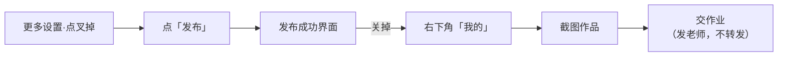

# 05 · 发布后与作业交付：我的 → 截图 → 勿转发

## 一、发布动作

设置完成后点「**发布**」按钮提交作品（F-037）。发布完成后**停留在发布成功界面**（F-038），讲师提示**关掉（退出）该界面**（F-039）。

## 二、查看自己的作品

从快手**右下角「我的」**进入，查看自己已发布的作品（F-040）。

```
发布成功界面 → 关掉
      │
      ▼
快手右下角「我的」
      │
      ▼
作品列表 → 找到刚发布的图集
```

## 三、作业交付方式：截图（不转发）

作业的交付方式**是截图**（F-041），有两种取图路径：

| 路径 | 操作 | 事实编号 |
|---|---|---|
| 路径一 | 在「我的」中对已发布作品**截图**交作业 | F-042 |
| 路径二 | 点进作品**详情页**截图后**发给老师** | F-043 |

**明确禁止**：作业交付**不得随意转发**作品（F-044）。

> **信源等级**：`video_claim`（讲师口播），属**课程作业要求**，与平台功能无关。

## 四、课程作业约束

| 约束 | 内容 | 事实编号 |
|---|---|---|
| 每天发布量 | **当天只发布一条** | F-045 |
| 约束性质 | **讲师对学员的课程约束**，**不是平台规则** | F-046 |
| 交付物 | 作品截图 | F-041 |

> ⚠️ **重要区分**：「今天只发一个」是**课程作业约束**（F-046），快手平台并无「每人每天只能发一条」的规则。本包**不把课程约束表述为平台限制**。

## 五、完整收尾流程



## 六、关联阅读

- 上一步：发布前设置 → [04 · 发布前设置与权限](04-pre-publish-settings.md)
- 照做版总流程 → [examples/01 · 从口令到发布](../examples/01-publish-walkthrough.md)
- 本流程未闭环项 → [06 · 风险与未闭环项](06-risks-and-open-questions.md)
