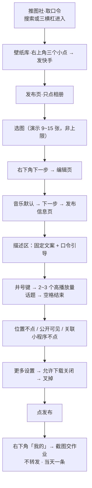

# 照做版：从口令到发布的分步流程

> **适用提醒**：本示例是**第三方讲师真机演示的复述版**（信源为 ASR 转写），**非平台官方指引**；界面按钮位置可能随快手 App 版本变动；图片数量与「允许下载」开关**无官方口径**。照做时**以实际界面为准**。引用前请先读[核验报告](../references/verification.md)。

## 阶段一 · 取口令（在「推图社」小程序）

| 步 | 操作 | 界面位置 | 判定标准 |
|---|---|---|---|
| 1 | 打开快手，进入「推图社」小程序 | **二选一**：① 顶部**放大镜**搜「推图社」；② **左上角「三横杠」**→「常用小程序」 | 已进入「推图社」首页 |
| 2 | 输入**自己的口令**，完成身份绑定 | 小程序内口令输入处 | 口令绑定成功（对应发布者本人） |
| 3 | 核对**壁纸库**内容 | 小程序壁纸库页 | 待发布的壁纸确为自己要推广的图 |

> **口令是你的「钩子」**，后面要写进作品文案里；口令对应**你本人**，不要混用他人口令。

## 阶段二 · 进入快手发布页

| 步 | 操作 | 界面位置 | 判定标准 |
|---|---|---|---|
| 4 | 在壁纸库页点「**发快手**」 | 壁纸库界面**右上角「三个小点」**（更多菜单） | 跳转到快手**发布页** |
| 5 | **只点「相册」**，绕过默认的「随手拍」 | 发布页入口 | 进入**本地相册**选图界面（未进入拍摄） |

## 阶段三 · 选图与编辑

| 步 | 操作 | 界面位置 | 判定标准 |
|---|---|---|---|
| 6 | 选取壁纸图片（讲师演示约 **9~15 张**） | 本地相册 | 已选好图；⚠️ **9~15 张是演示值，非上限** |
| 7 | 点「**下一步**」 | **右下角** | 进入**编辑页** |
| 8 | 背景音乐：**默认即可**（也可更换） | 编辑页音频项 | 音乐已就位（默认或自选） |
| 9 | 再次点「**下一步**」 | 编辑页 | 进入**发布信息填写页** |

## 阶段四 · 文案与话题

| 步 | 操作 | 界面位置 | 判定标准 |
|---|---|---|---|
| 10 | 描述区填入**讲师提供的固定文案** | 发布信息页·描述区 | 文案已填入 |
| 11 | 文案中**包含口令引导语** | 描述区 | 出现「输入口令【你的口令】获取同款壁纸」类引导 |
| 12 | 点「**#**」插入话题，选 **2~3 个高播放量**话题 | 描述区·井号键 | 已插入话题标签，未误拼成正文 |
| 13 | 「**碰一下空格**」结束话题输入 | 描述区 | 话题已封闭，未黏连 |
| 14 | 其他编辑入口**都不用点** | 发布信息页 | 其余编辑项保持默认 |

## 阶段五 · 发布前设置

| 步 | 操作 | 界面位置 | 判定标准 |
|---|---|---|---|
| 15 | **位置**：不点选 | 发布信息页·位置 | 位置未附加 |
| 16 | **可见范围**：设为「**公开可见**」 | 发布信息页·可见范围 | 已选公开可见 |
| 17 | **关联小程序**：不点 | 发布信息页·关联小程序 | 该开关未启用 |
| 18 | 进入「**更多设置**」，把「**允许下载**」**关闭** | 发布信息页 → 更多设置 | 开关呈**灰色**（关闭）；⚠️ 效果未获官方口径 |
| 19 | 点「**叉掉**」关闭更多设置面板 | 更多设置面板 | 返回发布信息页 |

## 阶段六 · 发布与交作业

| 步 | 操作 | 界面位置 | 判定标准 |
|---|---|---|---|
| 20 | 点「**发布**」 | 发布信息页 | 作品提交成功 |
| 21 | 关掉**发布成功界面** | 发布成功界面 | 退出该界面 |
| 22 | 从**右下角「我的」**查看作品 | 快手首页·右下角 | 作品列表中出现刚发布的图集 |
| 23 | **截图**作品交作业（点进详情页截图发老师） | 「我的」或作品详情页 | 已获得作品截图 |
| 24 | ⚠️ **不随意转发**作品；**当天只发一条** | — | 作业为**截图**；发布量为课程约束 |

## 全流程一览

## 关键红线复述

- ❌ **不把「9~15 张」当平台上限**（三口径冲突、无官方口径）；
- ❌ **不把「当天只发一条」当平台规则**（是课程作业约束）；
- ❌ **不承诺任何收益或引流效果**；
- ✅ **文案具体措辞与话题名称**以讲师实际提供为准（本包未逐字转录）。

可勾选清单见 [02 · 发布前核对清单](02-pre-publish-checklist.md)。
