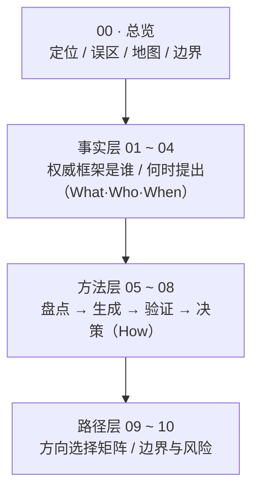

# 个人变现方向发现方法论 · 总览

> 本篇为**总览**：说明本包解决什么问题、由哪些篇目构成、该怎么读，以及必须知晓的边界声明。**本篇不展开任何框架细节**——权威框架的提出者与年份见事实层（01~04），操作步骤见方法层（05~08），人群路径与边界见路径层（09~10）。

## 一、本包定位

本知识包回答一个问题：**从「我是谁」出发，如何找到市场愿意付费的候选变现方向。**

它整合四类权威信源，登记共 **82 条 F 编号事实**（F-001 ~ F-082）：

| 信源类别 | 主题 | F 编号段 | 对应事实层篇目 |
|---|---|---|---|
| C1 | 职业匹配 / 设计人生 | F-001 ~ F-021 | [01 篇](01-career-matching-facts.md) |
| C2 | 优势 / 兴趣 / 天赋识别 | F-022 ~ F-047 | [02 篇](02-strengths-talent-facts.md) |
| C3 | 个人商业模式与变现模式 | F-048 ~ F-070 | [03 篇](03-monetization-model-facts.md) |
| C4 | 需求验证 / 最小可行验证 | F-071 ~ F-082 | [04 篇](04-validation-method-facts.md) |

四类信源既提供**权威框架**（是谁、何时提出），也提供**可操作的工具**（自评、候选生成、需求验证、决策），本包据此分三层承载。

## 二、三类常见误区

在进入方法之前，先识别三类典型误区——它们是把「找方向」做歪的主要来源：

1. **跟风赛道误区**：不加自评就追随当前热门赛道，把「别人赚钱的领域」直接当作自己的方向，忽略自身与方向的匹配关系。
2. **爱好即能力误区**：把「喜欢做某事」直接等同于「擅长做某事」，再等同于「可变现」——三者并不等同。相关适用性限定见 [01 篇](01-career-matching-facts.md) 的 RIASEC 学术局限小节与 [02 篇](02-strengths-talent-facts.md) 的测评边界声明。
3. **只学技巧不问匹配误区**：只收集「变现技巧 / 增长套路」，却从不做「我是谁 → 市场要什么」的匹配核对，使方向与自身长期不可持续的**风险升高**——该因果为本包方法的**前提假设，非实证结论**。

> 本包方法层的设计，正是针对这三类误区的逆向纠正：先盘点（05）→ 再生成候选（06）→ 再验证需求（07）→ 最后决策启动（08）。

## 三、bundle 地图（怎么读）

本包 `concepts/` 共 11 篇，三层划分如下：

| 层 | 篇目 | 一句话导读 |
|---|---|---|
| 总览 | [00](00-overview.md) | 本包定位、三类误区、bundle 地图、时效与边界声明 |
| 事实层 | [01](01-career-matching-facts.md) | C1：职业锚、RIASEC、Designing Your Life、CCT、TWA、Super（含 ikigai 勘误） |
| 事实层 | [02](02-strengths-talent-facts.md) | C2：CliftonStrengths、VIA、Dreyfus 五阶段、刻意练习、grit、心流、SDT（含 MBTI 争议） |
| 事实层 | [03](03-monetization-model-facts.md) | C3：Business Model You、BMC、Company of One、1000 True Fans、职业资本、特定知识、长尾 |
| 事实层 | [04](04-validation-method-facts.md) | C4：Lean Startup / MVP、JTBD、Mom Test、价值主张画布、客户开发 |
| 方法层 | [05](05-self-inventory-method.md) | 步骤 1 自我盘点：职业锚排序 + 优势/心流清单 + 资源约束 + 内在动机 |
| 方法层 | [06](06-candidate-generation-method.md) | 步骤 2 候选方向生成：画布 + 特定知识×杠杆矩阵 + 问题优先 |
| 方法层 | [07](07-needs-validation-method.md) | 步骤 3 需求验证：JTBD 三问 + Mom Test 脚本 + 最小验证实验 |
| 方法层 | [08](08-decision-and-launch-method.md) | 步骤 4 决策与启动：信号汇总 → go/no-go → 30 天行动 → 退出条件 |
| 路径层 | [09](09-path-matrix.md) | 方向选择矩阵：四种起点 × 资源约束的四条主路径 |
| 路径层 | [10](10-boundaries-and-risks.md) | 边界与风险：伪科学自评、画饼式路径、相关≠因果、收益不确定性 |

## 四、一条阅读路径建议

- **新手读者**：先读 [00 总览](00-overview.md) 建立全局认知，然后**从方法层**（[05](05-self-inventory-method.md) → [06](06-candidate-generation-method.md) → [07](07-needs-validation-method.md) → [08](08-decision-and-launch-method.md)）按四步顺序走一遍可照做的流程。
- **有基础 / 只想查权威出处者**：直接读**事实层**（[01](01-career-matching-facts.md) ~ [04](04-validation-method-facts.md)），定位每个框架「是谁、何时提出、核心主张归属」。
- **所有人收尾前**：读 [09 方向选择矩阵](09-path-matrix.md) 定位自身起点，再读 [10 边界与风险](10-boundaries-and-risks.md) 明确红线。

> 事实层与实践细节的对应关系、每篇的单一职责边界，其设计依据见 spec 区 `create-monetization-direction-okf-wiki/knowledge-map.md`（不随本包分发）。

## 五、时效与边界声明（重要）

- **生命周期**：本包 `status: stable`；`stale_after: 2027-06-30`；**核验时点为 2026-10-17**。其中工具类内容（CliftonStrengths、VIA、MBTI 测评规格等）若工具方更新版本或信效度结论，须重核后更新。
- **非决定论声明**：性格 / 天赋测评类工具（含 MBTI、RIASEC、CliftonStrengths、grit 等）**具科学效度争议，属非决定论工具，不得作为变现方向判定依据**，仅可作自我反思的启发式参照（对应 F-041，详见 [02 篇](02-strengths-talent-facts.md)）。
- **非承诺声明**：本包中一切收益 / 规模类表述（如 1000 True Fans 的数学条件、$100 Startup 的样本成效）均为**原作者在其限定语境下的主张或样本观察，非对读者的收益承诺**（对应 F-056/F-057、F-052、F-065、F-066，详见 [03 篇](03-monetization-model-facts.md)）。
- **不做推荐**：本包不推荐任何具体测评产品、课程或付费工具，不提供任何收益保证。
- **核验与勘误**：全部 82 条事实的核验结论、勘误四张清单（1000 True Fans 拔高 E-01、MBTI 伪决定性 E-02、ikigai 误植 E-03、刻意练习以偏概全 E-04、职业锚版本口径 E-05）与单源清单，见 [核验报告](../references/verification.md)。

## 本篇要点小结

1. 本包回答「从我是谁 → 市场愿意付费的候选方向」，整合 C1~C4 四类信源、登记 82 条 F 编号事实。
2. 三类误区：跟风赛道、爱好即能力、只学技巧不问匹配；方法层四步正是其逆向纠正。
3. 三层结构：事实层（01~04）登记权威来源，方法层（05~08）给出操作步骤，路径层（09~10）给出人群路径与边界。
4. 边界红线：测评**非决定论**、表述**非承诺**、不做任何产品与收益推荐。
5. 全量核验结论与勘误见 [核验报告](../references/verification.md)。
