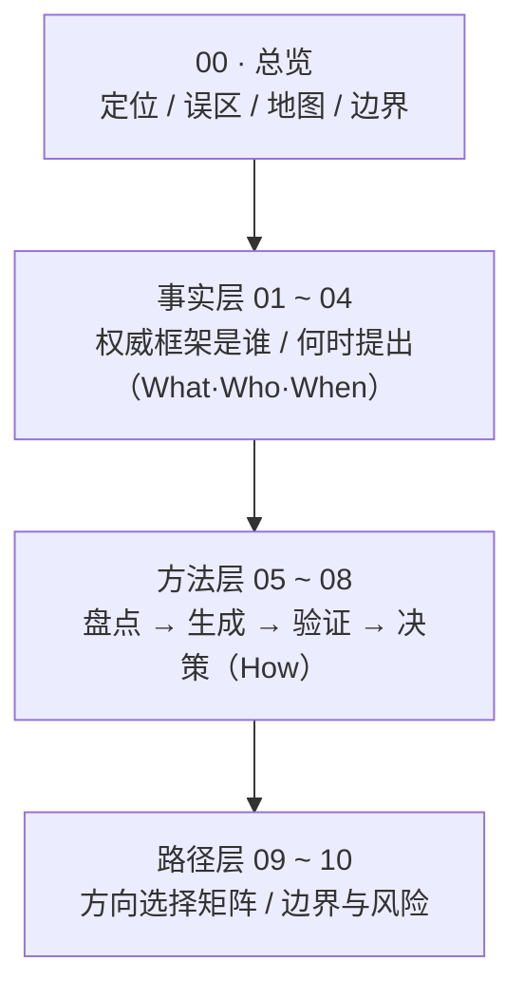

# 个人变现方向发现方法论 · 总览

> 本篇为**总览**：说明本包解决什么问题、由哪些篇目构成、该怎么读，以及必须知晓的边界声明。**本篇不展开任何框架细节**——权威框架的提出者与年份见事实层（01~04），操作步骤见方法层（05~08），人群路径与边界见路径层（09~10）。

## 一、本包定位

本知识包回答一个问题：**从「我是谁」出发，如何找到市场愿意付费的候选变现方向。**

它整合四类权威信源，登记共 **99 条 F 编号事实**——其中 **F-001 ~ F-082 为四类信源的框架出处登记**，**F-083 ~ F-099 为 2026-10-17 深入研究增量的「实证机制补证」**（专为填补本包自认的研究缺口而登记，见下文**第七节**）：

| 信源类别 | 主题 | F 编号段 | 对应事实层篇目 |
|---|---|---|---|
| C1 | 职业匹配 / 设计人生 | F-001 ~ F-021 | [01 篇](01-career-matching-facts.md) |
| C2 | 优势 / 兴趣 / 天赋识别 | F-022 ~ F-047 | [02 篇](02-strengths-talent-facts.md) |
| C3 | 个人商业模式与变现模式 | F-048 ~ F-070 | [03 篇](03-monetization-model-facts.md) |
| C4 | 需求验证 / 最小可行验证 | F-071 ~ F-082 | [04 篇](04-validation-method-facts.md) |
| C5 | 实证机制补证（增量） | F-083 ~ F-099 | 见下文**第七节**；登记于 [事实清单](../references/article-source.md) 第五节 |

四类信源既提供**权威框架**（是谁、何时提出），也提供**可操作的工具**（自评、候选生成、需求验证、决策），本包据此分三层承载。

## 二、三类常见误区

在进入方法之前，先识别三类典型误区——它们是把「找方向」做歪的主要来源：

1. **跟风赛道误区**：不加自评就追随当前热门赛道，把「别人赚钱的领域」直接当作自己的方向，忽略自身与方向的匹配关系。
2. **爱好即能力误区**：把「喜欢做某事」直接等同于「擅长做某事」，再等同于「可变现」——三者并不等同。相关适用性限定见 [01 篇](01-career-matching-facts.md) 的 RIASEC 学术局限小节与 [02 篇](02-strengths-talent-facts.md) 的测评边界声明。
3. **只学技巧不问匹配误区**：只收集「变现技巧 / 增长套路」，却从不做「我是谁 → 市场要什么」的匹配核对。
   〔洞察〕匹配缺位与方向可持续性的关系
   - 现象：行动停留在技巧收集，而自我盘点（步骤 1）与需求验证（步骤 3）两个环节长期缺位。
   - 根因（2026-10-17 补证）：**人-环境匹配缺位**与**消极职业状态（不满意 → 退出意向 → 实际转换方向）**之间，已有多项元分析与纵向研究**方向一致地**显示关联——人-环境匹配元分析（172 项研究 / 836 个效应量）显示该组关系跨情境可泛化（F-083）；人-组织匹配综述载工作满意度 ρ = .44、组织承诺 ρ = .51、**离职意向 ρ = −.35**（F-084）；德国 2005–2017 面板显示人格与同职业在任者差异越大者**越可能实际离开**该职业（F-087）。**四重限定必须并列**：效应量为**相关**系数而非因果（F-084）；人-岗匹配与**实际离职、实际绩效无关**（F-086）；存在**无显著**的反面发现（F-088）；综述作者自陈存在测量方式与国家文化 caveat，且**错配亦可能有益**（F-085）。故本项由「无证据的前提假设」升级为「**有方向性实证支持、但非因果结论的假设**」。
   - 影响：方向与自身长期不可持续的**风险升高**——该因果方向现有**方向性实证支持**（F-083 ~ F-088，仍为相关证据），但仍属本包方法的**前提假设，非因果结论**。
   - 建议：按下文四步法顺序补上缺位环节——先盘点（[05](05-self-inventory-method.md)）→ 再生成候选（[06](06-candidate-generation-method.md)）→ 再验证需求（[07](07-needs-validation-method.md)）→ 最后决策启动（[08](08-decision-and-launch-method.md)）。

> 本包方法层的设计，正是针对这三类误区的逆向纠正：先盘点（05）→ 再生成候选（06）→ 再验证需求（07）→ 最后决策启动（08）。

## 三、bundle 地图（怎么读）

本包 `concepts/` 共 11 篇，三层划分如下：

| 层 | 篇目 | 一句话导读 |
|---|---|---|
| 总览 | [00](00-overview.md) | 本包定位、三类误区、bundle 地图、时效与边界声明 |
| 事实层 | [01](01-career-matching-facts.md) | C1：职业锚、RIASEC、Designing Your Life、CCT、TWA、Super（含 ikigai 勘误） |
| 事实层 | [02](02-strengths-talent-facts.md) | C2：CliftonStrengths、VIA、Dreyfus 五阶段、刻意练习、grit、心流、SDT（含 MBTI 争议） |
| 事实层 | [03](03-monetization-model-facts.md) | C3：Business Model You、BMC、Company of One、1000 True Fans、职业资本、特定知识、长尾 |
| 事实层 | [04](04-validation-method-facts.md) | C4：Lean Startup / MVP、JTBD、Mom Test、价值主张画布、客户开发 |
| 方法层 | [05](05-self-inventory-method.md) | 步骤 1 自我盘点：职业锚排序 + 优势/心流清单 + 资源约束 + 内在动机 |
| 方法层 | [06](06-candidate-generation-method.md) | 步骤 2 候选方向生成：画布 + 特定知识×杠杆矩阵 + 问题优先 |
| 方法层 | [07](07-needs-validation-method.md) | 步骤 3 需求验证：JTBD 三问 + Mom Test 脚本 + 最小验证实验 |
| 方法层 | [08](08-decision-and-launch-method.md) | 步骤 4 决策与启动：信号汇总 → go/no-go → 30 天行动 → 退出条件 |
| 路径层 | [09](09-path-matrix.md) | 方向选择矩阵：四种起点 × 资源约束的四条主路径 |
| 路径层 | [10](10-boundaries-and-risks.md) | 边界与风险：伪科学自评、画饼式路径、相关≠因果、收益不确定性 |

## 四、一条阅读路径建议

- **新手读者**：先读 [00 总览](00-overview.md) 建立全局认知，然后**从方法层**（[05](05-self-inventory-method.md) → [06](06-candidate-generation-method.md) → [07](07-needs-validation-method.md) → [08](08-decision-and-launch-method.md)）按四步顺序走一遍可照做的流程。
- **有基础 / 只想查权威出处者**：直接读**事实层**（[01](01-career-matching-facts.md) ~ [04](04-validation-method-facts.md)），定位每个框架「是谁、何时提出、核心主张归属」。
- **所有人收尾前**：读 [09 方向选择矩阵](09-path-matrix.md) 定位自身起点，再读 [10 边界与风险](10-boundaries-and-risks.md) 明确红线。

> 事实层与实践细节的对应关系、每篇的单一职责边界，其设计依据见 spec 区 `create-monetization-direction-okf-wiki/knowledge-map.md`（不随本包分发）。

## 五、时效与边界声明（重要）

- **生命周期**：本包 `status: stable`；`stale_after: 2027-06-30`；**核验时点为 2026-10-17**。其中工具类内容（CliftonStrengths、VIA、MBTI 测评规格等）若工具方更新版本或信效度结论，须重核后更新。
- **非决定论声明**：性格 / 天赋测评类工具（含 MBTI、RIASEC、CliftonStrengths、grit 等）**具科学效度争议，属非决定论工具，不得作为变现方向判定依据**，仅可作自我反思的启发式参照（对应 F-041，详见 [02 篇](02-strengths-talent-facts.md)）。
- **非承诺声明**：本包中一切收益 / 规模类表述（如 1000 True Fans 的数学条件、$100 Startup 的样本成效）均为**原作者在其限定语境下的主张或样本观察，非对读者的收益承诺**（对应 F-056/F-057、F-052、F-065、F-066，详见 [03 篇](03-monetization-model-facts.md)）。
- **不做推荐**：本包不推荐任何具体测评产品、课程或付费工具，不提供任何收益保证。
- **核验与勘误**：全部 **99 条**事实（82 条框架出处 + 17 条实证机制补证）的核验结论、勘误四张清单（1000 True Fans 拔高 E-01、MBTI 伪决定性 E-02、ikigai 误植 E-03、刻意练习以偏概全 E-04、职业锚版本口径 E-05）与单源清单，见 [核验报告](../references/verification.md)；本轮补证另见该报告第 9 节。

## 六、可迁移模式：变现方向发现四步法

> 本节登记本包方法的**可迁移模式**条目（G3）：触发场景 / 核心步骤 / 反模式 / 迁移验证。本节只陈述**已实际发生的结构适配事实**，不含任何实证成效主张。

- **触发场景**：个体不知道「自己能靠什么变现」，或已陷入本文第二节的三类误区之一——**跟风赛道**（不加自评即追随热门）、**爱好即能力**（把「喜欢」当「擅长」再当「可变现」）、**只学技巧不问匹配**（收集技巧而不做匹配核对）。
- **核心步骤**：**自我盘点**（[05](05-self-inventory-method.md)）→ **候选方向生成**（[06](06-candidate-generation-method.md)）→ **需求验证**（[07](07-needs-validation-method.md)）→ **决策与启动**（[08](08-decision-and-launch-method.md)）。四步为主干顺序，每步均给出「输入项 / 操作步骤 / 判定标准」三要素，步间以产出物串联：自评盘点表 → 候选方向卡 → 验证实验卡 → 决策清单。
- **反模式**：
  - 把测评类型直接当作方向判决（[05](05-self-inventory-method.md) §5）；
  - 把「享受某事」当作「能做某事」、画布填抽象词、删除「当前最大不确定性」字段（[06](06-candidate-generation-method.md) §10）；
  - 问朋友「会不会买」、样本全是熟人、把点赞 / 好评当付费意愿、事后调整信号阈值（[07](07-needs-validation-method.md) §6 反模式清单）；
  - 忽略硬约束生成不切实际的候选与行动（[05](05-self-inventory-method.md) §2.3、[08](08-decision-and-launch-method.md) §5）；
  - 把个案路径当作可复制的因果证据（[10](10-boundaries-and-risks.md) §3）。
- **迁移验证**（已发生的结构适配事实，非实证检验结论）：
  - **主干复用**：本四步法主干在**四条起点路径上复用且无需改动**——[09 §4](09-path-matrix.md) 的 P1 在职副业 / P2 全职转型 / P3 技能型创作者 / P4 被动转型共用同一套方法层步骤，差异只落在「准入门槛取值」与「实验形态选择」（[09](09-path-matrix.md) §7、§4）；
  - **同簇对接**：已与 5 个同簇场景 bundle 建立互链——[ai-monetization](../../ai-monetization/index.md)、[monetization-essence](../../monetization-essence/index.md)、[zhihu-monetization](../../zhihu-monetization/index.md)、[overseas-freelance-night-work](../../overseas-freelance-night-work/index.md)、[ai-one-person-micro-product](../../ai-one-person-micro-product/index.md)（互链方向见根 [index.md](../index.md) 「主题关联互链」段），本四步法在其处作为前置筛子 / 入口环节被引用；
  - **边界**：以上仅为文档结构层面的适配与互链事实；本包未做跨场景效果验证，不得读作「照此四步法即可成功」。

## 七、研究缺口补证（2026-10-17 深入研究增量）

> 本节登记对**本包自认研究缺口**的定向补证结果。缺口来源：§二第 3 条洞察、[05 §2.1](05-self-inventory-method.md)、[05 §2.2](05-self-inventory-method.md)、[10 §3](10-boundaries-and-risks.md)、[10 §4](10-boundaries-and-risks.md) 中如实标注「根因：本包未给出，属待研究方法问题」的条目。
> **本节不改变本包的非决定论 / 非承诺边界，也不构成对本包方法的实证检验通过**——新增事实一律为**登记性陈述 + 限定语**，不含因果结论。

**一、已获补证 / 部分补证（5 项）**

| 缺口 | 补证事实 | 补证结论（**含必须并列的限定语**） |
|---|---|---|
| §二「匹配缺位 → 方向不可持续」 | F-083 ~ F-088 | 多项元分析与纵向研究**方向一致**显示：匹配度偏低 ↔ 更高的不满意、更强的退出意向、更可能**实际转换方向**。**但为相关方向性证据、非因果证明**，且必须并列反面与限定：人-岗匹配与**实际离职 / 实际绩效无关**（F-086）、存在**无显著**反面发现（F-088）、存在测量方式与国家文化 caveat 且**错配亦可能有益**（F-085） |
| [05 §2.1](05-self-inventory-method.md)「多主导锚 / 排序随时间变化」 | F-089 ~ F-091 | Schein 本人 **1996 年**即述：职业锚**只随职业与人生经历演化**，形成后充当稳定力，且**多数职业可同时满足多个锚的需求**（F-089）；多锚共存的成因是锚的三类维度**互不排斥**（F-090）；实证样本中约七成持多锚（F-091，**发生率数字系转引**） |
| [05 §2.2](05-self-inventory-method.md)「心流挑战—技能平衡」成因 | F-092 ~ F-094 | 经验取样研究支持「平衡对体验质量有正向独立作用」（F-092），但另有研究给出「**仅部分支持**」并受活动重要性与成就动机调节（F-093），以及「客观操控的难度—技能比对享受 / 投入**无显著影响**」（F-094，**预注册实验**）——**争议未解**。故「过高趋向焦虑、过低趋向厌倦」仍只能作**作者主张**陈述 |
| [10 §3](10-boundaries-and-risks.md) 刻意练习领域差异成因 | F-095 | 该元分析**自身**已把「**任务环境可预测性**」列为理论调节变量（低 / 中 / 高三级）并预测其方向；但**作者未断言**领域差异由该变量造成——属**候选机制、非定论**；Ericsson 方另主张差异部分源于定义放宽（F-033 / F-035） |
| [10 §4](10-boundaries-and-risks.md) 缺乏可外推收益样本 | F-096 ~ F-099 | 外部权威数据**反向证实了本包「个案不可外推」这条边界**：自雇者**中位**收益低于雇员（美国 −35%，F-096；OECD −16%，F-097），独资申报中营收 ≤ $10 万者占 **88.7%** 却仅贡献 **30.1%** 利润（F-098），创作者收益呈 α ≈ 2 重尾（F-099，**预印本**）。**不等于「变现必然失败」**——部分国家自雇者收益反超、分布右尾仍存在高收益者 |

**二、仍未解决（4 项，如实登记，未编造）**

- [09 §6](09-path-matrix.md) / [09 §7](09-path-matrix.md)——个人变现路径的**实证分类**：本次检索未获同行评议分类学研究，路径划分维持「BMY 要素命名（F-049）下的启发式分类」定性；
- [07 §9](07-needs-validation-method.md) / [08 §9](08-decision-and-launch-method.md)——单次验证信号外推的**量化归因模型**：未获可直接量化「实验信号 → 整体市场需求」的模型。

> 逐条依据（信源距离 / 核验级 / 限定语 / 证据 URL）见 [核验报告](../references/verification.md) 第 9 节；事实登记见 [事实清单](../references/article-source.md) 第五节。本节只增加「已发生的结构性事实」，**不含任何成效承诺**。

## 本篇要点小结

1. 本包回答「从我是谁 → 市场愿意付费的候选方向」，整合 C1~C4 四类信源、登记 99 条 F 编号事实（82 条框架出处 + 17 条实证机制补证）。
2. 三类误区：跟风赛道、爱好即能力、只学技巧不问匹配；方法层四步正是其逆向纠正。
3. 三层结构：事实层（01~04）登记权威来源，方法层（05~08）给出操作步骤，路径层（09~10）给出人群路径与边界。
4. 边界红线：测评**非决定论**、表述**非承诺**、不做任何产品与收益推荐。
5. 2026-10-17 深入研究增量（§七）补上 5 项研究缺口的权威证据，并**如实登记 4 项仍未解决的缺口**；补证不构成对本包方法的实证检验通过。
6. 全量核验结论与勘误见 [核验报告](../references/verification.md)。
