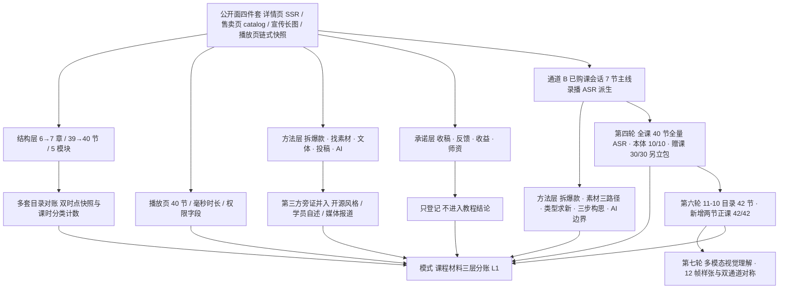

# 短故事创作与投稿变现：从爆款拆解到结构改写的可核验教程

> **状态：flagged · 路线：chaptered-summary（深度摘要 + 原创改写）。** 本包有**两条互不印证的证据通道**：通道 A 是免登录公开面（详情页、售卖页、宣传长图、播放页小节级快照），通道 B 是 2026-11-09 稍晚一次已购课会话下取得的**课堂主线录播音轨转写**。A 回答目录与字段口径，B 回答课堂讲了哪些方法；B 不给 A 的招生承诺背书，A 也不证明 B 的讲法有效（F-112）。前四轮把讲义、课件画面文字、官方字幕、作业与批改登记为「全部缺席」（F-135）；11-10 第五轮复核把这句收窄为四层可得性：独立讲义附件、官方字幕轨与批改记录确未取得，课件画面文字与作业要求的载体已随录播原件取得但不做逐字转录，详见[证据范围复核与四层可得性](references/evidence-scope-audit.md)（F-140～F-155）；第三轮的课堂内容是 **ASR 派生稿而非逐字稿**，只以原创改写进入教程，引用体例见[课堂本体覆盖与证据分层](references/lecture-coverage.md)。本包不是课程转录、不是课堂讲义复刻，也不提供平台操作手册；去品牌化处理与采集边界见[来源清单](references/source-manifest.md)。11-07 与 11-09 上午的两份历史快照整页保留。11-10 更晚的第六轮把当日新解锁的两节正课补齐为内容级转写，落成[人物立得住](concepts/14-character-design.md)与[单线与四段式](concepts/15-narrative-structure.md)；11-09 的 40/40 与 11-10 的 42/42 分属两个目录时点，见[全量录播覆盖与双包分账](references/full-course-coverage.md)第六轮注记（F-156～F-171）。第四轮（同日更晚）把全课 40 节录播全部补齐并做内容级转写，其中课程本体 10 节留在本包、30 节搭售赠课属另一产品线而[另立独立包](../ai-assisted-content-operations/index.md)；覆盖与分账见[全量录播覆盖与双包分账](references/full-course-coverage.md)。 11-10 第七轮复核「有视频为何不做多模态提取」：能、且第二轮起就用过；原结论把「不逐字转录」误推成「不提取文字」，现补齐视觉理解层与双通道对称，详见[多模态视觉理解复核与双通道对称](references/visual-understanding-audit.md)（F-172～F-185）。

读这门课的材料，第一件要分清的事不是「哪种写法更容易过稿」，而是**同一门课至少有三套互不等价的目录**：详情页的 6 个章节、售卖页 11-07 的 39 节排期表、宣传长图的 5 个能力模块（F-007、F-018、F-035）。三套目录回答的是三个不同问题，把它们当中任何一套当成「课程完整大纲」都会得出错误结论。第一课因此是[课程结构与两套大纲](concepts/01-course-structure-and-two-syllabi.md)，不是写作技巧。2026-11-09 复核又补上[播放页 40 节快照](references/player-page-snapshot.md)：同一组字段在两天内由 39 变 40、章节由 6 变 7，读法见[目录会自己变](concepts/07-catalog-snapshots-and-unlock.md)。同日稍晚的第三轮把可读范围推进到课堂本体，新增[拆解与素材](concepts/08-deconstruct-and-source.md)、[类型与构思](concepts/09-type-map-and-conception.md)、[AI 共创与改编](concepts/10-ai-cowork-and-adaptation.md)三篇；第 07 篇的「内容可读范围没有增加」是**上午免登录会话**的时点真值，两者按时点分账（F-113）。

## 按用途选择路径

| 路径 | 要回答的问题 | 本包能提供什么 |
|---|---|---|
| [先分清四种陈述](concepts/00-reading-and-evidence.md) | 哪些是页面事实，哪些只是单源宣传或第三方转述？ | 四层陈述分层、七个信源的性质与本包覆盖边界 |
| [课程结构与两套大纲](concepts/01-course-structure-and-two-syllabi.md) | 39 节课到底有多少是正课？为什么会有两套大纲？ | 课时分类计数、三套目录对账、赠课占比与采集快照 |
| [拆爆款与找素材](concepts/02-deconstruct-hits-and-source-hunting.md) | 「拆爆款」能拆出什么，素材从哪里来？ | 拆解维度、素材来源分层、七步骨架的多版本对账 |
| [短篇文体规范](concepts/03-short-story-form-conventions.md) | 这类短篇在形式上有哪些可检查的特征？ | 视角／对话／句式／排版四项与拆文检查表，均标第三方口径 |
| [投稿与变现口径](concepts/04-submission-and-monetization.md) | 「保证收稿」「篇篇有反馈」「单篇分账」能不能互相印证？ | 承诺／观察／个案三级证据分层与不可外推清单 |
| [AI 辅助写作边界](concepts/05-ai-assisted-writing-boundary.md) | AI 在这条链路里被放在哪些位置，哪些边界必须另查？ | 导学与赠课的位置、公开工作流、平台 AI 规则引用纪律 |
| [单源主张与适用边界](concepts/06-claims-and-boundaries.md) | 哪些句子不能用、什么时候该重读？ | 营销话术剥离、口径冲突并存、勘误与复核触发 |
| [目录会自己变](concepts/07-catalog-snapshots-and-unlock.md) | 39 节与 40 节哪个才算数？播放页多给了什么？ | 双时点快照、三方逐条对账、字段四堆与元数据边界 |
| [拆爆款与找素材（课堂通道）](concepts/08-deconstruct-and-source.md) | 课堂里拆解与找素材各按什么顺序讲？ | 三段拆解、四项检查、细读与提炼、三条素材路径 |
| [类型地图与三步构思](concepts/09-type-map-and-conception.md) | 选哪类写、动笔前要校准到什么程度？ | 类型三分与求新位置、灵感与构思之别、三步构思法 |
| [AI 共创与改编形态](concepts/10-ai-cowork-and-adaptation.md) | 工具用到哪里停、改编侧与写作侧有何不同？ | 工具边界、提问纪律、只分析不代改、两套工业逻辑与合规顺序 |
| [导学三节走查](concepts/11-guided-lessons.md) | 三节导学各自承担什么定位、怎么衔接？ | 文体认知→工具链路→影视化出口的递进与当堂判据 |
| [四节正课走查](concepts/12-core-lessons-walkthrough.md) | 正课按什么次序推进、当场给了哪些检查动作？ | 拆→找→辨类型→构思的课次依赖与动笔顺序 |
| [三场直播走查](concepts/13-live-sessions.md) | 三场直播各管什么、反复出现的卡点是什么？ | 节奏／延伸／答疑的功能分工、作业递进与提问纪律 |

只想取公开材料里的方法可读第 02、03、05 篇；要读课堂方法链结论改读第 08、09、10 篇，要按课次看课堂怎么推进改读第 11、12、13 篇；三组结论不要跨通道混用；关心目录为何会变的读者加读第 01、07 篇。每篇的「本包不覆盖」段落请一并读完，那里写的才是这套方法的真实边界。

## 三条主线



## 证据怎样使用

F-001～F-185 共 185 条，是本包唯一的事实台账，见[课程事实与主张登记](references/course-facts.md)。分层登记：F-001～F-012 详情页页面事实、F-013～F-024 售卖页页面事实、F-025～F-040 宣传长图的单源主张、F-041～F-054 第三方公开旁证、F-055～F-060 首轮负向事实与适用边界；F-061～F-080 为 11-09 上午播放页复核与开放平台检索；**F-081～F-115 为 11-09 稍晚第三轮已购课会话新增**（会话与覆盖 14 条、课堂方法的原创改写 16 条、分账与模式 5 条），按幂等规则顺延，不改写既有行。**F-116～F-139 为同日更晚第四轮全量录播补齐新增**（采集与覆盖 10 条、逐课走查原创改写 7 条、分账与模式 7 条）；**F-140～F-155 为 11-10 第五轮证据范围复核新增**，四层可得性见[证据范围复核与四层可得性](references/evidence-scope-audit.md)；**F-156～F-171 为同日更晚第六轮新增两节正课内容级转写新增**（采集与目录 5 条、两课方法链原创改写 8 条、覆盖与结论 3 条），走查见第 14／15 篇。F-095～F-110 是**课堂讲法的原创改写**，只回答「课堂讲了什么」，不认证方法有效性。事实表只回答「页面写了什么」「公开材料怎么转述」，**不认证任何方法的有效性、任何平台规则的当前状态、任何收益承诺**。逐项裁决与勘误见[核验与勘误](references/verification.md)，四视角攻击与采纳记录见[对抗审查](references/adversarial-review.md)。 **F-172～F-185 为 11-10 第七轮多模态视觉理解复核新增**（能力／规范／偏差 3 条、样张与四类增量 6 条、字幕口径与路线 3 条、音轨与工具边界 1 条、V 门与编号 1 条），见[多模态视觉理解复核与双通道对称](references/visual-understanding-audit.md)。

四条负向事实值得先记住：首轮（2026-11-07）未取得任何一节课程视频、讲义、字幕或作业正文（F-055）；宣传长图的「33 名师讲堂 + 16 节直播」与售卖页的 39 节目录口径不一致，成因未明，本包并存登记而不合并抹平（F-057）；第三方开源风格参考不是平台官方规则，公开流传的「七步故事法」也至少有 4 个互不相同的版本，均非课程官方文本（F-059、F-060）。因此本包对「这门课教了什么具体句式」「平台当前收稿标准是什么」保持空白，不用常识补写。第四条负向事实同样要记住：11-09 **上午免登录会话**复核后 40 节依然全部未购、试看时长为 0、播放列表与资料列表为空、笔记总数为 0，**目录记录增加不等于内容可读范围增加**（F-071、F-078）。第五条是第三轮的：同日稍晚的已购课会话取得了 7 节主线录播的音轨转写，但**讲义、课件画面文字、官方字幕、作业、批改、3 场直播与 30 节赠课的内容仍全部缺席**（F-086、F-091～F-093）；全课内容级覆盖为 7/40，且这 7 节是 ASR 派生稿而非逐字稿（F-090）；**该覆盖率是第三轮的时点真值**，第四轮补齐后全课达 40/40、本包课程本体 10/10，按时点分账见[全量录播覆盖与双包分账](references/full-course-coverage.md)（F-124、F-125）。第六条是第五轮的：11-10 目录复核为 42 节、新增两节正课未覆盖，故 40/40 只属于 11-09 目录时点（F-149、F-152）；第七条是「全部缺席」不再成立，四层裁决见[证据范围复核与四层可得性](references/evidence-scope-audit.md)（F-145、F-153）。第八条是第六轮的：11-10 新增两节正课已补齐内容级转写，故 42/42 属 11-10 目录时点；但覆盖节数上升**不等于证据等级上升**，L1 成熟度仍不升级（F-169、F-171）。 第九条是第七轮的：「不做逐字转录」不等于「不做文字提取」，画面与音轨应同作理解素材；「官方字幕缺席」仅指独立字幕文件与可检索字幕轨，像素内烧录字幕可见（F-181、F-182）。

> **表格 ≠ 课堂原表。** 本包所有表格均为依据公开页面字段、宣传图文字或第三方材料整理的**原创改述**，不是课堂讲义中的表格，也不是平台后台字段说明。

## 文档清单

本包共 31 篇 Markdown：16 篇教程、11 篇参考正文（来源清单、事实登记、11-07 目录快照、11-09 播放页快照、课堂本体覆盖与证据分层、核验与勘误、对抗审查、知识地图）、3 篇索引与 1 篇更新日志。第二轮新增 2 篇；第三轮新增 4 篇；第四轮新增 4 篇：[导学三节走查](concepts/11-guided-lessons.md)、[四节正课走查](concepts/12-core-lessons-walkthrough.md)、[三场直播走查](concepts/13-live-sessions.md)与[全量录播覆盖与双包分账](references/full-course-coverage.md)。第五轮新增 1 篇参考[证据范围复核与四层可得性](references/evidence-scope-audit.md)；第六轮新增 2 篇教程：[人物立得住](concepts/14-character-design.md)与[单线与四段式](concepts/15-narrative-structure.md)。不建 `examples/`：课程本体未给出读者可照做的步骤、版本与输入输出，可复现性两问皆否，理由见[知识地图](references/knowledge-map.md)；第 02、03、07 篇中的检查顺序与工作表均显式标注为本包自拟。 第七轮新增 1 篇参考[多模态视觉理解复核与双通道对称](references/visual-understanding-audit.md)。

## 主题关联

- [AI 辅助内容运营](../ai-assisted-content-operations/index.md)：同一已购课会话下的搭售赠课 30 节，**另一产品线**独立成包；F 编号独立、结论互不印证，不拼因果链（F-126、F-127）。
- [知乎盐言作者平台](../zhihu-salt-author-platform/index.md)：本包讨论**课程材料**能说明什么，该包讨论**平台官方口径**的产品流程与活动规则；两者的 AI 红线与投稿闸门只对各自采集快照成立，不可互证。
- [内容创作三原则](../content-creation-three-rules/index.md)：同为付费课程单源材料按 `chaptered-summary` 转化，演示「只有原则」的处理方式；本包多出「有完整目录」这一类结构事实。
- [壁纸主题选择与上传判断](../wallpaper-selection-directions/index.md)与[快手发布壁纸作品引流](../kuaishou-wallpaper-publish-traffic/index.md)：同组课程材料转化簇，分别演示「只有清单」与「有口播全流程」；三包 F 编号各自独立。
- [零基础 AI 实操赚钱项目](../ai-side-hustle-playbook/index.md)：一般副业路径与合规红线；本包不含定价、交付与项目选择内容。
- [个人变现方向发现](../monetization-direction/index.md)：适合尚未确定方向的读者；本包假设读者已决定尝试短篇内容创作。

## 更新边界

2026-12-07 为复核期限，不是自动巡检任务。触发复核的条件：课程目录继续解锁且章节数或课时数变化、售卖页价格与权益文案改版、所引平台规则页改版、出现可复核的第三方效果数据、或取得课程正文后可核方法细节。**其中「课程目录继续解锁」与「取得课程正文」均已于 2026-11-09 触发**，执行记录见[更新日志](log.md)；七轮分别占用 F-061～F-080、F-081～F-115、F-116～F-139、F-140～F-155、F-156～F-171 与 F-172～F-185，**下一轮从 F-186 顺延**。「直播或赠课完成内容级转写」已于第四轮触发；第五轮又触发「课程目录继续解锁」（40→42 节）与「课件画面文字载体取得」（像素可读、按路线不转录），产出[证据范围复核与四层可得性](references/evidence-scope-audit.md)与 F-140～F-155。第六轮已触发「新增两节正课完成内容级转写」：按标题与 11-09 的 40 节逐条对账锁定净新增两节，取最小清晰度原件 100.1 MB 并校验魔数与 SHA-256，音轨 ASR 派生稿只以原创改写进入第 14／15 篇，产出 F-156～F-171。新增触发条件：目录再次解锁后新增节的内容级转写、讲义或官方字幕全文取得、批改记录可核对、会话权限变化、搭售赠课产品线口径变化。完整覆盖清单与幂等规则见[来源清单](references/source-manifest.md)。 第七轮触发「课件画面文字取得」的复核追问：对新增两节做 12 帧视觉理解样张，确认相对音轨有编号、栏位、两套清单并存与案例卡契约四类增量，并收窄字幕口径；产出[多模态视觉理解复核与双通道对称](references/visual-understanding-audit.md)与 F-172～F-185。

```{toctree}
:hidden:
:maxdepth: 2

concepts/index
references/index
log
```
