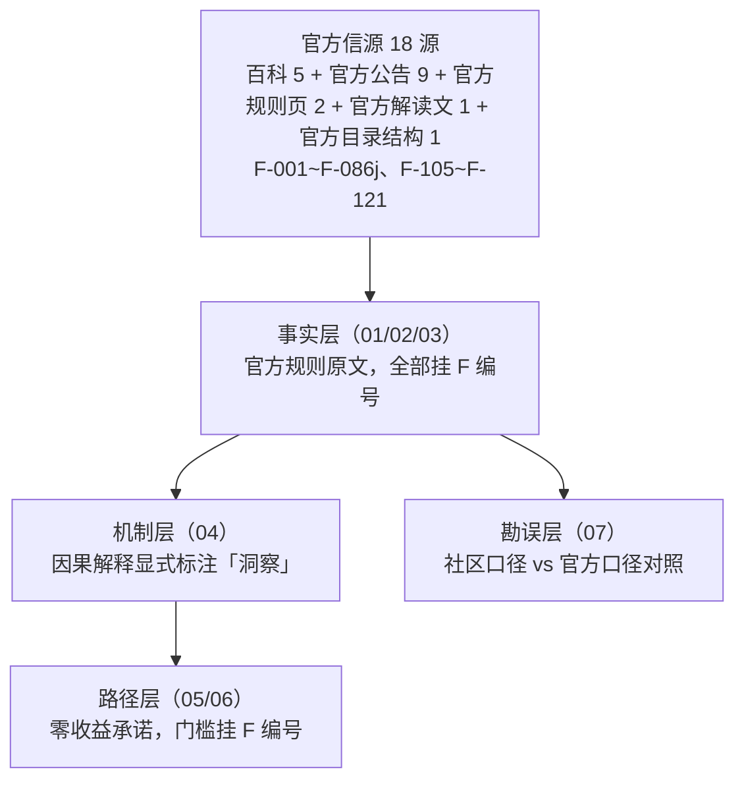

# 头条号变现体系总览：首发激励、分成公式与权益阶梯

## 一、包定位与取证路径

本知识包解析**今日头条（头条号）面向个人创作者的变现机制**，覆盖三层问题：

1. **钱从哪来**——文字内容分成的计算公式（千次阅读单价 × 互动系数 × 获利阅读量）及其三次策略升级；
2. **怎么多拿**——首发激励计划（单篇声明制、动态 1~5 倍额外补贴）与创作者计划权益阶梯（0 粉 / 千粉 / 万粉）；
3. **怎么不踩雷**——原创与首发认定、扣款与申诉、信用分熔断。

**取证路径（重要）**：用户给出的入口页 `mp.toutiao.com/gf/exclusive?enter_from=menu` 为今日头条「头条首发激励计划」入口，**未登录访问跳转登录页**（浏览器实测，F-104）；其「详细规则」指向官方百科条目 `baike.toutiao.com/detail/242/566/0`。本包规则原文取自该百科条目全文 + 四份官方公告 + 官方规则页，**不采用入口页快照**（JS 渲染 + 鉴权，游客态不可复现正文）。

## 二、四层结构

## 三、内容导航

| 层 | 篇目 | 一句话导读 |
|---|---|---|
| 总览 | 本篇 | 取证路径、四层结构、时效与 flagged 声明 |
| 事实层 | [01 · 首发激励计划](01-first-publish-incentive.md) | 官方时间线六档、三态收益结构、三条硬条件与五大质量标准、原创 / 非首发认定清单、扣款与申诉闭环（F-001~F-032h） |
| 事实层 | [02 · 分成公式与策略沿革](02-revenue-formula.md) | 三次策略升级时间线、现行公式与三个乘数、体裁适配、收益数据可查看性限制、官方为何不公开单价点值（F-033~F-049、F-105~F-107、F-121） |
| 事实层 | [03 · 权益阶梯与信用分](03-rights-ladder.md) | 0 粉 / 千粉 / 万粉三档权益、开通过程、信用分三档熔断与提现路径、中视频计划现状与存量处置（F-050~F-086j） |
| 机制层 | [04 · 机制洞察五元组](04-mechanism-insights.md) | 现象（挂 F）+ 根因 / 影响 / 建议（洞察）+ 反常识 |
| 路径层 | [05 · 变现路径矩阵](05-monetization-path-matrix.md) | 按体裁与粉丝档位的路径选择、180 天推进节奏、收益表达纪律、退出条件 |
| 路径层 | [06 · 风险与边界](06-risk-and-boundaries.md) | 原创首发红线、扣款申诉链、信用分熔断、AI 辅助的版本差异边界 |
| 勘误层 | [07 · 社区口径勘误](07-community-claims-audit.md) | 8 组官方 vs 社区冲突的逐项裁定（含已过期口径）+ 七步过期判定法 |
| 信源 | [事实清单 F-001~F-121](../references/article-source.md) | 编号事实 + 15 行口径冲突登记表 |
| 信源 | [核验报告](../references/verification.md) | P0 核验结论、冲突裁定、缺口与 flagged 判定、复核建议 |

## 四、时效与核验状态声明

- **本包 `status: flagged`**：A~D 组（F-001~F-086j）为官方规则原文，多源确认；E 组（F-087~F-098）社区口径与 F 组（F-101~F-103）第三方商业站口径**全部单源**，且第三方站的具体单价与字数门槛与官方直接冲突（见 [07 篇](07-community-claims-audit.md)）。
- **`stale_after: 2027-06-30`**：头条规则在 2024-06 至 2026-02 的 20 个月内至少变更六次（F-036、F-042、F-044、F-099、F-100、F-117），变动频率约 3~6 个月一次。**引用本包任何门槛、倍数、公式前，须复核官方百科当日版本**；复核应由「官方页面更新时间变化」触发，而非仅按日历到期。
- **官方不公开千次阅读单价点值**：官方仅给出公式结构（F-037、F-046、F-047、F-105），任何「千次阅读单价 X 元」均为第三方估算，不作规则引用。**但权益层官方是公开点值的**（新锐/领航周阅读量档位 2 元 / 30 元 / 分成翻 2 倍，F-114），不可混为一谈。
- **引用纪律**：涉及 0 粉 / 千粉 / 万粉门槛一律以 [03 篇](03-rights-ladder.md) 的 F 编号为准；涉及首发倍数一律以 [01 篇](01-first-publish-incentive.md) 的 F-034 为准（**不是**社区流传的 3 倍）；涉及中视频计划一律以 [03 篇](03-rights-ladder.md) 第五节为准（**停止新加入 + 存量收益已停发**）。
