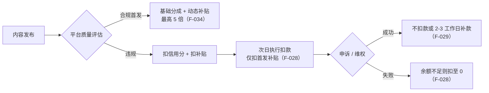

# 首发激励计划：从固定 3 倍到动态 1~5 倍

> **核心结论**：现行（2025-08-28 起）规则**已取消固定 3 倍**。声明首发的内容获得**额外分成补贴**，额度动态调整、与内容质量强挂钩，优质内容有机会拿 **1~5 倍**（F-034）。官方 FAQ 直接回答「不会有 3 倍的额外分成保底」（F-032）。社区中仍在流传的「首发翻 3 倍」是 2025-08-28 前的过期口径。

## 一、官方时间线（规则演进五档）

| 时点 | 机制形态 | 关键条款 | F 编号 |
|---|---|---|---|
| 2024-06 | **账号维度**准入 | 加入条件：近 30 天新发文中声明首发内容阅读量占比 ≥ 70%；近 180 天累计违规声明首发 < 5 次；占比连续 14 天低于 70% 自动退出并进入 14 天冻结期 | F-099、F-100、F-110 |
| 2024-06（旧版语义） | 3 倍扶持 | 官方表述为「按**当日分成收益的 3 倍**进行扶持」；单篇违规处罚为每篇扣 10 分信用分 | F-109、F-108 |
| 2025-06-09 | **内容维度**激励 | 单篇声明首发即加入并按阅读量享 3 倍分成结算，账号维度门槛取消；「头条首发作者」标识下线；3 周转型期，6 月 30 日前质量标准不影响收益 | F-032f、F-032g、F-032h |
| 2025-08-19（公告） | 质量门槛提升 | 不符合质量要求者（空洞水化 / 套路模板化 / 低质 AI 生成 / 接口批量发文）仅享基础分成 | F-035 |
| 2025-08-28（生效） | **动态倍数** | 取消固定倍数，改为额外补贴，优质内容有机会 1~5 倍 | F-034、F-036 |
| 现行 | 单篇声明 + 质量评估 | 未加入计划的作者，单篇声明首发即默认加入 | F-008、F-009 |

**分界规则**：2025-08-28（不含当日）前发布的声明首发内容仍按原规则执行；当日及之后发布的统一按新版计算（F-036）。这意味着**同一账号的历史内容与新内容可能适用不同倍率**。

> **旧版 3 倍的两种官方表述并存**：2024-06 上线公告称「按当日分成收益的 3 倍进行扶持」（F-109），2025-08 升级公告称「固定 3 倍的**分成补贴**」（F-033）。二者措辞不同，**不可据此反推旧规则是「固定 3 倍总收益」**——本包不对旧规则的乘数结构作推断。

## 二、三态收益结构

平台对每篇内容分三档处置（F-002、F-003、F-004）：

| 内容状态 | 基础分成 | 额外首发补贴 | 全网维权服务 |
|---|:---:|:---:|:---:|
| 违规内容 | ❌ 无 | ❌ 无 | — |
| 非首发内容 | ✅ 有 | ❌ 无 | — |
| 首发内容（合规） | ✅ 有 | ✅ 有，优质者最高 5 倍 | ✅ 随首发内容提供 |

**计算举例**（官方原文）：基础分成 = 10 元，补贴 = 15 元，总收益 = 10 + 15 = 25 元（F-011）。此处只可读出一条：**补贴是叠加在基础分成之上的增量项**（补贴额 15 元 > 基础分成 10 元），而非替代项。

> **不要据此反推旧规则的乘数结构**：该算例属 2025-08-28 之后的新版规则，用它反推旧版「固定 3 倍」是何种乘数关系在逻辑上不成立（旧版两种官方表述见 F-033 与 F-109，本包不作推断）。

## 三、享受激励的三条硬条件

必须**同时**满足（F-005、F-006、F-007）：

1. **字数与质量**：声明首发内容正文字数 **> 100 字**，且符合五大质量标准；
2. **独家性**：内容需原创，**首发在头条**，且发出后 **72 小时内未在其他平台发布**；
3. **账号状态**：账号类型非国家机构 / 新闻媒体，且首发功能可正常使用（未被禁言、未被关闭首发功能）。

### 五大质量标准（官方原文释义）

| 标准 | 官方释义 | F 编号 |
|---|---|---|
| 首发时效 | 热点事件及时发布，确保用户第一时间获取关键信息，持续性事件信息快速更新 | F-012 |
| 原创深度 | 体现创作者独有的观点和视角，能够为用户带来新鲜的见解和启发，提供别处难以获取的价值 | F-013 |
| 信息增量 | 不仅陈述事实，更需要深入分析和洞察，帮助用户理解事件背后的原因、影响和意义 | F-014 |
| 创作规范 | 专业有权威的内容应基于事实和专业知识，引用数据、政策等，保证表述准确 | F-015 |
| 用户价值 | 需使受众在情感、经历或观点上产生连接，能够触动读者内心 | F-016 |

官方为每条标准给出正反示例，标题分别是「资讯强时效 / 稀缺有态度 / 深度有收获 / 专业有权威 / 真实有共鸣」。**对照式判据**：把自己文章挂到这五个标题下各问一遍，答不上任何一条即不满足质量门槛。

## 四、认定边界：什么算「非原创」

官方列举八类认定情形（F-022~F-024 已单独编号，其余五类见 S1 原文「具体规则」清单）：

- **抄袭、剽窃、搬运**他人作品（F-022）；
- **罗列常识、拼接要点**等整合汇编（F-023）——官方判据为「引用内容占比过高、自己原创内容占比过少即不满足」；
- **以售卖商品为目的或为个人 / 机构吸粉导流**（F-024）；
- 歪曲、篡改他人作品；未获著作权人授权改编 / 翻译 / 注释 / 评议；未获独家授权发表或转载；
- 不受著作权法保护的内容（法规、国家机关决议、官方正式译文、时事新闻、通用数表等公共信息）；
- 违反法律法规、相关政策、公序良俗、社会公德或《今日头条社区规范》。

> **版本差异**：2024-06 上线公告的清单为**九类**，多出「**AI 技术生成的内容**」一项（F-108）；2025-08 起的现行百科（S1）已删除该独立条目，改为在质量门槛层面按产出形态处理（低质 AI 生成内容，见 [06 篇](06-risk-and-boundaries.md) 第四节）。**现行以八类为准。**

## 五、认定边界：什么算「非首发」

- 内容在头条发布**之前**已在其他平台发布过（F-025）；
- 内容在头条发布后 **72 小时内**在其他平台发布（F-026）；
- 同一作品在头条发布过一次，后续再次发布相同或实质性相似作品，或删除后重新发布（认定违规）。

**官方场景判例（四条，直接可用于自检）**：

| 场景 | 认定 | 依据 |
|---|---|---|
| 3/5 站外发 → 5/9 头条发并声明首发 | 非首发（首次发布非头条） | F-025 |
| 3/5 站外发 → 3/7 头条洗稿编辑后声明首发 | 非首发（实质性相似） | F-025 |
| 3/5 头条发并声明首发 → 3/8 发到其他平台 | 非首发（间隔未超 72h） | F-026 |
| 3/5 头条发并声明首发 → 账号默认开启「内容同步授权」导致自动同步到其他平台 | 非首发（发布时间一致） | F-026 |
| 同 MCN 旗下账号 A 先发并声明首发，账号 B 再发同一内容 | B 不可勾选首发；后发账号受违规声明首发处罚 | F-027 |

> **易踩坑项**：第四条场景说明——**账号级的「内容同步授权」默认开启时，跨平台自动同步会构成非首发**。多平台分发的创作者须逐篇确认同步授权状态。

## 六、处罚与申诉闭环

**处罚档位**：

| 触发行为 | 处罚 | F 编号 |
|---|---|---|
| 单篇非原创非首发 | 每篇扣 5 分信用分 + 扣相应首发补贴，30 天内扣分上限 50 分 | F-019 |
| 频繁发布平台不鼓励 / 低成本内容 | 冻结「头条首发」功能 14 天，第 15 天默认恢复 | F-020 |
| 累计 2 次被识别为频繁发布不鼓励内容 | **永久关闭**「头条首发」功能 | F-021 |
| 恶意多次删除站外 72h 内发布内容或伪造原创证据申诉 | 可能被直接取消「声明首发」功能 | F-030 |

> **版本差异（扣分额度）**：2024-06 上线公告的单篇违规处罚为**每篇扣除 10 分信用分**，近 180 天单篇违规声明首发 ≥5 次自动退出首发激励计划（F-108、F-110）；现行 S1 为**每篇扣 5 分、30 天内上限 50 分**（F-019）。**现行以 S1 为准。** 同公告旧版还载明「违规声明首发的内容不会有扣信用分、扣款等处罚」（F-111），现行口径已包含扣分与扣款。

**扣款规则细节**：收到处罚通知的内容于**次日**执行分成扣款，扣款**仅包含首发补贴收益**（基础分成不动，F-028）。申诉成功则不扣款；已扣款后申诉成功，平台在 2-3 个工作日内补款（F-029）。余额不足时扣至 0 为止。

**扣款查看路径**：后台「数据 - 收益数据 - 整体收益 - 收益数据趋势 - 扣款金额」；APP「我的 - 收益提现 - 整体收益 - 收益详情 - 扣款金额」（F-028 配套路径，见 [06 篇](06-risk-and-boundaries.md)）。

## 七、维权与五条 FAQ

- **全网维权服务**：电脑端「工具 - 创作保护 - 首发」；手机端「我的 - 创作中心 - 首发维权」（F-017、F-018）。**只要勾选了「声明首发」的内容都支持**使用全网维权服务，不必先加入激励计划（F-032c）。

| FAQ | 官方答案 | F 编号 |
|---|---|---|
| Q1 | 勾选「声明首发」未显示首发标识——升级为单篇即可享受激励后，「头条首发作者」标识不再显示 | F-031 |
| Q3 | 没有加入「首发激励计划」也能使用全网维权服务 | F-032c |
| Q4 | 没有主动加入却显示已加入——单篇声明首发即默认加入 | F-032d |
| Q5 | 已发布的内容**不支持**后期补充声明首发 | F-032b |
| Q6 | 活动话题页发布不支持默认勾选独家；如需声明独家可保存至草稿箱 → 返回草稿箱编辑 → 勾选独家并发布 | F-032e |
| Q7 | 新独家激励规则下**不会有 3 倍的额外分成保底** | F-032 |

> **Q5 的操作含义**：首发声明必须在**发布那一刻**做出。事后再补不可能，因此「先发后评估质量」的做法在首发维度上不成立——若对质量没把握，正确做法是**不声明首发**，而非先发再补。
