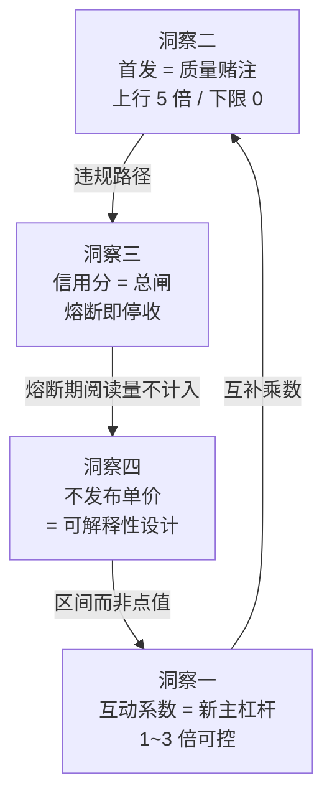

# 机制洞察五元组：头条号变现的四个真实杠杆

> **⚠️ 阅读约定**：本篇的「现象」列全部挂 F 编号（可回溯官方原文）；「根因」「影响」「建议」三列为**本包的分析推断（洞察）**，不是平台口径表述。平台从未这样表述，请勿混引。

## 洞察一：收益的主战场已从「阅读量」迁移到「阅读量 × 互动系数」

| 维度 | 内容 |
|---|---|
| **现象** | 2025-02-24 起公式变为「千次阅读单价 × 互动系数 × 获利阅读量 / 1000」，互动系数上限 3 倍（F-037、F-039）；2025-05-23 历史系数（优质/涨粉/原创/用户偏好）整体下线（F-043、F-044）；官方测算高互动率创作者收益增长 8%~20%、获利作者量增长 5%~10%（F-045）；**互动系数当前无官方查看渠道**（F-105） |
| **根因（洞察）** | 平台同时做了两件事：**移除不可解释的乘数**（2025-05 下线处于单价之外的「优质/涨粉/原创/用户偏好」历史乘数，S8 原公式可见其与互动系数同级，F-043）、**新增可被创作者主动影响的乘数**（互动系数）。前者降低创作者的规则不确定性，后者把收益的一部分控制权交还创作者——评论、进入评论区、收藏、进主页（F-039）都是创作者可直接影响的行为。 **注意层级**：官方在 2026-03 的 FAQ 中把千次阅读单价本身定义为「基础千次阅读单价 × 作者系数」（F-046），作者系数位于**单价内部**，与已被下线、位于**单价外部**的历史系数**不是替换关系、不可互证**（详见 [02 篇](02-revenue-formula.md) 口径提示） |
| **影响（洞察）** | 单价不再是唯一杠杆。**同等阅读量下，互动率高的账号可拿到 3 倍于零互动账号的收益**（系数 1~3 倍区间，F-039）。这意味着「靠阅读量吃饭」的天花板被压缩，而「靠互动吃饭」的空间被打开 |
| **建议（洞察）** | 内容设计应内置**互动钩子**：文末设具体问题而非空泛征询；把「进评论区」当作传播指标（它与评论同权重，F-039）；收藏与进主页需靠「值得存」的清单/工具型内容驱动 |
| **反常识** | 反直觉点：**不需要更多阅读量，需要更深的阅读行为**。在互动系数 3 倍上限下，把现有阅读量的互动系数从 1 提到 2.5，其收益效果与阅读量翻 2.5 倍等价，但成本远低于拉新流量 |

## 洞察二：首发补贴已从「资格奖励」变为「质量赌注」

| 维度 | 内容 |
|---|---|
| **现象** | 2025-08-28 起取消固定 3 倍，改为动态 1~5 倍额外补贴，与内容质量强挂钩（F-034）；不合质量要求者仅享基础分成、无任何额外补贴（F-035）；平台列举了低质内容形态：空洞水化、套路模板化、低质 AI 生成、接口批量发文（F-035）；官方 FAQ 明确「不会有 3 倍保底」（F-032、F-076） |
| **根因（洞察）** | 规则形态从「**账号准入 + 固定倍率**」转为「**单篇评估 + 浮动倍率**」。前者对创作者是确定性收入，平台需承担质量下行风险；后者把质量判断下沉到每一篇内容，平台只对优质内容付费。官方同步强化了质量门槛（五大标准 F-012~F-016）与专属独家条件（72 小时 F-006），是把「独家性」从形式要求升级为质量筛选器 |
| **影响（洞察）** | 首发不再是「勾一个勾就多拿 3 倍」的必选项，而是一个**有下行风险的选择**：勾了但质量不达标，则额外收益为零，且触发违规时还要扣补贴、扣信用分（F-019、F-028）。**保守策略（不声明首发）与激进策略（声明首发）的收益分布都变了**——激进策略的上行空间扩大到 5 倍，但下限从「至少 3 倍」降到「零」 |
| **建议（洞察）** | 声明首发前先过五大质量标准自检（[01 篇](01-first-publish-incentive.md) 第三节）：**不能明确挂上「深度有收获」这一条，就不要声明首发**。同时确认 72 小时内不在其他平台发同内容——尤其检查账号的「内容同步授权」默认状态（F-026 判例四） |
| **反常识** | 反直觉点：**「多发多勾首发」是负期望策略**。在动态倍率下，把质量不达标的篇目也声明首发，只会拉高违规累计风险（F-019、F-021），而这部分补贴本来就是零 |

## 洞察三：信用分是收益的「总闸」，不是「扣分项」

| 维度 | 内容 |
|---|---|
| **现象** | 信用分 0-59 分时**所有权益关闭**（F-058）；信用分低于 60 分后开通中的收益权益关闭，关闭后阅读量不计算收益（F-074）；恢复规则为连续 10 天无违规恢复 10 分（F-055）；信用分 < 60 分时微头条与问答权益冻结（F-078）；首发违规每篇扣 5 分、30 天上限 50 分（F-019）；中视频计划另设 70~100 / 60~70 / <60 三档且 <60 分关闭创作收益与声明原创权益（F-086i） |
| **根因（洞察）** | 平台把**合规状态**与**收益资格**做了硬绑定，而非「扣分—扣收益」的线性惩罚。这在机制上等价于：合规是变现的**前置许可证**，分数是许可证的电量。分档设计（100 / 60-99 / 0-59）也表明存在两个断点——99 分不申请新权益，59 分全部关闭——前者是限流设计，后者是熔断设计 |
| **影响（洞察）** | **一次严重违规的代价远超当篇收益**。以 F-019 的扣分速度（每篇 5 分）看，10 篇首发违规即触及 50 分上限；若同时触发「频繁发布不鼓励内容」（F-020 冻结 14 天 / F-021 累计 2 次永久关闭），则整个首发通道关闭，等价于放弃最高 5 倍的杠杆。收益模型中「违规」的期望值可能是负的 |
| **建议（洞察）** | 把信用分当作**首要运营指标**而非事后考核项：把它当成「账户健康度」每周检查一次；把 90 分设为个人内部红线（远高于官方 60 分门槛），留出缓冲；首发内容发布前必过 [01 篇](01-first-publish-incentive.md) 的非原创 / 非首发两张认定清单（F-022~F-026） |
| **反常识** | 反直觉点：**信用分从 100 掉到 59 的损失，大于从 0 赚到的收益**。因为熔断期间产生的阅读量不计入收益（F-074），而恢复周期以 10 天为单位（F-055），触发越晚、修复越慢 |

## 洞察四：官方不公开「千次阅读单价」点值——这是「可解释性设计」而非信息缺失

| 维度 | 内容 |
|---|---|
| **现象** | 官方只给公式结构与系数定义（F-037、F-039、F-046、F-047），并在后台提供「系数详情」查询（F-046）；历史系数下线后官方给出的收益影响是**区间测算**（获利作者量 +5%~10%、高互动者 +8%~20%，F-045）而非具体金额；社区与第三方站却流传大量具体单价（48.6 / 31.7 / 12.3 / 1.2 元、万阅读 0.3~2 元，F-087、F-092、F-101） |
| **重要限定** | **「不发布单价」≠「不发布任何数值」**。2026-02-02 官方公告公开了权益层的具体点值：新锐/领航创作者的周阅读量档位对应 **2 元 / 30 元现金奖励**，≥10 万阅读量**基础分成翻 2 倍（单周最高补贴 100 元）**，加油包额度由 1000 提升至 3000、2000 提升至 5000（F-112~F-117）。**官方在权益/活动层公开点值，在单价层不公开**——这两件事必须分开表述，不可混为一谈 |
| **根因（洞察）** | 若平台在单价层发布固定数值，同一单价下不同质量内容收益相同，等于宣告「内容质量不影响单价」；不发布点值 + 提供系数详情，则**单价成为可审计的因变量**——创作者能看到自己的内容落在哪一档并据此优化。这与 2025-05 下线「优质/涨粉/原创/用户偏好」历史系数（F-043）是同一方向：把不可解释的乘数换成创作者能看见、能影响的乘数（互动系数 F-039、作者系数 F-046） |
| **影响（洞察）** | 任何**具体单价数字都是第三方估算**，其不确定性来源至少有三：① 官方口径下单价逐篇逐日动态评定（F-046、F-047）；② 互动系数区间 1~3 倍（F-039）；③ 发文体裁与作者系数差异（F-040、F-046）。因此单点单价在方法论上不可靠，**用它做收益预期必然失真** |
| **建议（洞察）** | 收益预期**只做结构化测算，不做单价承诺**：用「阅读量区间 × 互动系数区间 × 补贴倍率区间」表达不确定性，公开时明确标注区间而非点值；引用任何具体单价必须标注「第三方估算，非官方口径」（见 [07 篇](07-community-claims-audit.md)） |
| **反常识** | 反直觉点：**找不到「官方单价」不是资料不全，而是官方把可解释性放在了系数详情里**。把它当成「数据缺失」去各处搜答案，搜到的全是 UGC 估算，误差叠加后反而比结构性区间测算更不可靠。 **另一层反常识**：官方**并非不发数字**——权益层的 2 元 / 30 元 / 100 元是官方白纸黑字（F-114），说明「官方公布收益数据」本身不是禁区，只是**单价层不公开** |

---

## 洞察之间的关系

- **洞察一 → 洞察二**：两者是**乘数关系**。互动系数（基础分成内，1~3 倍）与首发补贴（基础分成外，0~5 倍）叠加，决定单篇收益上限；二者都是「质量换收益」的设计，只是评估维度不同（互动深度 vs 独家质量）。
- **洞察二 → 洞察三**：声明首发是**日常内容生产中最容易主动触发**信用分扣减的行为（F-019），也是唯一带「永久关闭」后果的行为（F-021）；另有近 3 个月违规无法加入计划（F-061）、多次低质内容被移出计划（F-062）等资格类后果。**首发声明 = 收益杠杆 + 风险敞口**，二者同源。
- **洞察三 → 洞察四**：熔断机制使「单价」不再是稳定输入——收益的可预测性被合规状态覆盖。
- **洞察四 → 洞察一**：正因为单价不透明，**可控的互动系数才是基础分成内部创作者唯一能自主调节的收益旋钮**（收益通道的完整清单见 [05 篇](05-monetization-path-matrix.md) 体裁 × 权益矩阵：赞赏、付费专栏、商品卡等另属粉丝档位权益，不在基础分成公式内）。
