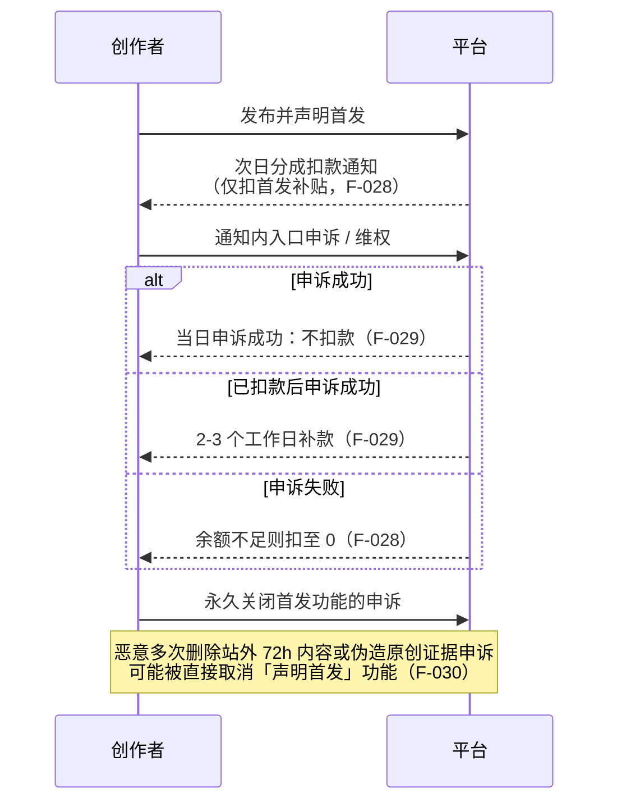

# 风险与边界：原创首发红线、扣款申诉链与信用分熔断

## 一、红线清单（官方认定口径）

### 非原创的八类认定情形（S1 现行；F-022~F-024 已编号，其余五类见 S1 原文）

| # | 情形 | 平台实操判据（官方示例） |
|---|---|---|
| 1 | 抄袭、剽窃、搬运他人作品 | 大部分材料 / 观点来源于他人，或与他人内容高度相似 |
| 2 | 歪曲、篡改他人作品 | 词句替换、增减、语序调整后主旨一致脉络相似 |
| 3 | 罗列常识、拼接要点等整合汇编 | **引用内容占比过高、自己原创占比过少**即不满足；含引用政府或行业公开信息与百科知识 |
| 4 | 未获著作权人授权改编 / 翻译 / 注释 / 评议 | — |
| 5 | 未获著作权人独家授权发表或转载 | — |
| 6 | **以售卖商品为目的或为个人 / 机构吸粉导流** | — |
| 7 | 不受著作权法保护的内容 | 法律 / 法规、国家机关决议命令、官方正式译文、时事新闻、通用数表公式等公共信息 |
| 8 | 违反法律法规、政策、公序良俗或《今日头条社区规范》 | — |

**场景要点**：官方举例「作者发文内容量较少，且配图部分来自他人视频截图、网络表情包、他人内容截图」→ 认定原创度不足。这意味着**配图来源同样计入原创度判定**，不是「文字原创即可」。

### 非首发的三类情形（F-025、F-026）

1. 头条发布**之前**已在其他平台发布过；
2. 头条发布后 **72 小时内**在其他平台发布；
3. 同一作品在头条发布过一次后，再次发布相同或实质性相似作品，或删除后重新发布。

**两条易忽略的判例**：

- **同 MCN / 同矩阵 / 同作者**：相同内容**只允许勾选首发一次**，后发账号受违规声明首发处罚（F-027）。
- **自动同步**：账号默认开启「账号内容同步授权」导致作品自动同步到其他平台且发布时间与头条首发一致 → 认定非首发（F-026 判例四）。**多平台分发者必须逐篇检查此开关。**

### 平台不鼓励 / 低成本内容（触发冻结与永久关闭）

以下六类出自 S1 现行规则「平台不鼓励的内容示例」章节（原文列举，尚未单独编 F 编号，故以 S1 为准）：

| 类别 | 官方描述 |
|---|---|
| 内容空洞水化 | 事件重复描述、旧闻翻炒、缺少个人观点表达、有机器编译痕迹 |
| 内容格式低质 | 排版混乱、逻辑混乱、语句不通 |
| 套路模板化发文 | 使用夸张悬念式标题等固定化格式发文 |
| 持续编虚假故事 | 捏造细节、存在人设冲突 |
| 信息罗列、无依据排名 | 常识罗列、网络信息拼凑汇编 |
| 命理类预测内容 | 星座预测、运势预测、不同组图选择预测 |

> **注意区分三张相似的表**：
> ① **本表（S1「平台不鼓励的内容示例」，六类）** —— 触发首发功能冻结 14 天 / 累计 2 次永久关闭（F-020、F-021）；
> ② **S4 公告的质量门槛四类**（空洞水化 / 套路模板化发文 / 低质 AI 生成内容 / 接口批量发文，F-035）—— 只享受基础分成、不获额外首发补贴，**不直接触发冻结**；
> ③ **创作者计划层面的低质内容 12 类**（医疗推广、风险投资、恶意营销等，F-062）—— 多次发布会被**移出创作者计划**。
>
> 三表交集有限（如「空洞水化」同时出现在 ①②），但**后果不同**，不可混引同一编号。

## 二、扣款与申诉全流程

**要点**：

- 扣款**在次日**执行（F-028）；
- 扣款**仅涉及首发补贴收益**，基础分成不动（F-028）；
- 当日申诉成功则不扣款；已扣款后申诉成功，2-3 个工作日补款（F-029）；
- 余额不足时扣至 0（F-028）。

**查看路径**：后台「数据 - 收益数据 - 整体收益 - 收益数据趋势 - 扣款金额」；APP「我的 - 收益提现 - 整体收益 - 收益详情 - 扣款金额」。

### 申诉材料要求（官方）

| 情形 | 所需材料 |
|---|---|
| 获得过作者授权的文章 | 原作者的书面授权书 + 授权人身份证件扫描件 |
| 文章刊载于电子刊 / 实体书 | ① 提供具有【同一作者名】的文章截图或实拍图；② 证明该作者名是本人（如报纸文章作者名为张三，可用身份证证明本人即张三） |

## 三、信用分熔断边界

| 区间 | 权益使用 | 申请新权益 | 收益影响 | F 编号 |
|---|:---:|:---:|---|---|
| 100 分 | ✅ | ✅ | 正常计算 | F-056 |
| 60-99 分 | ✅ | ❌ | 正常计算 | F-057 |
| < 60 分 | ❌ 全部关闭 | ❌ | **关闭后产生的阅读量不计算收益** | F-058、F-074 |

**恢复机制**：连续 10 天无违规（从扣分第二天开始计算）恢复 10 分；出现新违规则重新开始计算（F-055）。

**申诉补救**：对违规内容申诉成功后，已关闭权益自动开通，**权益关闭期间产生的阅读量会进行计算补款**（F-075）——这是熔断机制里唯一的补偿通道，**必须主动申诉**。

**其他熔断点**：

- 首发功能冻结 14 天，第 15 天默认恢复（F-020）；
- 累计 2 次不鼓励内容 → 首发功能永久关闭（F-021）；
- 近 3 个月内存在违规记录 → 无法加入创作者计划（F-061）；
- 多次发布低质内容 → 移出创作者计划，全部权益失效（F-062）。

## 四、AI 辅助创作的平台立场（版本差异，非现行通则）

**⚠️ 必须按版本表述**：官方对 AI 内容的认定规则**随版本变过**，不可写成「官方从未禁止 AI」。

| 版本 | 官方口径 | 依据 |
|---|---|---|
| **2024-06（旧版）** | 「非原创」认定清单中**明列「AI技术生成的内容」一项**——即当时 AI 生成内容直接被认定为非原创 | F-108 |
| **2025-08-28 起（现行）** | 现行百科（S1）的非原创清单为**八类，已删除「AI 技术生成的内容」独立条目**；改为在质量门槛层按产出形态处理——「低质 AI 生成内容」与「接口批量发文」被点名，仅享基础分成、不获额外首发补贴 | F-035、F-022~F-024 |

**现行口径的三条可执行约束**（均来自官方原文）：

| 约束 | 官方原文要点 | 依据 |
|---|---|---|
| 低质 AI 生成内容无额外补贴 | 不符合质量要求的内容（内容空洞水化、套路模板化发文、低质 AI 生成内容、接口批量发文）仅享受基础分成收益，不再获得任何额外分成补贴 | F-035 |
| 机器编译痕迹属不鼓励内容 | 内容空洞水化、事件重复描述、旧闻翻炒、缺少个人观点表达、有机器编译痕迹 | F-020 / F-021 同组 |
| 拼凑洗稿不参与分成 | 灌水评论、机刷内容、拼凑洗稿的内容不参与分成 | F-106 |

**实践含义（分析推断）**：

- 现行的判定落点是**产出形态**（痕迹、批量、同质化），而非「是否用了模型」本身——**但这不等于平台放弃了 AI 内容的版权审查**，2024-06 的旧版条款说明平台曾直接将其列为非原创，且官方从未声明撤销该立场（F-108）；
- 风险不来自使用 AI，而来自**批量同质化产出**——这类内容同时踩中「低质」与「不鼓励」两条线；
- 第三方商业站关于「AI 生成文本相似度超过 15% 取消全部首发补贴」的说法（F-103）**未获官方证实**，不得引用为规则；
- 面向 AI 辅助创作的安全边界是：**AI 只能提供素材与初稿，原创观点与信息增量必须由创作者注入**（对应五大标准的「原创深度」F-013 与「信息增量」F-014）。

## 五、本包内容边界（自声明）

1. **不含收益承诺**：所有收益表述为公式结构与倍数区间，官方不发布单价（F-047）。
2. **不含代写代发**：本包为规则解析与路径设计，不提供洗稿、改写、搬运等违反原创规则的操作指引（F-022、F-023）。
3. **不构成法律意见**：著作权与合规判定以平台规则与法律原文为准；本包对「非原创」八类情形的复述是平台口径摘要，实际纠纷需自行查证《著作权法》原文。
4. **时效边界**：`stale_after: 2027-06-30`。头条规则在 2024-06 至 2026-02 的 20 个月内至少变更六次（F-036、F-042、F-044、F-099、F-100、F-117），变动频率约 3~6 个月一次。**引用前必须复核官方百科当日版本**；复核应由「官方页面更新时间变化」触发，而非仅按日历到期（见 [核验报告](../references/verification.md) 第 7 节触发条件表）。
5. **单源标注**：E 组社区口径（F-087~F-098）与 F 组第三方商业站口径（F-101~F-103）**全部单源**，仅用于 [07 篇](07-community-claims-audit.md) 的对照，不构成本包结论依据。
