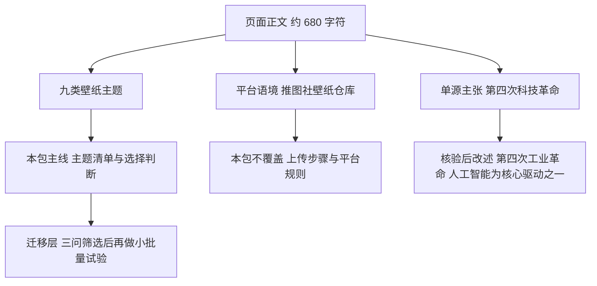

# 壁纸主题选择：九类方向与上传判断

> **状态：flagged**。源文是一篇课程日更文字，正文约 680 字符，只给主题方向和一句技术叙事，没有上传步骤、平台规则、单价或收益数据。文中“第四次科技革命”的归属与“非常受欢迎”一类流行度判断未获独立证据，本包按[核验与勘误](references/verification.md)改述并保留原口径。本包不是课程转录，也不是平台投稿操作手册。

来源是一篇公开页面《D5午间分享》，账号“特级班班资料小屋”、署名金娜，页面 ct 时间 2026-11-01 00:55（F-001～F-003），核读日期为 2026-11-01。正文共 19 个段落，含 9 条编号主题、2 个视频播放器、0 个图片元素（F-004、F-006、F-008）。采集范围与公开性边界见[来源清单](references/source-manifest.md)，媒体状态见[媒体覆盖](references/media-coverage.md)。

## 按用途选择路径

| 路径 | 要回答的问题 | 本包能提供什么 |
|---|---|---|
| [先分清三种陈述](concepts/00-reading-and-evidence.md) | 哪些是页面事实，哪些只是作者主张？ | 三类陈述分层与本包覆盖边界 |
| [九类主题清单](concepts/01-nine-wallpaper-categories.md) | 作者列了哪些方向，各自的未言明条件是什么？ | 九类逐条登记、附加判断与风险提醒 |
| [从主题到上传判断](concepts/02-from-category-to-upload-decision.md) | 选好主题之后，先确认哪三件事？ | 执行者设计的三问与小批量试验框架 |
| [单源主张与时效边界](concepts/03-single-source-claims-and-boundaries.md) | 哪些句子需要改述，为什么？ | 术语勘误、视频缺口、平台与收益边界 |

初学者从[阅读与证据](concepts/00-reading-and-evidence.md)进入；只想要清单的读者可直接读[九类主题清单](concepts/01-nine-wallpaper-categories.md)，但请同时阅读该页的“清单没有说的事”。准备把图片上传到任何平台前，读[上传判断](concepts/02-from-category-to-upload-decision.md)。



## 证据怎样使用

F-001～F-025 是页面信息或作者主张，F-026～F-032 是补充核验与第三方报道记录，总计 32 条。页面事实只回答“页面写了什么”，作者主张只记录“作者怎么说”；两者都不认证平台准入、作品权利或收益水平。逐项裁决与勘误见[核验与勘误](references/verification.md)，三层知识拆分与 F 映射见[知识地图](references/knowledge-map.md)。

三条负向事实值得先记住：正文不含单价、收入、分成、上传步骤与平台规则（F-010）；页面没有官方平台条款或投稿协议链接（F-032）；文章所说的“上传步骤”属于前期课程内容，本页没有复述（F-005）。因此，本包对上传操作保持空白，而不是用常识补写。

## 文档清单

本包共 13 篇 Markdown：4 篇教程、5 篇参考正文（事实登记、核验与勘误、来源清单、媒体覆盖、知识地图）、3 篇索引与 1 篇更新日志。不建 `examples/`：操作可复现性两问均不成立，源文没有版本、输入输出与可复验流程，详见[知识地图](references/knowledge-map.md)。

## 主题关联

- [AI 图像服务与内容变现](../ai-image-service-monetization/index.md)：同一账号前一日的分享所转化，覆盖定制服务、素材产品、内容获客与实物周边四条路径；本包只做壁纸主题清单与上传前判断，不涉及定价与合同。
- [快手发布壁纸作品引流](../kuaishou-wallpaper-publish-traffic/index.md)：同一账号 2026-09-07《快手发布-视频教程》的转化包，覆盖推图社取口令、发快手、选图编辑、话题与发布后交作业的完整演示流程；本包不覆盖这些步骤，两包 F 编号独立，阅读顺序建议先读本包的主题判断，再读该包的操作还原。
- [零基础 AI 实操赚钱项目](../ai-side-hustle-playbook/index.md)：一般副业路径、工具成本与定价交付；本包不含成本与定价内容。
- [个人变现方向发现](../monetization-direction/index.md)：适合尚未确定方向的读者；本包假设读者已经决定做壁纸类素材。

## 更新边界

2026-12-31 为复核期限，不是自动巡检任务。平台规则、标识要求或主题流行度发生变化时，应重读官方文本与本页源文。完整覆盖清单、补采条件与幂等规则见[来源清单](references/source-manifest.md)，执行记录见[更新日志](log.md)。

```{toctree}
:hidden:
:maxdepth: 2

concepts/index
references/index
log
```
