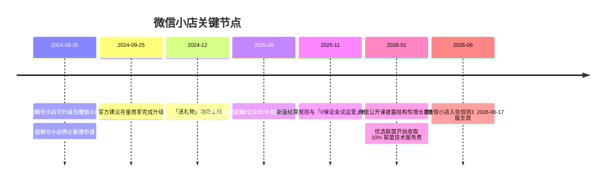
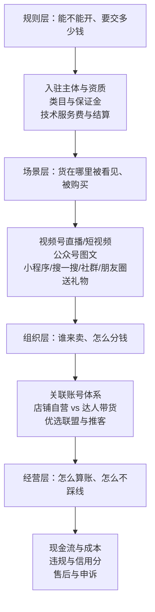

# 微信小店总览：一个交易底座，多个内容与社交场景

> **⚠️ flagged**：本包规则类事实取自微信小店官方规则与公告，但平台规则修订频繁（保证金、费率、联盟收费在 2025–2026 年均有变动）。**引用任何门槛、费率、结算周期前，请以官方规则页面当日版本为准**；本包所有数字均标注 F 编号与信源（见 [事实清单](../references/facts.md)）。

## 一、微信小店是什么

官方定义很克制：微信小店是**腾讯以微信为技术开发基础，向商家提供的商品信息展示、商品交易等功能的技术服务**（F-007），并且是**视频号小店的升级版**（F-008）。

这句话包含三个关键信息：

1. **它是技术服务，不是流量承诺**。平台提供的是商品展示、交易、结算、售后等能力，不承诺曝光量或成交额。
2. **它的底座是微信，而不是一个独立 App**。店铺与商品信息可以在公众号、视频号、小程序、搜一搜等多个场景流转（F-004）。
3. **它由视频号小店演化而来**。2024-08-25 起腾讯正式支持视频号小店升级为微信小店，视频号小店同日停止接受新增申请（F-001、F-003）。

### 它不是什么

| 常见误解 | 官方口径 |
|---|---|
| 「微信小店是一个像淘宝/京东那样的中心化商城」 | 官方强调商品信息在公众号、视频号、小程序、搜一搜等多场景流转（F-004）；中心化商城入口并非其唯一形态 |
| 「开微信小店必须有个人身份证即可」 | 仅支持企业店与个体工商户店两类主体，营业执照是必需材料（F-010、F-013、F-016） |
| 「微信小店只在视频号里经营」 | 早期 FAQ 仍写「视频号场景内开店经营」，但 2024 公告与 2026 规则均写多场景流转（冲突 C-7） |
| 「保证金是一笔固定门票」 | 保证金由类目保证金与浮动保证金取高构成，随上一自然月 GMV 变化（F-034、F-035、F-036） |
| 「技术服务费就是全部成本」 | 还有支付通道、达人佣金、联盟技术服务费、退款与资金占用等成本（见 [费用与结算](03-fees-settlement.md)） |

## 二、时间线：从视频号小店到微信小店

时间线对应的 F 编号：升级（F-001~F-006）、送礼物（F-070）、全场景（F-066）、结算与试运营（F-045、F-056）、公开课与联盟收费（F-095~F-099、F-083）、入驻规则（F-011）。

## 三、三层理解框架

本包不按「功能菜单」组织，而按商家真正会遇到的三个决策层组织：

| 层 | 回答的问题 | 对应篇目 |
|---|---|---|
| 规则层 | 我能不能开？开哪种店？要交多少保证金和技术服务费？钱多久能到账？ | [入驻与资质](01-onboarding.md)、[类目与保证金](02-categories-deposit.md)、[费用与结算](03-fees-settlement.md) |
| 场景层 | 商品在哪些微信场景被看见？搜索、直播、图文、送礼各是什么逻辑？ | [场景与流量](04-traffic-scenarios.md) |
| 组织层 | 商家、视频号、公众号、达人、机构、推客之间如何关联与分佣？ | [分销与带货](05-distribution.md) |
| 经营层 | 怎么算真实成本？怎么设计 90 天路径？哪些红线不能碰？ | [合规与售后](06-compliance.md)、[机制洞察](07-insights.md)、[落地路径](08-playbook.md) |

## 四、本包结构

| 层 | 篇目 | 一句话导读 |
|---|---|---|
| 总览 | 本篇 | 定义、时间线、三层框架与阅读路径 |
| 事实层 | [01 · 入驻与资质](01-onboarding.md) | 企业店/个体户店、四件套材料、账户验证、店铺数量与账号管理（F-009~F-028） |
| 事实层 | [02 · 类目与保证金](02-categories-deposit.md) | 2000+ 类目、类目资质、类目/浮动保证金、0 保证金试运营（F-029~F-047） |
| 事实层 | [03 · 费用与结算](03-fees-settlement.md) | 技术服务费公式、新商 1% 激励、确认收货 +7 天、提现与联盟服务费（F-048~F-065） |
| 事实层 | [04 · 场景与流量](04-traffic-scenarios.md) | 视频号、公众号、小程序、搜一搜、社群、朋友圈、送礼物（F-066~F-074） |
| 事实层 | [05 · 分销与带货](05-distribution.md) | 关联账号额度、店铺自营/达人带货、优选联盟三类计划与 10% 服务费（F-075~F-084） |
| 事实层 | [06 · 合规与售后](06-compliance.md) | 违规分类、信用分 12 分制、售后与申诉、礼物订单特殊规则（F-085~F-094） |
| 机制层 | [07 · 机制洞察](07-insights.md) | 4 条四元组洞察：交易底座、制度化试错、隐性成本、场景红利与入口约束 |
| 路径层 | [08 · 落地路径](08-playbook.md) | 商家类型决策矩阵、90 天推进节奏、成本算例与红线清单（设计产物，非平台承诺） |
| 信源 | [事实清单 F-001~F-104](../references/facts.md) | 104 条编号事实 + 8 组口径冲突 |
| 信源 | [核验报告](../references/verification.md) | P0 核验、冲突裁定、缺口、V 门 14 条问题与 8 项修正 |

## 五、术语速查

| 术语 | 一句话解释 | 依据 |
|---|---|---|
| 结算基数 | 技术服务费的计算基数 = 用户实付 + 支付补贴 + 带货者优惠 + 平台优惠 | F-049 |
| 商家技术服务费 | 平台按类目费率 × 结算基数收取的费用，从货款中直接扣 | F-048、F-051 |
| 类目保证金 | 按主体类型与经营类目缴纳的保证金 | F-033、F-037 |
| 浮动保证金 | 按上一自然月支付 GMV 分档计算的保证金，与类目保证金取高 | F-034、F-036 |
| 0 保证金试运营 | 新商家暂不缴保证金即可上架试运营，但有 SKU 与提现预留限制 | F-044、F-045 |
| 确认收货 | 用户主动确认，或发货后按物流签收/发货天数自动确认 | F-057 |
| 待结算资金 | 用户已支付、尚未结算给商家的冻结资金 | S6 |
| 可提现资金 | 已解冻并扣除各项费用后的余额 | S6 |
| 暂预留资金 | 平台暂时预留用于保障售后退款的商家资金 | S6 |
| 关联账号 | 小店绑定的视频号、公众号、服务号账号 | F-075 |
| 店铺自营 | 视频号账号作为小店关联账号、主要卖该店商品的带货身份 | F-079 |
| 达人带货 | 视频号账号主要卖其他小店商品、赚取佣金的带货身份 | F-079 |
| 优选联盟 | 商家设置佣金、带货者/机构推广商品的联盟体系 | F-082 |
| 带货机构 | 连接商家与带货者的机构（MCN/服务商） | S11 |
| 推客 | 通过机构 API 在社群等场景分享商品、赚取佣金的带货者 | S11 |
| 染色链接 | 带推广参数的商品链接/直播链接，用于归因计佣 | S11 |
| 售后期 | 商品售后权益存续期；技术服务费与佣金在此期结束后结算 | F-060 |
| GPM | 千次观看成交金额，衡量内容场景转化效率 | F-096 |
| DSR | 店铺/带货评分，关联账号额度提升的门槛之一 | F-077 |

## 六、阅读路径

- **零基础开店**：01 → 02 → 03 → 06，先确认主体与类目，再算钱，最后看合规。
- **已有货源、想找流量**：04 → 05 → 07，先选场景，再设计分销，最后理解机制。
- **品牌/服务商做规划**：00 → 07 → 08，先建立正确预期，再落地 90 天路径。
- **只想知道「值不值得做」**：07 的四条洞察 → 08 的决策矩阵与算例。

## 七、时效与边界声明

- **规则版本**：本包取证于 2026-11-01。核心规则版本为《入驻规则》2026-06-17、《结算规则说明》2025-11-14、《0 保证金试运营》2025-11-05、《商家技术服务费管理规则》2025-02-25、《商家违规管理规则》2026-03-19、《优选联盟计佣与结算规则》2026-06-26。
- **不构成法律或投资意见**：本包是规则与机制的整理，不替代平台协议、类目管理规则或法律意见。
- **不承诺收益**：所有增长数字均为平台或媒体口径，不代表单个商家的可复制结果。
- **单源边界**：2025 年增长数据来自微信公开课的媒体转述；具体类目费率表与保证金金额表位于平台外部表格，本包未逐类目抄录（见 [核验报告](../references/verification.md) 第 4 节）。
