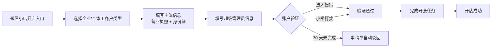

# 入驻与资质：企业店、个体户店与账号体系

## 一、先确认：只有两类主体

微信小店只支持两类店铺主体（F-010）：

| 店铺类型 | 主体 | 基础材料 | 账户要求 |
|---|---|---|---|
| 企业店 | 中国大陆合法注册的企业实体 | 营业执照 + 法定代表人身份证 | 对公账户（F-025） |
| 个体工商户店 | 中国大陆合法注册的个体工商户 | 营业执照 + 经营者身份证 | 对公或对私二选一（F-025） |

并且，申请主体须为按中华人民共和国法律法规合法注册的法律实体，**不含港澳台地区法规**，暂不接受非中国大陆注册法律实体（F-009）。

> **常见误解**：「没有营业执照也能开店」。官方 FAQ 明确：目前仅支持企业&个体户申请资质入驻，营业执照是必须提交的资质材料（F-013、F-016、S3）。个人想开店，现实路径是先注册个体工商户。

## 二、四件套材料

### 企业店

| 材料 | 要求 | F 编号 |
|---|---|---|
| 营业执照 | 彩色原件扫描件/复印件；未列入经营异常名录；经营范围覆盖所售商品/行业大类 | F-013、F-014 |
| 法定代表人身份证 | 正反面扫描件/复印件；须与营业执照一致；复印件需本人签名并加盖公司鲜章 | F-013 |
| 超级管理员身份证件 | 拥有店铺最高权限的管理人员证件，可与法人/经营者为同一人 | S3、S15 |
| 银行账户 | 企业店须使用对公账户 | F-025 |
| 微信账号 | 一个能正常使用的微信账号 | F-018 |
| 品牌认证（可选） | 商标及授权材料；商标不得为纯图形商标；核定使用范围需覆盖商品类别 | F-015 |

### 个体工商户店

| 材料 | 要求 | F 编号 |
|---|---|---|
| 个体工商户营业执照 | 彩色原件扫描件/复印件；未在经营异常名录；经营范围覆盖所售商品 | F-016、F-017 |
| 经营者身份证 | 正反面扫描件/复印件；须与营业执照登记经营者一致 | F-016 |
| 超级管理员身份证件 | 可与经营者为同一人 | S3、S15 |
| 银行账户 | 对公或经营者本人对私账户二选一 | F-025 |
| 微信账号 | 一个能正常使用的微信账号 | F-018 |

> **材料细节（腾讯营销口径）**：所有证件需清晰完整的彩色原件照片或扫描件，不接受截图或翻拍；复印件需加盖主体公章（F-025、F-026 所在的腾讯营销 FAQ 还提示新注册营业执照约需 5 天工商信息同步，过早提交会被驳回）。

## 三、开店流程

对应事实：

- 流程为「微信小店开店」→「选择企业/个体工商户类型」→「完成开张任务」→「开店成功」（F-019）。
- 账户验证两种方式：法人微信号扫码，或按页面提示小额打款，验证成功后金额原路退回（F-020）。
- 30 天内未完成验证，申请单自动驳回（F-021）。
- 注册微信小店需要**新开一个微信支付商户号**，不能沿用原微商店户号（F-022）。

## 四、能开几家店

| 口径 | 数量 | F 编号 |
|---|---|---|
| 《微信小店入驻规则》2026-06-17 版 | 同一营业执照最多 30 家 | F-011 |
| 官方常见问题页 | 一个营业执照支持开 5 家 | F-012 |
| 早期常见问题页 | 一个视频号只能申请一个微信小店 | F-027 |

**裁定**：店铺数量上限以较新的《入驻规则》为准（30 家）；FAQ 的「5 家」是未同步的旧口径（冲突 C-1）。「一个视频号只能申请一个微信小店」仍是账号侧约束，与主体可开多店并不矛盾：多店可以分别用不同视频号关联。

## 五、人员与账号管理

- 企业店支持多人管理：在「店铺管理-成员管理」添加岗位与成员，并设置岗位权限（F-023）。
- 超级管理员可更换，路径为「店铺管理-基础信息-小店超级管理员-右上角修改」（F-024）。
- 后台支持网页端与移动端双端登录管理（F-028）。

### 关联账号额度（与 05 篇联动）

| 店铺类型 | 初始额度（视频号/公众号/服务号） | 提升门槛 | F 编号 |
|---|---|---|---|
| 个体工商户店 | 1 / 1 / 1 | 无提升档位 | F-076 |
| 企业店 | 5 / 5 / 5 | 初始 | F-077 |
| 企业店 | 10 / 10 / 10 | 店铺 DSR 近 30 天均 ≥4.6 | F-077 |
| 企业店 | 20 / 20 / 20 | DSR ≥4.6 且近 30 天支付 GMV≥30 万 | F-077 |
| 企业店 | 50 / 50 / 50 | DSR ≥4.6 且近 30 天支付 GMV≥60 万 | F-077 |
| 企业店 | 100 / 100 / 100 | DSR ≥4.6 且近 30 天支付 GMV≥150 万 | F-077 |

约束：一个视频号只能关联一个微信小店或视频号小店；一个公众号/服务号只能关联一个微信小店（F-078）。

## 六、常见驳回原因与自查

| 驳回原因 | 自查动作 | 依据 |
|---|---|---|
| 营业执照信息不一致/过期/模糊 | 核对营业执照号、名称、经营范围；使用彩色原件扫描件 | F-013、F-016 |
| 主体在经营异常名录 | 先在市场监管部门处理异常状态 | F-014、F-017 |
| 经营范围不覆盖所售类目 | 先查类目是否需要前置资质；必要时变更经营范围 | F-014、F-017 |
| 身份证与营业执照不一致 | 核对法定代表人/经营者是否为同一人 | F-013、F-016 |
| 商标为纯图形或范围不覆盖 | 补充文字商标或授权材料，确认核定类别 | F-015 |
| 新营业执照刚注册 | 等待约 5 天工商信息同步后再提交 | F-026 |
| 账户验证超时 | 30 天内完成法人扫码或小额打款 | F-021 |
| 店铺数量超限 | 确认同一营业执照已开店铺数 | F-011 |

## 七、主体选择决策表

| 你的情况 | 建议主体 | 理由 |
|---|---|---|
| 已有公司、需要品牌认证与多人协作 | 企业店 | 支持品牌认证、多人管理、关联账号初始 5 个并可提升（F-015、F-023、F-077） |
| 个人/小团队、想低成本试水 | 个体工商户店 | 材料更少，收款可用经营者个人账户（F-016、F-025） |
| 需要开多家店做矩阵 | 企业店 | 同一营业执照可开 30 家，且关联账号额度更高（F-011、F-077） |
| 跨境/港澳台主体 | 暂不可入驻 | 仅接受中国大陆注册法律实体（F-009） |

> **边界提醒**：类目是否对个体工商户开放，需在类目申请页确认；部分定向准入类目要求企业主体。不要先装修店铺再发现类目不可开。

## 八、关联阅读

- 下一步：[类目与保证金](02-categories-deposit.md)
- 账号如何用于带货：[分销与带货](05-distribution.md)
- 事实与信源：[事实清单 F-001~F-104](../references/facts.md)
