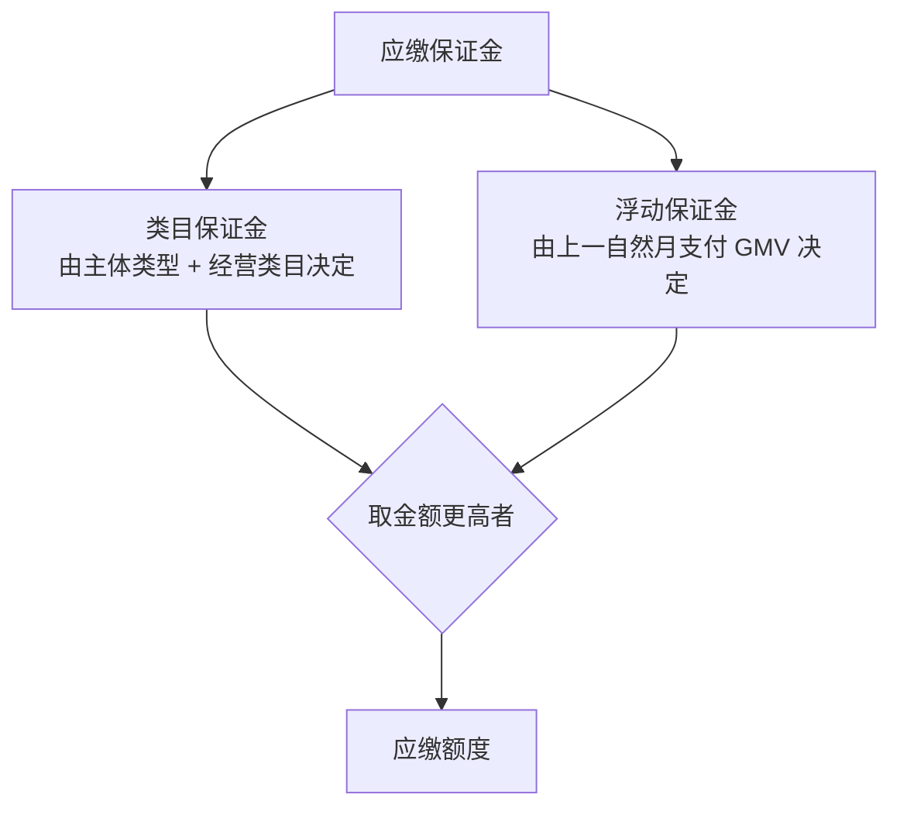

# 类目与保证金：从 2000+ 类目到 0 元试运营

## 一、类目：先确认「能不能卖」

官方 FAQ 称微信小店开放**超过 2000 个类目**，并列出 31 个一级类目，包括宠物生活、厨具、家用电器、手机通讯、数码、电脑&办公、服饰内衣、鞋靴、个人护理、母婴、美妆护肤、家纺、家居日用、家具、家庭清洁&纸品、家装建材、工业品、汽车用品、玩具乐器、运动户外、箱包皮具、酒类、食品饮料、钟表、农资园艺、生鲜、二手、生活服务、图书、艺术品、教育培训（F-029）。

类目不是「选了就能卖」，有三道约束：

| 约束 | 含义 | 依据 |
|---|---|---|
| 类目资质 | 按对应类目管理规则提交行业资质（如食品经营许可证、质检报告等） | F-030 |
| 品牌定准 | 被识别为高风险或非活跃的品牌，不支持申请品牌定准类目 | F-031 |
| 重复铺货 | 同一店铺同一类目在架的品牌/商品不得重复铺货（腾讯另行同意除外） | F-032 |

> **操作顺序建议**：先在类目申请页搜索你要卖的商品关键词，确认「一级-二级-三级类目 + 主体类型 + 额外资质」三项都满足，再准备入驻材料。否则会出现「店开好了，类目下不来」。

## 二、保证金：两条轨道，取高不叠加

保证金定义为商家按经营类目向腾讯缴纳、用于保证商品质量与服务质量的资金，违规时向用户、腾讯赔付（F-033）。它由两部分构成（F-034）：

关键规则：

- 两类保证金**不叠加，以金额更高者为准**（F-034）。
- 腾讯**每月 6 日**按上一自然月支付订单总成交金额及当前经营类目更新应缴额度（F-035）。
- 店铺含多个类目时，类目保证金也**不叠加**，按最高类目金额缴纳（F-037）。

### 浮动保证金档位

| 上一自然月支付订单总成交额 x（元） | 浮动保证金（元） | F 编号 |
|---|---|---|
| x > 500,000 | 30,000 | F-036 |
| 100,000 < x ≤ 500,000 | 5,000 | F-036 |
| 50,000 < x ≤ 100,000 | 3,000 | F-036 |
| 0 ≤ x ≤ 50,000 | 0 | F-036 |

### 算例（官方示例复述）

商家已缴纳类目保证金 2,000 元；上一自然月销售额 55,000 元 → 浮动保证金档位为 3,000 元 → 应缴额度调整为 3,000 元，需补缴差额 1,000 元（F-036、S5）。

> **这不是「罚款」**：补缴是风险定价随 GMV 上调，额度仍在商家保证金账户中；但它会占用现金流，并可能触发提现限制。

## 三、缴纳、欠缴与退保

### 缴纳方式

| 应缴金额 | 可用方式 | F 编号 |
|---|---|---|
| > 5 万元 | 仅网银支付 | F-038 |
| ≤ 5 万元 | 微信支付 | F-038 |

### 欠缴处理

| 保证金余额 | 处理措施 | F 编号 |
|---|---|---|
| 75%（含）≤ 余额 < 应缴额 | 限制部分资产提现，限额为欠款金额 | F-039 |
| 余额 < 75% 应缴额 | 暂停店铺账户资产提现能力 | F-040 |

### 全额退保的七个条件（须同时满足）

1. 首次充值缴纳保证金满 30 个自然日；
2. 距最近一次充值满 48 个自然小时；
3. 无处理中的售后单与纠纷单；
4. 所有订单为完成或取消状态，且最后一笔订单完成满 30 个自然日；
5. 保证金提现能力未被暂停；
6. 无进行中的保证金提现流程；
7. 无待补缴商责欠款、违约欠款及其他欠付款项。

依据 F-041。退保后系统自动下架在售商品；重新经营须 30 日后重新缴纳（F-042）；一个自然月内退回申请不超过 1 次（F-043）。

## 四、0 保证金试运营：平台把「试错」制度化了

### 适用条件

- 从未缴纳过小店保证金，且未上架过任何商品的新商家（F-044）。
- 支持类目以平台附表为准；腾讯营销口径称超过 3000 个叶子类目支持（F-047）。
- 商家或其关联主体有严重/特别严重违规、重大舆情或平台评估的经营风险时，平台可拒绝（F-044、S4）。

### 试运营期限制

| 限制项 | 规则 | F 编号 |
|---|---|---|
| 商品数量 | 店铺内在售商品数 ≤100 个 | F-045 |
| 资金提现 | 暂预留应缴保证金金额，其余货款可提现 | F-045 |

### 试运营结束的四个闸门

1. 商家首次足额缴纳保证金；
2. 有效支付订单 GMV > 10 万元；
3. 发生情节严重或特别严重的违规；
4. 平台停止相应类目试运营。

依据 F-046。结束后须足额缴纳保证金，否则无法提交新商品上架申请且无法提现货款（S4）。

> **口径修正**：修订前版本曾规定「试运营期间无法提现货款」「个体户有效订单 >100 单触发结束」，现行 2025-11-05 版已改为「暂预留应缴保证金、其余可提现」与「GMV > 10 万元」（冲突 C-4、C-5）。

## 五、把保证金当作「现金流变量」而非「一次性门票」

| 阶段 | 应缴保证金可能 | 对现金流的影响 |
|---|---|---|
| 0 保证金试运营 | 0（但货款中暂预留应缴额度） | 货款可提现部分减少 |
| 月 GMV ≤5 万 | 类目保证金（按类目） | 一次性占用 |
| 月 GMV 5–10 万 | 3,000 | 需补缴差额 |
| 月 GMV 10–50 万 | 5,000 | 需补缴差额 |
| 月 GMV >50 万 | 30,000 | 可能触发网银大额缴纳 |

规划时应在现金流表中单列「保证金占用」与「试运营预留」两项，而不是只算货款收入。

## 六、常见问题

**Q：多个类目要交多份保证金吗？**
A：不叠加，按金额更高的类目缴纳（F-037）。

**Q：上月卖得多，这个月就要补钱吗？**
A：每月 6 日按上一自然月支付订单总成交额更新应缴额度，额度上升需补缴差额（F-035）。

**Q：试运营期可以提现吗？**
A：现行规则为「暂预留应缴保证金金额，其余货款可提现」（F-045）；不再是旧版的「完全无法提现」。

**Q：全额退保后还能继续卖吗？**
A：退保后系统自动下架在售商品；重新经营须 30 日后重新缴纳（F-042）。

## 七、关联阅读

- 费用与结算：[费用与结算](03-fees-settlement.md)
- 入驻主体：[入驻与资质](01-onboarding.md)
- 事实与信源：[事实清单 F-001~F-104](../references/facts.md)
