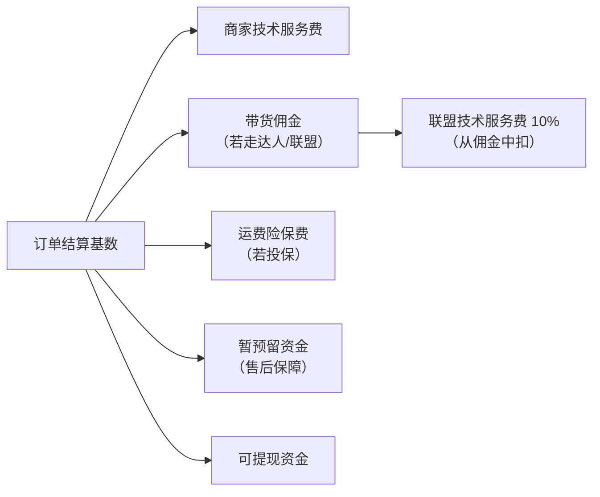
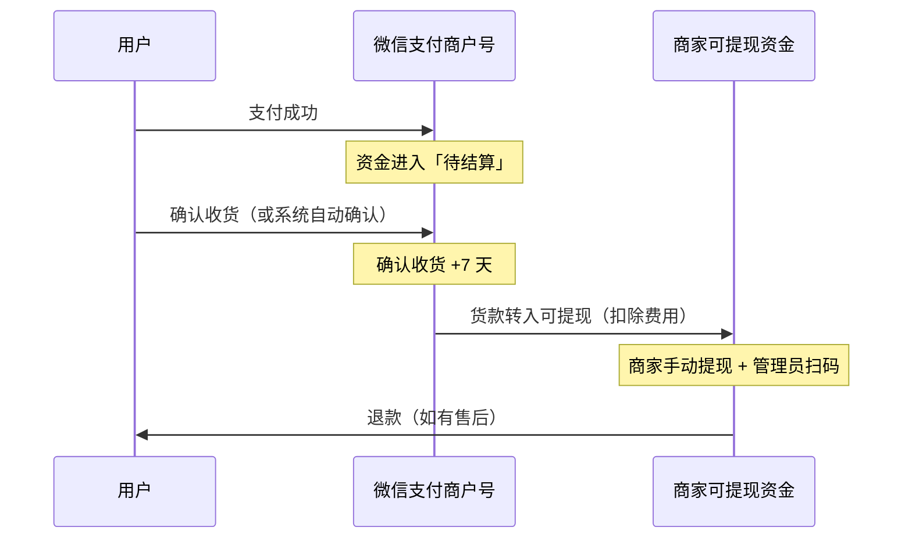

# 费用与结算：技术服务费、确认收货与现金流

## 一、成本地图：显性费用只有一项，隐性成本有四类

| 成本项 | 计费对象 | 谁承担 | 依据 |
|---|---|---|---|
| 商家技术服务费 | 结算基数 | 商家 | F-048~F-051 |
| 支付通道费（财付通） | 订单 | 微信小店/视频号小店/小程序视频号交易组件由平台代承担 | F-052 |
| 带货佣金 | 订单 | 商家设置比例 | F-082 |
| 联盟技术服务费 | 带货佣金/机构服务费 | 带货者/机构（从佣金中扣） | F-083 |
| 运费险保费 | 订单 | 商家（货款不足时从保证金扣） | S6 |
| 退款与售后 | 订单 | 商家 | F-059、F-061 |
| 资金占用 | 待结算资金 | 商家 | F-056~F-060 |
| 保证金占用 | 应缴额度 | 商家 | F-034~F-040 |

## 二、商家技术服务费：公式与基数

### 公式

**技术服务费 = 技术服务费费率 × 结算基数**（F-048）

**结算基数 = 用户实付金额 + 支付补贴 + 带货者优惠 + 平台优惠**（F-049）

其中：

- 商家券金额**不计入**结算基数；
- 订单运费**不计入**结算基数；
- 支付补贴指银行/第三方支付机构提供的优惠（如银行卡满减）；
- 带货者优惠、平台优惠指由带货者或平台出资、使用户少付的金额。

> **反直觉点 1**：平台补贴也计入结算基数。用户少付了，但商家的计费基数没有等额减少——因为补贴是平台/支付机构替用户付的那部分。
>
> **反直觉点 2**：商家自己发的券不计入基数，所以「发券」在技术服务费上不重复计税；但券的成本仍由商家承担。

### 费率与结算

- 费率按每笔订单对应商品或服务的类目计算，见官方《微信小店商家技术服务费一览表》（F-050）。
- 技术服务费从每笔订单的结算货款中**直接扣除**，结算时间与商品售后期结束时间一致（F-051）。
- 腾讯营销 FAQ 称类目费率为 **1%–5%**（F-054，营销口径，非规则原文）。
- 2026 年有类目费率下调：会员卡券 2%→1%；香薰蜡烛 5%→2.5%；母婴洗护部分三级类目 2.5%→2%（F-055）。

### 新商激励

首笔普通订单支付后 **90 天内**、且最晚不超过开店后 **180 天**，前 **100 万元**（重点引入类目 **150 万元**）自营交易额的技术服务费率降至 **1%**（F-053）。

> **注意**：这是「自营交易额」，不是全店 GMV；走达人分销的订单是否计入，需以激励规则原文与实际账单为准。

## 三、结算：确认收货 + 7 天，售后顺延

### 资金流转

### 确认收货规则

| 类目 | 规则 | F 编号 |
|---|---|---|
| 生活服务、旅游休闲、汽车、出行与交通、定制家具 | 用户可点击确认；发货起 10 个月未确认，系统判断未收货并自动退款 | F-058 |
| 其余常规类目 | 取三者较早：用户主动确认；发货且物流签收 3 天后；发货 10 天后（未签收可延迟 5 天，最多 3 次，累计上限 15 天） | F-057 |

### 结算时点

| 结算时机 | 结算资金 | F 编号 |
|---|---|---|
| 确认收货 +7 天 | 商家货款、运费险保费 | F-056 |
| 售后/纠纷完结 +7 天 | 发生售后的对应资金 | F-059 |
| 商品售后期完结 | 平台技术服务费、带货佣金、机构服务费 | F-060 |

**关键规则**：

- 确认收货 +7 天内发生仅退款、退货退款等售后或纠纷，对应资金需在售后/纠纷完结 7 天后结算（F-059）。
- 用户对订单中**部分商品**申请售后，系统冻结**整个订单金额**（F-061）。
- 待结算资金转入可提现或分账，执行时间需 1–2 天（S6）。

### 提现

- 商家手动发起提现，输入金额，并由商户管理员扫码验证（F-062）。
- **每日最多提现一次**；一般 24 小时内到账（F-062）。
- 提现账户须与开店主体一致；每天只可修改提现账户一次（F-064）。
- 结算规则原文要求提现至对公账户银行卡（F-065）；腾讯营销 FAQ 称个体工商户可使用对私账户（F-025）——**这是冲突项 C-2**，规划时按对公预留，实际以店铺后台绑定页为准。

## 四、成本算例（设计算例，非平台承诺）

假设一笔订单：

- 用户实付：100 元
- 无支付补贴、无平台优惠
- 类目技术服务费率：5%
- 商家设置达人佣金：20%
- 达人通过优选联盟带货，联盟技术服务费率：10%

| 项目 | 计算 | 金额 |
|---|---|---|
| 结算基数 | 用户实付 100 | 100 元 |
| 商家技术服务费 | 100 × 5% | 5 元 |
| 带货佣金 | 100 × 20% | 20 元 |
| 联盟技术服务费 | 20 × 10% | 2 元（从达人佣金中扣，不由商家直接承担） |
| 商家可得（未计退款/运费险） | 100 − 5 − 20 | 75 元 |

若该订单在新商 1% 激励期内且属于自营交易额，则技术服务费为 1 元，商家可得 99 元（未计佣金）。

> **注意**：以上为结构演示，不含运费、运费险、退款、暂预留资金、保证金占用与税费；实际账单以平台结算页为准。

## 五、现金流时间线：比毛利率更容易低估的成本

以一笔 100 元订单、5% 费率、20% 佣金为例：

| 时间点 | 事件 | 现金影响 |
|---|---|---|
| T0 | 用户支付 | 100 元进入待结算（不可用） |
| T0+发货 | 物流签收 | 开始计算确认收货 |
| T0+签收 3 天 | 自动确认收货（若用户未主动确认） | 进入 +7 天倒计时 |
| T0+签收 10 天 | 货款转入可提现（扣 5 元技术服务费、20 元佣金） | 75 元可提现 |
| 提现日 | 管理员扫码提现 | 75 元转至绑定账户（一般 24 小时内） |
| 售后期完结 | 技术服务费/佣金最终结算 | 若期间退款，按退款部分回冲 |

**结论**：从用户支付到商家拿到钱，典型周期约 **10–20 天**（确认收货 3–10 天 + 7 天结算 + 1–2 天入账 + 提现日）。做现金流预算时，至少按 15 天账期准备周转资金。

## 六、五个常见误区

| 误区 | 事实 |
|---|---|
| 「技术服务费按用户实付算，商家券可以抵税」 | 商家券不计入基数，但券成本仍由商家承担（F-049） |
| 「平台补贴不进商家收入，所以不计费」 | 支付补贴、平台优惠计入结算基数（F-049） |
| 「确认收货后马上到账」 | 确认收货后 +7 天才转可提现，售后还会顺延（F-056、F-059） |
| 「部分商品退款只冻结部分金额」 | 系统冻结整个订单金额（F-061） |
| 「每天可以多次提现」 | 每日最多一次，且需管理员扫码（F-062） |

## 七、关联阅读

- 保证金与试运营：[类目与保证金](02-categories-deposit.md)
- 达人佣金与联盟：[分销与带货](05-distribution.md)
- 事实与信源：[事实清单 F-001~F-104](../references/facts.md)
