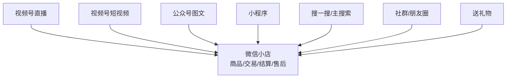
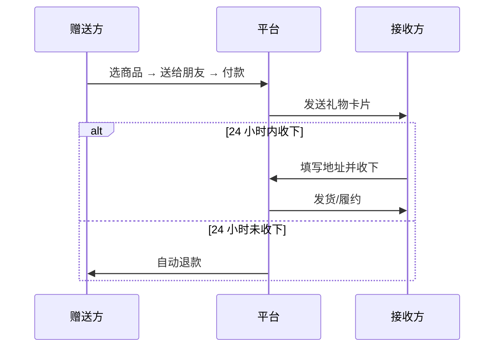

# 场景与流量：直播、图文、搜索、社群与送礼物

## 一、先理解「场景」，再谈「流量」

微信小店与中心化电商最大的结构差异：**商品不是堆在一个商城里等人搜索，而是被拆散到多个内容与社交场景中**（F-004、F-066）。平台披露的官方定义只承诺「商品信息展示、商品交易等功能」（F-007），不承诺流量；流量来自场景中的内容、关系与搜索行为。

## 二、场景清单与能力边界

| 场景 | 商品如何出现 | 关键约束 | 依据 |
|---|---|---|---|
| 视频号直播 | 直播间挂商品、讲解、下单 | 账号需选择「店铺自营」或「达人带货」身份；达人直播需 >100 有效粉丝 | F-079、F-080 |
| 视频号短视频 | 短视频挂商品/橱窗 | 达人短视频需 >1000 有效粉丝；店铺自营的对外展示账号无限制，非对外展示账号需 >1000 | F-080 |
| 公众号图文 | 文章内插入小店商品卡 | 公众号需与小店关联；一个公众号只能关联一个小店 | F-075、F-078 |
| 小程序 | 小程序内承接交易/会员 | 可作为「小店+小程序+服务号」协同的一环（媒体口径） | F-004、F-102 |
| 搜一搜/主搜索 | 商品搜索结果、礼物搜索框 | 三大搜索入口为媒体归纳，非平台规则原文 | F-068、F-069 |
| 社群/朋友圈 | 分享商品卡/链接、朋友圈广告 | 送礼物已接入朋友圈广告；社群分享属于社交分发 | F-071 |
| 送礼物 | 礼物卡片在聊天中赠送 | 类目限制、单笔 ≤5 万元、24 小时未收自动退款 | F-072~F-074 |

> **口径提示**：2024 公告列出的场景是「公众号（订阅号、服务号）、视频号（直播、短视频）、小程序、搜一搜」（F-004）；2025-08 的媒体描述扩展为「视频号直播、短视频、公众号图文、小程序、社群、朋友圈」等全场景（F-066）。「社群/朋友圈」属于媒体归纳，平台公告未逐项列举，引用时应标注来源层级。

## 三、三大搜索入口：被低估的低成本流量

2025 年微信小店明确了三个核心搜索入口（F-068）：

1. **微信主搜索框**；
2. **发现页「搜一搜」的商品专属栏目**；
3. **礼物搜索框**。

媒体报道称三大入口协同为商家带来 **3 倍以上的搜索流量增量**（F-069）。这是**媒体口径**，不是平台官方承诺，但方向值得重视：

- 搜索流量的意图更强：用户已经在找某个商品，而不是被动刷到。
- 礼物搜索是「场景化搜索」：用户搜的不是品类，而是「送什么」。
- 搜索优化属于商品信息质量工作：标题、主图、属性、价格、库存的一致性（S13 的商家手册建议）。

## 四、送礼物：一个独立的交易场景

### 机制

### 规则要点

| 项目 | 规则 | F 编号 |
|---|---|---|
| 类目限制 | 珠宝首饰部分二级、文玩部分二级、教育培训/「其他」全部、食品饮料-食品礼券不支持 | F-072 |
| 金额上限 | 单笔礼物订单商品原价（合计）与实付金额均 ≤5 万元 | F-073 |
| 未收下 | 24 小时内未收下，自动退款至赠送方 | F-074 |
| 已收下售后 | 接收方或赠送方可发起；赠送方代发起需接收方授权；退款退至赠送方 | F-074 |
| 订单信息 | 无收货地址、无买家信息、不支持改价、不支持拉黑 | F-094 |
| 商家关闭 | 仅店铺维度关闭，立即生效 | F-093 |

> **版本提示**：2024-12-19 的媒体早期报道写「原价不得高于 1 万元」（S22），而 2024-12-27 的官方商家手册已写「5 万元」（F-073）。本包以官方手册为准（冲突 C-3）。

### 商家侧可做的事（来自官方商家手册）

- 用「商品分类」把适合送礼的商品放到专区，并在店铺首页第一屏展示（S13）。
- 用「精选展示位」突出礼物商品（S13）。
- 优化标题中的礼物/节日关键词、主图中的送礼场景、商品详情中的节日元素、库存准确性（S13）。
- 通过公众号文章、小程序送礼物专区、门店物料推广（S13）。

## 五、场景适配矩阵（设计判断，非平台规则）

| 商家类型 | 首选场景 | 次选场景 | 不建议作为主战场 |
|---|---|---|---|
| 有内容能力的品牌 | 视频号直播 + 短视频 + 公众号 | 搜一搜 + 送礼物 | 纯货架等待自然搜索 |
| 无内容能力的白牌/工厂 | 搜一搜 + 优选联盟（达人分销） | 社群/朋友圈 | 自建日播（内容成本高） |
| 个体工商户/小团队 | 社群 + 朋友圈 + 送礼物 | 短视频（低粉丝门槛：店铺自营无限制） | 大促投放 |
| 礼品/食品/文创 | 送礼物 + 搜索 | 公众号图文 | 高客单珠宝（类目受限） |

## 六、入口约束：微信的「克制」是结构性事实

媒体观察指出（S16，非平台规则）：

- 送礼物入口隐蔽，需在搜索框输入「礼物」才能快速进入；
- 查看订单、购物车、收藏店铺需走「我 → 订单与卡包」；
- 商品搜索需切换到「商品」标签。

这意味着：

1. **不能假设用户知道入口在哪里**。商家需要用内容、客服、社群、二维码等方式主动把用户带到交易路径。
2. **私域复购比公域拉新更可控**。公众号、社群、企业微信是「可重复触达」的资产；直播和搜索是「一次性曝光」。
3. **搜索优化是长期资产**。商品标题、属性、评价、销量会持续影响搜索结果，且不依赖每次开播。

## 七、关联阅读

- 谁可以带货、怎么分佣：[分销与带货](05-distribution.md)
- 机制层解释：[机制洞察](07-insights.md)
- 事实与信源：[事实清单 F-001~F-104](../references/facts.md)
