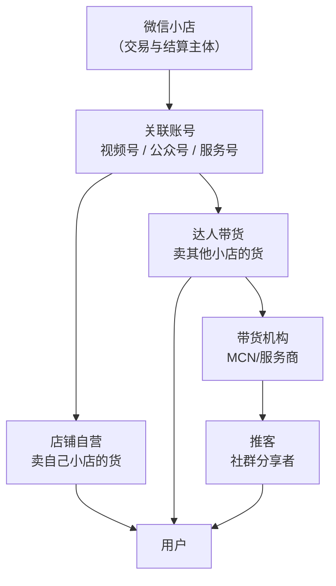
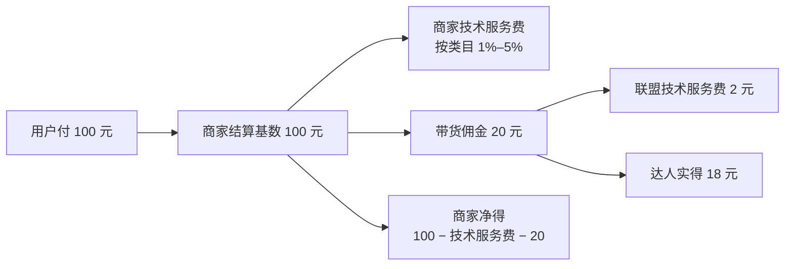

# 分销与带货：关联账号、店铺自营、达人与优选联盟

## 一、先把「谁在卖」画清楚

微信小店的分销不是「商家 → 平台 → 买家」这么简单，而是由四类角色构成：

## 二、关联账号：店铺的「内容分身」

商家可通过「店铺管理-关联账号」向视频号、公众号（订阅号）、服务号发起关联邀请；对方管理员同意后关联成功（F-075）。

### 额度

| 店铺类型 | 初始额度 | 提升条件 | F 编号 |
|---|---|---|---|
| 个体工商户店 | 视频号/公众号/服务号各 1 | 无 | F-076 |
| 企业店 | 各 5 | 初始 | F-077 |
| 企业店 | 各 10 | DSR 近 30 天均 ≥4.6 | F-077 |
| 企业店 | 各 20 | DSR ≥4.6 且近 30 天支付 GMV≥30 万 | F-077 |
| 企业店 | 各 50 | DSR ≥4.6 且近 30 天支付 GMV≥60 万 | F-077 |
| 企业店 | 各 100 | DSR ≥4.6 且近 30 天支付 GMV≥150 万 | F-077 |

约束：一个视频号只能关联一个小店（含视频号小店）；一个公众号/服务号只能关联一个小店（F-078）。

> **解读**：「关联账号额度」本质是平台按店铺服务质量（DSR）与交易规模（GMV）分配的**内容分发资源**。它不是无条件的，而是随着店铺表现逐级解锁。

## 三、两种带货身份：店铺自营 vs 达人带货

视频号账号的带货身份只有两种（F-079）：

| 维度 | 店铺自营 | 达人带货 |
|---|---|---|
| 主要卖谁的货 | 关联小店自营商品 | 其他小店的商品 |
| 第三方商品 | 对外展示账号可带 5 件第三方商品；非对外展示账号仅卖自营 | 不限制第三方商品数量 |
| 店铺营销能力 | 可使用商家优惠券/闪购 | 不可使用商家优惠券/闪购 |
| 短视频带货粉丝门槛 | 对外展示账号无；非对外展示账号 >1000 有效粉丝 | >1000 有效粉丝 |
| 直播带货粉丝门槛 | 无 | >100 有效粉丝 |
| 橱窗带货粉丝门槛 | 无 | 无 |
| 橱窗保证金 | 对外展示的关联账号无需缴纳 | 需缴纳 |
| 身份切换 | 365 天内 2 次机会 | 365 天内 2 次机会 |

依据 F-080、F-081、S10。

> **关键差异**：「店铺自营」不是「自己开店」，而是「视频号账号作为某家小店的关联账号，专门卖这家店的货」。它换来的是**对外展示账号**的零粉丝门槛与营销能力，代价是商品范围受限（非对外展示账号的短视频仍需 >1000 粉）。达人带货则相反：商品范围自由，但短视频/直播有粉丝门槛，且要缴橱窗保证金。

## 四、优选联盟：商家设置佣金，达人/机构/推客来分销

### 三类推广计划（带货者侧）

| 计划类型 | 面向谁 | 佣金优先级 | F 编号 |
|---|---|---|---|
| 指定带货者计划 | 指定的带货者 | 最高 | F-082 |
| 圈选带货者计划（即将上线） | 符合圈选条件的带货者 | 中 | F-082 |
| 全部带货者计划 | 所有加入优选联盟的带货者 | 最低 | F-082 |

同一商品被多个圈选计划覆盖时：先按固定佣金率从高到低，再按计划时间从长到短（S11）。

### 佣金结算模式

- **普通佣金结算模式**：商家只设普通佣金率，按普通佣金率结算（S11）。
- **投流佣金结算模式**：商家同时设投流佣金率与普通佣金率，按订单是否来自符合条件的投流推广分别计算（S11）。

### 带货机构与推客

- **带货机构推广计划**：普通推广计划面向所有机构；定向推广计划面向已绑定机构。商家可分别设机构服务费与带货佣金，或设总比例由机构自行分配（S11）。
- **推客带货模式**：机构通过推客带货 API 邀请带货者在社群等场景推广；推客即该模式下的带货者（S11）。
- **计佣时效**：推客模式的常规默认时效为商品/店铺 30 天、视频号短视频/直播 3 天 + 30 天延长期、公众号/服务号图文 3 天 + 30 天延长期；商家可为机构设置 30–365 天的专属自定义时效（S11）。

### 联盟技术服务费

2026-01-19 起，优选联盟向带货机构、带货者收取联盟技术服务费（F-083）：

- 费率：**10%**
- 公式：**联盟技术服务费 = 机构服务费或带货佣金 × 10%**
- 扣除方式：从每笔订单的结算佣金中直接扣除

阶段性优惠（F-084）：

| 优惠 | 范围 | 费率 |
|---|---|---|
| 全量免佣 | 至 2026-03-31 下单的订单 | 0% |
| 星级免佣 | 至 2026-06-30 下单，且带货者当月为 0/1/2 星 | 0% |
| 热招免佣 | 至 2026-12-31 下单，且商品为热招品牌合作商品 | 0% |

> **时间敏感**：以上优惠均有明确截止日期。2026-11-01 取证时，全量免佣与星级免佣已结束，仅「热招免佣」仍可能有效（以订单下单日与平台账单为准）。

## 五、一笔分销订单的钱怎么分

以 100 元订单、20% 达人佣金、10% 联盟技术服务费为例：

| 角色 | 收入/支出 | 说明 |
|---|---|---|
| 商家 | 收 100，付技术服务费 + 20 元佣金 | 佣金是商家成本 |
| 达人 | 收 20，付 2 元联盟服务费 | 实得 18 |
| 带货机构 | 若有，收机构服务费，付 10% 联盟服务费 | 与达人合作时按约定分配 |
| 平台 | 收商家技术服务费 + 联盟技术服务费 | 两项性质不同 |

## 六、选择建议（设计判断）

| 你的资源 | 建议路径 | 原因 |
|---|---|---|
| 有稳定内容能力、想控价控货 | 店铺自营 + 关联视频号/公众号 | 对外展示账号零粉丝门槛、可用商家营销工具、商品范围可控 |
| 有货但没内容 | 优选联盟「全部带货者计划」+ 定向邀约达人 | 用佣金换分发，启动快 |
| 有私域社群 | 推客带货模式 | 社群分享天然适配染色链接与计佣时效 |
| 品牌方 | 指定带货者计划 + 品牌定准类目 | 控达人与价格体系，避免全量计划乱价 |
| 个体户 | 社群 + 朋友圈 + 送礼物 | 关联账号额度仅各 1，难以矩阵化 |

## 七、常见误区

| 误区 | 事实 |
|---|---|
| 「关联账号越多越好，先开满」 | 个体户各 1；企业店初始各 5，提升要看 DSR 与 GMV（F-076、F-077） |
| 「达人带货没有门槛」 | 短视频 >1000 粉、直播 >100 粉（F-080） |
| 「优选联盟一直免费」 | 2026-01-19 起收 10%，仅有阶段性免佣（F-083、F-084） |
| 「佣金全给达人」 | 联盟技术服务费从佣金中再扣 10%（F-083） |
| 「一个视频号可以挂多个小店」 | 只能关联一个小店（F-078） |

## 八、关联阅读

- 场景与流量：[场景与流量](04-traffic-scenarios.md)
- 费用与结算：[费用与结算](03-fees-settlement.md)
- 事实与信源：[事实清单 F-001~F-104](../references/facts.md)
