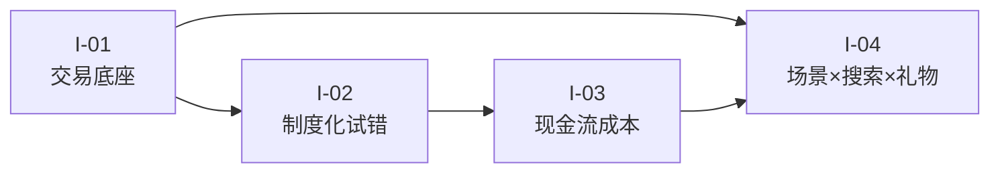

# 机制洞察：微信小店的四条结构性判断

> 本篇是**分析层**，不是平台口径。每条洞察由「陈述 / 证据 / 反常识 / 行动」四元组构成；因果解释标注为「洞察」，不伪装成官方规则。

## 洞察关系图

---

## I-01 微信小店是「交易底座」，不是「又一个中心化商城」

**陈述**：微信小店的核心价值在于把交易能力嵌入微信既有场景，而不是造一个独立商城与淘宝/京东正面竞争。理解这一点，决定了运营重心应放在「场景选择」而非「店铺装修」。

**证据**：

- 官方定义只承诺商品展示、交易等技术服务，不承诺流量（F-007）。
- 商品信息可在公众号、视频号、小程序、搜一搜等多场景流转（F-004）。
- 2025-08 扩展为直播、短视频、公众号图文、小程序、社群、朋友圈等全场景（F-066）。
- 2026 公开课提出「小店+小程序+服务号」三位一体：小店承接交易，小程序做会员，服务号做复购（F-102，研报二次整理）。

**反常识**：多数人默认「开店 → 装修 → 等流量」，但微信小店的流量不集中在店铺首页，而在内容与关系链里。**店铺首页不是流量入口，只是承接页。**

**行动**：

1. 先选 1–2 个主场景（例如「视频号短视频 + 搜一搜」或「社群 + 送礼物」），再决定店铺结构。
2. 把「商品信息质量」当作跨场景资产：同一套标题/主图/属性要能同时服务直播讲解、搜索命中、礼物场景。
3. 不要用中心商城的「首页装修 KPI」衡量微信小店；改用「场景转化率 + 复购率」。

---

## I-02 平台把「低成本试错」制度化了

**陈述**：0 保证金试运营、新商 1% 技术服务费、阶梯保证金三者组合，构成一个「先验证、后投入」的制度化通道。这是微信小店相对其他平台最值得利用的结构性设计。

**证据**：

- 0 保证金试运营面向从未缴保证金、未上架商品的新商家（F-044）。
- 试运营期在售商品 ≤100 个，暂预留应缴保证金，其余货款可提现（F-045）。
- 试运营在有效支付订单 GMV >10 万元时结束（F-046）。
- 新商首笔订单后 90 天内、最晚 180 天内，前 100 万（重点类目 150 万）自营交易额费率降至 1%（F-053）。
- 浮动保证金按上一自然月 GMV 分档，月 GMV ≤5 万时为 0（F-036）。

**反常识**：保证金不是「固定门票」，而是**随规模浮动的风险定价**；试运营也不是「免费用」，而是**用提现预留换低门槛**。平台用制度把「小规模试错」和「大规模经营」分成了两个风险区间。

**行动**：

1. 把试运营期定义为「验证期」，目标不是冲 GMV，而是验证三件事：类目准入、履约时效、售后率。
2. 在 GMV 接近 10 万元前，提前测算升级后的保证金占用与费率变化，避免「卖得越多、现金越紧」。
3. 用「前 100 万自营交易额」做费率规划：优先把高毛利、低退款的自营商品放在激励期内。

---

## I-03 真实成本是「现金流周期」，不是「佣金率」

**陈述**：商家最容易低估的成本不是技术服务费，而是从用户支付到货款可提现之间的资金占用，以及售后冻结、退款回冲与保证金占用。

**证据**：

- 用户支付后资金进入待结算（F-056）。
- 常规类目确认收货后 +7 天才转可提现（F-056、F-057）。
- 确认收货 +7 天内发生售后，结算再顺延至售后完结 +7 天（F-059）。
- 部分商品售后会冻结整个订单金额（F-061）。
- 技术服务费、佣金在售后期完结后才结算（F-060）。
- 保证金按月按 GMV 调整，可能触发补缴（F-035、F-036）。
- 提现每日仅一次，需管理员扫码（F-062）。

**反常识**：毛利率 40% 的生意，如果账期 20 天、退款率 15%，实际年化资金回报可能低于毛利率 25% 但账期 7 天的生意。**在微信小店，现金流速度是比毛利率更重要的经营指标。**

**行动**：

1. 建一张「订单—结算—提现」时间表，按最坏情况（签收 10 天 + 7 天结算 + 售后 7 天）预留周转金。
2. 把「退款率」「售后完结时长」纳入选品标准，而不只看毛利。
3. 保证金按「月 GMV 峰值」预留，而不是按开店时的类目保证金预留。

---

## I-04 增长来自「内容 × 搜索 × 礼物」，但入口隐蔽是结构性约束

**陈述**：微信小店 2025 年的增长不是靠中心化流量投放，而是内容场景渗透、搜索入口与送礼场景三条线叠加；但入口分散、心智薄弱，决定了它更适合「已有信任关系」的商家，而不是「纯冷启动投流」的商家。

**证据**：

- 2025 年品牌带货 GMV 增速为平台整体的 4.3 倍，GPM 同比 +1.5 倍，月均动销商家数 +1.7 倍（F-095~F-097）。
- 一线+新一线用户占 32%，二三线占 39%（F-098）。
- 三大搜索入口带来 3 倍以上搜索流量增量（F-069，媒体口径）。
- 送礼物接入朋友圈广告、小店页面、搜索，并设专属专区（F-071）。
- 媒体观察：送礼物入口需搜索「礼物」进入，订单/购物车需走「我 → 订单与卡包」（S16）。

**反常识**：微信的最大优势不是「流量大」，而是**关系链上的信任转化**；最大劣势也不是「流量少」，而是**入口太隐蔽、用户心智弱**。两者同时成立。把微信小店当「低成本流量池」会失望；把它当「信任关系的交易承接器」才顺。

**行动**：

1. 先问「我已有的信任关系在哪里」（公众号读者、社群、老客户、门店会员），再选场景。
2. 把搜索优化与礼物场景当作「不依赖日播的长期资产」，而不是大促临时动作。
3. 用私域复购率、搜索成交占比、礼物订单占比三个指标替代「直播间在线人数」作为主 KPI。

---

## 附：读懂平台增长数字的三条纪律

### 1. 「增速是平台整体的 4.3 倍」≠「GMV 增长 4.3 倍」

官方口径是「品牌带货 GMV 的**增速**达到平台整体的 4.3 倍」（F-095）。这表示：如果平台整体增速是 g，品牌带货增速约为 4.3g。它不是「品牌 GMV 是去年的 4.3 倍」。腾讯营销 FAQ 的转述「品牌 GMV 增长 4.3 倍」容易被读成规模倍数（冲突 C-8）。

### 2. 「增长 1.7 倍」= 变为原来的 2.7 倍

中文里「增长 N 倍」= 原值 × (1+N)；「是原来的 N 倍」= 原值 × N。平台披露多用「增长 1.7 倍」「增长 1.5 倍」，引用时不要写成「是 1.7 倍」。

### 3. 结构性指标不能替代绝对值

平台连续两年未披露微信小店整体 GMV（F-101），公开的是增速、GPM、动销商家数、用户结构等结构性指标。这些指标能说明「在增长」，但不能推出「单个商家能赚钱」。**平台增长 ≠ 商家盈利**。

---

## 关联阅读

- 事实基础：[事实清单 F-001~F-104](../references/facts.md)
- 落地路径：[落地路径](08-playbook.md)
- 核验与边界：[核验报告](../references/verification.md)
