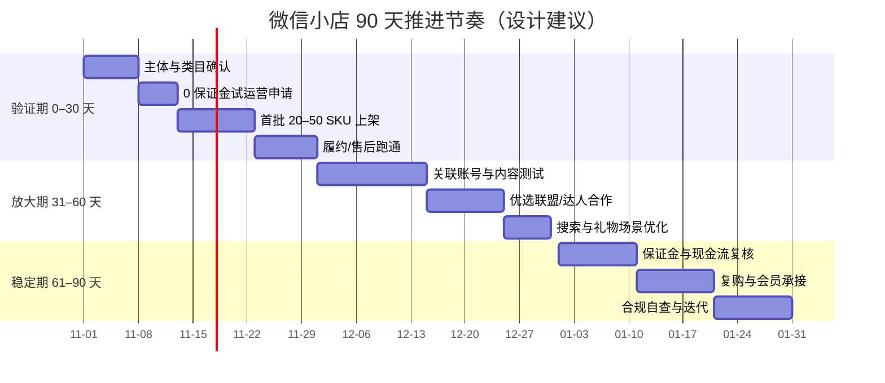

# 落地路径：90 天推进节奏与决策矩阵

> 本篇是**设计产物**，不是平台规则，也不构成收益承诺。所有门槛与费用数字回挂 F 编号；具体执行以官方规则与店铺后台为准。

## 一、先回答五个问题：你适不适合做

| # | 问题 | 如果答案是「否」 | 依据 |
|---|---|---|---|
| 1 | 你有中国大陆的企业或个体工商户营业执照吗？ | 先注册主体；个人无法直接入驻 | F-010、F-013、F-016 |
| 2 | 你要卖的类目对个体户/企业开放吗？需要额外资质吗？ | 换类目或补资质，不要先开店 | F-030 |
| 3 | 你能接受 10–20 天账期与保证金占用吗？ | 先做现金流测算，或缩小试运营规模 | F-056~F-062 |
| 4 | 你已有至少一个可触达的信任场景吗（公众号/社群/门店/老客/内容账号）？ | 先做内容或私域，不要直接开播 | F-004、F-066 |
| 5 | 你能持续提供售后与客服吗？ | 先设计售后流程，再上架 | F-059、S8 |

## 二、决策矩阵：按资源选路径

| 资源禀赋 | 推荐路径 | 关键动作 | 主要风险 |
|---|---|---|---|
| 品牌 + 内容团队 | 企业店 + 店铺自营 + 视频号直播/短视频 + 公众号 | 品牌认证、关联账号、日播/周播 | 内容成本高、退款率 |
| 工厂/白牌 + 无内容 | 企业店 + 优选联盟「全部带货者计划」 | 设置佣金、邀约达人、控价 | 达人乱价、佣金侵蚀 |
| 个体户/小团队 | 个体工商户店 + 社群/朋友圈 + 送礼物 | 0 保证金试运营、100 SKU 以内 | 关联账号仅各 1、规模上限 |
| 礼品/食品/文创 | 小店 + 送礼物 + 搜一搜 | 礼物专区、节日选品、标题优化 | 类目限制、季节性 |
| 服务商/MCN | 带货机构 + 推客模式 | 机构服务费、染色链接、计佣时效 | 归因争议、结算周期 |

## 三、90 天推进节奏

### 0–30 天：验证期

| 周 | 动作 | 验收标准 |
|---|---|---|
| 第 1 周 | 确认主体、类目、资质；完成入驻与账户验证 | 店铺开通；类目可发布 |
| 第 2 周 | 申请 0 保证金试运营；上架 20–50 个 SKU | 在售商品 ≤100；商品信息完整 |
| 第 3 周 | 跑通首单：发货、物流、确认收货、售后 | 首单完成；无超时发货 |
| 第 4 周 | 复盘退款率、客服响应、履约时效 | 退款率与售后时长有基线数据 |

**验证期不要做的事**：大额投放、批量开达人、开满关联账号、冲 GMV。目标是拿到「三张基线表」：类目准入表、履约时效表、售后原因表。

### 31–60 天：放大期

| 周 | 动作 | 验收标准 |
|---|---|---|
| 第 5–6 周 | 关联 1 个视频号 + 1 个公众号；测试短视频/图文 | 至少 10 条内容；有商品点击 |
| 第 7–8 周 | 开通优选联盟，设置 10%–20% 佣金；邀约 3–5 位达人 | 有达人出单；佣金可结算 |
| 第 9 周 | 优化搜索标题/属性；设置礼物专区 | 搜索成交占比与礼物订单占比可计量 |

**放大期的核心指标**：不是 GMV，而是「场景转化率」——每个场景带来的成交/曝光，以及「达人 ROI」——佣金支出/达人带来的 GMV。

### 61–90 天：稳定期

| 周 | 动作 | 验收标准 |
|---|---|---|
| 第 10 周 | 复核保证金档位与现金流；准备补缴 | 保证金余额 ≥ 应缴额；周转金 ≥ 20 天 |
| 第 11 周 | 用服务号/社群做复购；建立会员标签 | 复购率有基线；企微/社群可触达 |
| 第 12 周 | 合规自查；淘汰高退款 SKU；更新 90 天复盘 | 红线清单全过；SKU 结构优化 |

## 四、成本与现金流模板

### 单笔订单成本表

| 项目 | 公式 | 数据来源 |
|---|---|---|
| 结算基数 | 用户实付 + 支付补贴 + 带货者优惠 + 平台优惠 | 订单详情 |
| 商家技术服务费 | 结算基数 × 类目费率 | 账单 |
| 带货佣金 | 结算基数 × 佣金率 | 联盟后台 |
| 运费/运费险 | 实际 | 物流/保险 |
| 退款损失 | 退款金额 × (1 − 可回收成本率) | 售后记录 |
| 净收入 | 结算基数 − 技术服务费 − 佣金 − 运费 − 退款损失 | 计算 |

### 月度现金流表

| 项目 | 说明 |
|---|---|
| 期初现金 | 上月结余 |
| 待结算资金 | 已支付未确认收货 |
| 可提现资金 | 已确认收货 +7 天 |
| 保证金占用 | 类目/浮动取高 |
| 试运营预留 | 应缴保证金金额（试运营期） |
| 应付佣金 | 售后期完结后结算 |
| 周转缺口 | 待结算 + 保证金 − 可用现金 |

> 具体计算示例见 [费用与结算](03-fees-settlement.md) 第四节；本表只给结构，不替代财务核算。

## 五、指标体系：四个层级

| 层级 | 指标 | 用途 |
|---|---|---|
| 准入层 | 类目可售率、资质完整率 | 是否能卖 |
| 履约层 | 发货时效、签收时长、退款率、售后完结时长 | 是否守得住 |
| 场景层 | 各场景曝光→点击→成交、搜索成交占比、礼物订单占比 | 哪里有效 |
| 财务层 | 净收入率、账期、保证金占用、佣金 ROI | 是否赚钱 |

**建议的 90 天目标**（设计建议，非平台承诺）：

- 退款率 ≤10%（类目差异大，先建基线再定目标）；
- 售后完结时长 ≤3 天；
- 至少 1 个场景的成交占比 ≥30%；
- 账期 ≤20 天；
- 保证金余额始终 ≥ 应缴额。

## 六、止损与退出条件

出现以下任一情况，应暂停扩张并复盘：

1. 连续 4 周退款率上升且售后完结时长 >5 天；
2. 达人佣金 ROI <1（佣金支出大于达人带来的毛利）；
3. 保证金补缴导致周转缺口 >30 天；
4. 出现信息类/平台类违规（虚假宣传、引导私下交易、虚假交易）；
5. 类目被平台停止试运营或资质到期未续。

退出时注意：保证金全额退保需满足 7 个条件（含最后一笔订单完成满 30 天）；退保后商品自动下架；重新经营须 30 日后重新缴纳（F-041、F-042）。

## 七、红线（不可逾越）

- 不发布违禁信息、假冒商品、超范围商品（S8）。
- 不引导私下交易、不泄露用户信息（S8）。
- 不做虚假交易（刷单、自买自卖、物流造假、评价异常）（S8）。
- 不用「保本/稳赚/必爆」等收益承诺做宣传（本包自身也不做）。
- 不绕过平台支付与结算（S6）。

## 八、关联阅读

- 机制解释：[机制洞察](07-insights.md)
- 费用细节：[费用与结算](03-fees-settlement.md)
- 合规细节：[合规与售后](06-compliance.md)
- 事实与信源：[事实清单 F-001~F-104](../references/facts.md)
