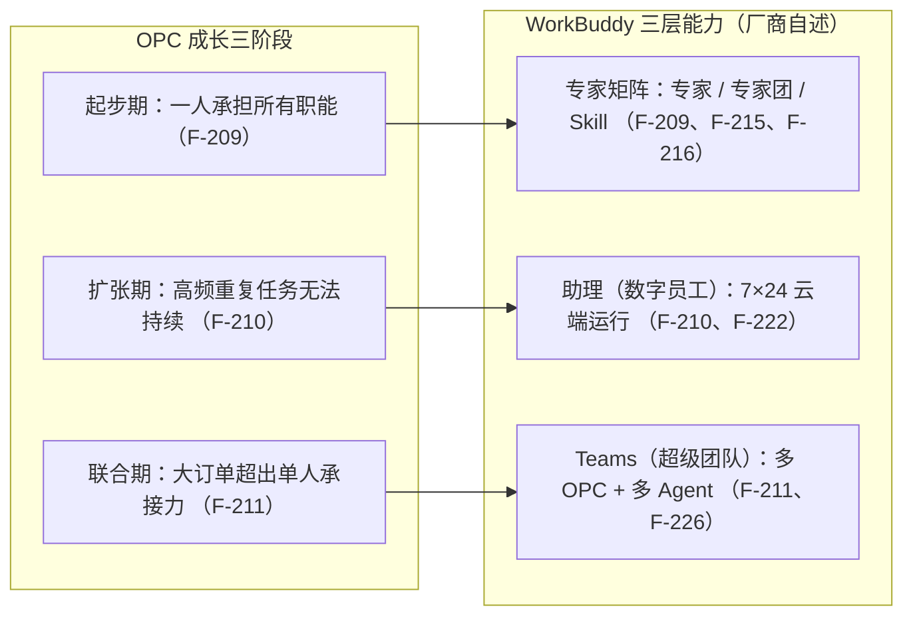

# 超级团队与 WorkBuddy 架构：四重需要、三层产品承接与混合架构

> 本篇对应白皮书第四章（页 17–20）。前三节属行业分析与**第三方研究口径**，§4.4 起为**厂商自述**；平台能力数字带「截至 2026 年 6 月」时点并含勘误。核验细节见[核验报告](../references/verification.md)。

## 一、超级个体为什么还需要团队

白皮书第四章导语称当前最大落差是「个人效率飞升，多人协作几乎没变」（F-185；本章框架定位 F-186）。§4.1 引调研称超级个体没有走向孤立，而是在以新方式聚合（F-187）。原因是四重结构性需要（**白皮书观点**）：

| 需要 | 核心逻辑 | 单人为何补不齐 | 编号 |
| --- | --- | --- | --- |
| 共同承担风险 | 连续做出正确判断的概率必然衰减 | 风险需要系统冗余，单点必有故障概率 | F-188 |
| 共同稳定注意力 | AI 让决策点密度暴涨，注意力切换有结构性损耗 | 一个人同时管 50 个判断点，质量必然下降 | F-189 |
| 共同形成信用 | 客户评估的是「系统可靠性」，不只是个人能力 | 信用是时间 × 关系的函数，单点结构性不可靠 | F-190 |
| 进入更大价值场景 | 需要多种判断并行，复数的人同时在场 | 单点能力再强也撑不开需要多人在场的空间 | F-191 |

数据佐证（**第三方研究口径**，来源 F-196）：有联合创始人的公司 5 年存活概率高约 **45%**（F-192）；十亿美元级公司中约 **80%** 有 2 名以上联合创始人（F-193）。

> **⚠️ 勘误 6/7**：核验到的 WinSavvy 原文为「高约 **35%**」，白皮书作 45%——以「来源原文 35%、白皮书作 45%」并列表述（F-192）；First Round Capital《The 10 Year Project》(2015) 存在，但「80% 独角兽」**未核到**，标「仅白皮书单源」（F-193）。

## 二、组织竞争力公式

白皮书 §4.2 引腾讯研究院提出的公式（**第三方研究口径**，F-194、来源 F-197）：

> 组织竞争力 = 人才密度 × AI 杠杆 / 组织摩擦

三项释义：**人才密度**为单位团队中具备独立闭环能力的人占比（F-198）；**AI 杠杆**为 AI 实际嵌入工作流的深度和覆盖面（F-199）；**组织摩擦**为一个想法从产生到变成可交付成果之间的等待、审批和信息衰减（F-200）。三者关系是乘除而非加减；超级个体放大的是分子，超级团队真正解决的是分母（F-201）。

## 三、三种超级团队形态

白皮书 §4.3 归纳三种形态（**白皮书观点**）：

| 形态 | 特征 | 代表案例 | 适用场景 | 编号 |
| --- | --- | --- | --- | --- |
| 节点辐射型 | 核心超级个体为中心，辐射周边 | 创始人带队早期团队 | 启动期 | F-202 |
| 网络协作型 | 无中心，对等协作，共享上下文 | CodeBuddy / Kimi | 创新迭代 | F-203 |
| AI 中枢型 | AI 主动编排任务，人围绕 Agent 工作 | 出门问问 / Multica | 规模突破 | F-204 |

白皮书称 AI 时代跑出增长的 AI Native 团队多在 20 人以内且不止一人（**第三方研究口径**，来源 F-213，**多为媒体报道口径**）：Cursor 约 20 人 12 个月做到 1 亿美元 ARR（F-205）；Lovable 15 人 2 个月做到约 1,000 万美元 ARR（F-206）；Base44 约 8 人 6 个月以约 8,000 万美元现金出售（F-207，报道口径为「8 名成员 + 创始人共 9 人」）。

## 四、WorkBuddy 的三层产品架构

白皮书 §4.4 称 WorkBuddy 为腾讯出品的全场景 AI 办公工作台，产品架构按 OPC 成长路径设计为三层递进（**厂商自述**，F-208）：

| OPC 阶段 | 核心瓶颈 | WorkBuddy 能力 | 产品形态 | 编号 |
| --- | --- | --- | --- | --- |
| 起步期 | 一人承担所有职能 | 专家/专家团/Skill | 按需召唤 AI 专家 | F-209 |
| 扩张期 | 高频重复任务无法持续 | 助理（数字员工） | 7×24 云端自动运行 | F-210 |
| 联合期 | 大订单超出单人承接力 | Teams（超级团队） | 多 OPC + 多 Agent 柔性协作 | F-211 |

白皮书强调三层不是要一次性全部使用，而是随 OPC 成长自然生长（F-212）。

### §4.4.1 起步期 · 专家矩阵

起步时的核心矛盾是只有自己一人却要覆盖产品、营销、客服、财税、法务全部职能（F-214）。白皮书给出规模数字（**均为厂商自述，截至 2026 年 6 月**）：**235 位 AI 专家**（F-215）、**250 个 Skill**（F-216）。专家的四大基石为 Skills（定义执行方法）+ MCP（连接外部工具）+ 连接器（接入知识库）+ Harness（运行底座）（F-217）。OPC 一人专区按 OPC 全生涯流程排列（立项→注册→产品→运营→获客→财税→法务→复盘，F-219）；通用版是「235 个专家任你挑」，专区是「86 个能力按 OPC 流程排好队」（F-220）。

> **⚠️ 专家团数量冲突（勘误 9）**：§4.4.1 称 OPC 一人专区为「**20 个专家团** + 31 位单体专家 + 35 个精选 Skill（合计 86 个能力）」（F-218），§5.1 称「**13 个核心专家团** + 31 位单体专家 + 35 个精选 Skill」（F-241）——同一专区两种专家团口径，且合计亦不一致（86 vs 79）。两口径并列登记，不取单一为定论；§5.1 表内形态为「专家团」的恰 13 行，与该口径自洽，但清单为代表性样本（见 [05 篇](05-opc-capability-map-and-user-cases.md)）。厂商官网现口径为「100+ 领域专家」，与 235/250 不一致（见[核验报告](../references/verification.md) 勘误 10）。

### §4.4.2 扩张期 · 助理（数字员工）

业务跑通后，客户咨询 24 小时进入、内容按时分发、订单/留言需即时响应，大量高频重复任务需持续处理（F-221）。白皮书称助理由专家升级而来，支持云端 7×24 运行，连接知识库、业务系统和连接器（F-222，**厂商自述**）；构建方式为自然语言描述 / 内置模板 / 按步骤勾选 / 验证后发布（F-223）。核心转变：专家是「问就答」，助理是「持续干」——从使用工具到沉淀可复用 AI 资产（F-224）。

### §4.4.3 联合期 · Teams（超级团队）

第三个瓶颈是大订单一人接不下来、跨领域机会一人吃不下，传统招人与 OPC 模型相悖（F-225，观点）。Teams 的五项核心机制（**厂商自述**）：

| 机制 | 说明 | 编号 |
| --- | --- | --- |
| 柔性组队 | 一个 OPC 拉入多个 OPC + 各自助理 = 项目制团队 | F-226 |
| 上下文共享 | 团队内人、助理、Agent 共享 Skills/MCP/连接器/知识 | F-227 |
| 自动流转 | 需求输入后，人和 Agent 在流水线中接力推进 | F-228 |
| AI 主动性 | AI 自动拆解、分发、跟进任务，可主动提出需求 | F-229 |
| 零组织债 | 项目结束即解散，不留合同/社保/管理成本 | F-230 |

**上下文飞轮**：每轮协作中产出的技能和产物沉淀为团队 AI 资产，所有成员可复用（F-231）。

## 五、混合架构是当前最优解

白皮书 §4.5 引 Polsia 早期数据：平台上仅 **10%** 自动化公司产生收入、首月流失率高达 **50%**（F-232，**第三方研究口径、单一来源**，来源 F-238）。白皮书据此主张最优路径不是「零人类」，而是「AI 处理高频流 + 人类做关键点验证」的混合架构（F-233）；并称高营收的 AI Native 团队（Cursor / Lovable / Bolt.new）全部是「超级个体 + AI 工作流」的混合模式（F-234，观点）。

## 小结

白皮书本章小结称：超级个体需要团队，根因是风险、注意力、信用、价值场景四重结构性需要，超级团队正从节点辐射型向 AI 中枢型演进（F-235）；WorkBuddy 以三层架构承接 OPC 全过程——专家层解决一人多职能覆盖（起步）、助理层解决高频任务持续执行（扩张）、Teams 层解决单人承接上限（联合）（F-236，**厂商自述**）；当每个人都成为 OPC，「团队」定义被改写为一群超级个体 + 一群 Agent 以接力方式协作（F-237，观点）。
