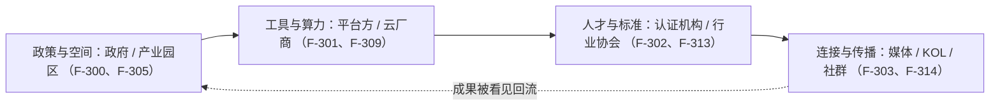

# 生态、认证与合作：四个建设维度、认证体系与四类合作方的框架性邀约

> 本篇对应白皮书第六章与结语（页 27–32）。§6.1–§6.3 为**白皮书观点 + 厂商自述**；§6.4 认证为**厂商自述（截至 2026 年 6 月）**；§6.5 合作模式与结语为**厂商框架性邀约**，是「双方各自提供什么」的邀约框架，**非已达成的合作事实**。核验细节见[核验报告](../references/verification.md)。

## 一、OPC 生态的四个建设维度

白皮书第六章导语称 OPC 的规模化发展不依赖单一产品或单一公司，而是多方参与的生态系统工程（F-298）；并引腾讯研究院类比「有效的变革极少是被规划出来的，组织能自上而下设计的至多是让它生长的土壤」（F-299，**第三方研究口径**，来源 F-308）。四个维度如下（**白皮书观点**）：

| 维度 | 核心命题 | 主要参与方 | 编号 |
| --- | --- | --- | --- |
| 政策与空间 | OPC 在哪里落地？制度保障和物理空间 | 政府 / 产业园区 | F-300 |
| 工具与算力 | OPC 用什么干活？生产基础设施 | 平台方 / 云厂商 | F-301 |
| 人才与标准 | OPC 如何被识别和信任？能力认证 | 认证机构 / 行业协会 | F-302 |
| 连接与传播 | OPC 如何被看见和组队？信息网络 | 媒体 / KOL / 社群 | F-303 |

白皮书主张四层相互依赖：政策提供空间但缺执行工具，工具降低门槛但需人才标准做质量筛选，标准需传播才能形成共识；任何一层缺位都会削减其他层的投入效果（F-304）。

## 二、各维度的核心需求

**政策与空间（白皮书观点）**：政府和园区扮演「土壤提供者」角色（F-305）；核心需求含低成本物理空间（深圳「一桌→一室→一层」全周期体系、朝阳区特色集聚社区，F-305）、算力和场景补贴（智能券/训力券，F-306）、政策确定性（OPC 纳入「十五五」规划，F-307）。

**工具与算力（白皮书观点）**：OPC 对生产工具平台的三个核心需求——**开箱即用**（无需自建技术栈，注册即可使用全套 AI 能力，F-309）、**按量付费**（以 Token 为单位计费，零门槛启动，不需年费承诺，F-310）、**可沉淀资产**（Skill/知识库/工作流可复用、可迁移、可分享，F-311）。白皮书称生产基础设施需多方共建，任何单一平台都无法覆盖所有行业场景（F-312）。

**人才与标准（白皮书观点）**：传统学历、职级、公司背书在 OPC 场景中失效，需要一套新的能力认证体系填补信任缺口（F-313）。

**连接与传播（第三方研究口径）**：腾讯研究院强调成果被看见的关键作用——超级个体的成果必须被看见，看见是传染的前提；案例传播、方法论传播、社群连接三条路径构成 OPC 信息网络（F-314，来源 F-320）。

## 三、WorkBuddy 在生态中的定位

白皮书 §6.3 称 WorkBuddy 定位明确，聚焦**工具层与标准层**，与其他层参与方互补（F-315，**厂商自述**）：

| 层级 | WorkBuddy 的角色 | 具体能力 | 编号 |
| --- | --- | --- | --- |
| 工具与算力 | 全场景 AI 办公工作台 | 专家/助理/Teams 三层能力，覆盖 OPC 全生涯流程 | F-316 |
| 人才与标准 | OPC 从业者认证运营方 | 腾讯云官方背书的认证体系 | F-317 |
| 连接与传播 | 内容与人才连接节点 | KOL 联名、OPC 一人专区、Nova 大使体系 | F-318 |

白皮书称 WorkBuddy 不试图覆盖所有层——政策由政府制定、空间由园区提供、深度传播由媒体和 KOL 完成；平台在工具层和标准层做到深度（F-319）。

## 四、OPC 从业者认证体系

白皮书 §6.4 指出 OPC 模式面临核心信任问题：客户如何评估一个人的真实能力，传统学历、职级、公司背书在 OPC 场景中失效（F-321）；WorkBuddy 推出 OPC 从业者认证（腾讯云官方背书）（F-322，**厂商自述**）：

| 维度 | 设计 | 编号 |
| --- | --- | --- |
| 认证形式 | 在线考试 | F-323 |
| 费用 | 800 元/次（园区合作可申请折扣）⚠️ | F-324 |
| 背书方 | 腾讯云官方证书 + 电子标识 | F-325 |
| 持证人权益 | 进入官方人才池 · 专属社群 · 持续学习资源 | F-326 |

> **⚠️ 费用口径差异（勘误 5）**：白皮书作 **800 元/次**（F-324），核验到的腾讯云认证中心现价为「**¥330（原 ¥600）**」——两口径并列；「园区折扣」「官方人才池」未核到，标注为厂商自述。

认证体系的设计逻辑：为 OPC 从业者提供可验证的能力标准，同时为政府（量化人才指标）、客户（筛选参考）、园区（招商素材）提供各自需要的接口；认证是串联各方合作的枢纽（F-327，**厂商自述**）。

## 五、合作形式（厂商框架性邀约）

白皮书 §6.5 称 WorkBuddy 与四类合作方形成互补关系（F-328）。以下合作模式表**全部为厂商框架性邀约**，保留「双方各自提供什么」的框架性定位，不得读作已达成的合作事实。

### 政府 / 产业园区（F-329、F-330）

| 合作模式 | 园区/政府提供 | WorkBuddy 提供 | 共建成果（白皮书框架） |
| --- | --- | --- | --- |
| OPC 创业基地共建 | 物理空间、入驻政策、招商渠道 | 本地化专家团（财税/注册/政策）、OPC 工具包 | 园区获得招商标杆，平台获得真实场景（F-331） |
| 认证与培训落地 | 培训场地、学员招募、政策补贴通道 | 腾讯云官方认证课程、讲师资源、专属折扣名额 | 园区完成人才培养指标（F-332） |
| OPC 活动共创 | 活动场地、宣传渠道、本地资源 | 活动策划、嘉宾资源、赛事评审体系 | 产业活跃度提升（F-333） |
| 训练营 / 城市行 | 场地、政策讲师、本地媒体 | 课程内容、KOL 嘉宾、专家团演示 | 政策抓手落地（F-334） |
| 区域数据共建 | 区域企业登记数据 | 行业报告、运营画像 | 联名发布区域 OPC 白皮书（F-335） |

### 媒体 / 智库（F-336、F-337）

| 合作模式 | 媒体提供 | WorkBuddy 提供 | 共建成果（白皮书框架） |
| --- | --- | --- | --- |
| 联名研究 | 调研网络、品牌信用 | 数据 + 案例 + 专家访谈 | 联名报告 / 行业榜单（F-338） |
| OPC 案例专访 | 报道版面 | 真实 OPC 用户、独家数据 | 行业影响力（F-339） |
| 行业奖项 / 评选 | 评审平台 | 候选池（KOL / 用户） | 共同定义「AI 超级个体」标签（F-340） |

### KOL / 自媒体（F-341、F-342）

| 合作层级 | WorkBuddy 提供 | KOL 投入 | 共建成果（白皮书框架） |
| --- | --- | --- | --- |
| 联名专家团 | 产品搭建 + 传播资源 | 方法论 IP | KOL 方法论 AI 资产化，平台获得独家内容（F-343） |
| 创作者上架 | Skill/专家上架通道 | 自主搭建产品 | 创作者扩大方法论触达，平台增厚生态（F-344） |
| 体验官 | 体验权限 | 真实测评内容 | 产品口碑积累（F-345） |

### 行业专家 / 生态伙伴（F-346、F-347）

| 合作模式 | 合作方提供 | WorkBuddy 提供 | 共建成果（白皮书框架） |
| --- | --- | --- | --- |
| 行业专家团共建 | 行业 know-how（律所/财税/咨询） | 产品化能力 + 用户触达 | 行业知识 AI 资产化（F-348） |
| Skill 工具方接入 | 工具/API（电子签/企查查等） | 调用入口、用户 | 能力互补，扩大工具覆盖面（F-349） |

## 六、结语

白皮书结语称 OPC 生态建设是多方协作的系统工程：政策提供土壤，工具提供生产力，认证提供标准，传播提供成果被看见的渠道，没有任何一方能独自完成（F-350）；20 多个省市同时投入 OPC 赛道，意味着窗口已经打开（F-351）。结语称当 AI 把执行成本降到趋近于零，判断力、品味与行动力第一次成为个体最稀缺、也最值钱的资产（F-352），并概括路径为从「雇人」到「调度算力」、从一个人到一个人 + 一群 Agent、从单点效率到行业 know-how 的资产化（F-353）；趋势、政策、工具都已就位，缺的不是判断而是协同（F-354）。

**WorkBuddy 定位复述（厂商自述）**：做 OPC 的 AI 工作台，并联合政府、行业专家共建认证体系（F-355）——前者让每一位 OPC 拥有一支 24 小时在线的 AI 团队，后者让 OPC 的能力有了可被识别、可被信任的标尺（F-356）。结语末尾发出公开合作邀约，欢迎政府、产业园区、媒体、KOL、行业专家、工具伙伴一起把超级个体的时代从趋势推成现实（F-357，**合作邀约语汇**）。以上定位与邀约均为厂商自宣，不构成对任何成效或合作的证实。
