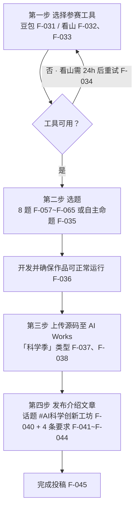

# 参赛路径：选题、执行、评审与退出条件

> **本篇为路径层**，全部为**设计产物**——分析者基于已登记事实推导的行动方案，**不是平台指引**。所有收益数字一律挂 F 编号或标「**待验证**」；源文对获奖概率、参与人数、Token 额度均无任何声明（缺口 G2、G6），因此本篇**零收益承诺**。

## 一、先确认三件事（决策前置）

参赛前必须先接受三个既成事实，否则路径设计无意义：

| 事实 | 依据 | 性质 |
|---|---|---|
| 工具绑定不可协商 | F-047、F-050 | **硬约束**，违反即无资格 |
| 有效作品有形态门槛 | F-047 | **硬约束**，套壳/搬运/无功能一律不算 |
| 获奖是审核后的结果，非提交即得 | F-052、F-053、F-054 | **不确定**，平台保留取消权 |

## 二、选题路径

### 2.1 三个选题入口

| 入口 | 依据 | 适配场景 |
|---|---|---|
| **8 道指定挑战题** | F-057~F-065 | 想借平台的题面降低选题成本 |
| **自主命题** | F-035 | 已有明确科学兴趣或领域积累 |
| **复刻已参赛作品形态** | F-066~F-071 | 已看到可验证的可行形态 |

> 源文对 8 道题**只给标题、不给规格**（无功能要求、无数据要求、无评分标准、无示例产物），所以「按题面做」并不存在标准答案参照——题面提供的是**主题边界**，不是**完成度标准**。

### 2.2 选题的三条筛选准则（洞察/推断）

1. **能否做出「用户不做就不发生」的动作**——对应 F-047 的「实际可体验、可交互或可使用的功能」；
2. **能否在同一形态下覆盖 ≥3 个科学子主题**——8 道题中最接近该结构的是「复原一项中国古代科技」（F-059）与「把科学做成游戏」（F-060），天然容纳多主题；
3. **过程能否留下可举证的截图**——对应 F-051 第三维度与 F-042 的配图要求。

### 2.3 选题矩阵

| 题目（F 编号） | 适配的技术形态 | 已知可参考的参赛形态 |
|---|---|---|
| 如何通俗地理解今年的诺贝尔奖成果（F-058） | 交互式科普馆 / 可滚动数据叙事 | 「诺贝尔奖科学馆，八专题八十页」（F-069） |
| 复原一项中国古代科技（F-059） | 参数可调模拟器 | 「充电站负荷模拟器」类可交互模型（F-068） |
| 把科学做成游戏（F-060） | 游戏化交互 | 「知造科学」含互动游戏形态（F-071） |
| 解释生活中的科学现象（F-061） | 场景化交互 | 需自行设计，源文无参考作品 |
| 文献速读助手（F-062） | 工具型应用 | 无（该主题在检出作品中最少） |
| 同行评审模拟器（F-063） | 工具型应用 + 评审规则 | 无 |
| 学科脉络地图（F-064） | 图谱 / 可视化探索 | 「2048 天体图鉴」「433 爱神星 → 可观测宇宙，17 级 37 数量级」（F-070） |
| 模拟实验室（F-065） | 参数可调实验台 | 无 |
| 自主命题（F-035） | 任意 | 已检出的 6 篇作品中至少 3 篇属此类 |

> 上表右栏是**形态参照**，不是「这样做会获奖」的证据——评审权重未知（F-051 无权重、缺口 G6）。

## 三、执行路径

### 3.1 赛道的硬性差异（先选，再动手）

| 环节 | 豆包赛道 | 看山工作台赛道 | F 编号 |
|---|---|---|---|
| 工具获取 | 下载安装最新版 | 下载 3 个安装包 + **填问卷申请内测权限** | F-031、F-032、F-033 |
| 等待 | 无 | **提交后 24 小时**可尝试使用；仍无权限则退出登录重登 | F-034 |
| 额外权益 | 「优秀内容有机会获得额外资源助推」（无形式声明，缺口 G5） | **参与内测即免费获得海量 Token 额度**（无量化，缺口 G2） | F-019、F-022 |
| 工具稳定性 | 已发布正式版 | **正在内测**（平台自述 F-021、弱旁证 F-074） | F-021 |

> **路径含义**：看山赛道的**时间成本前置**——选它就等于在选题之前先付一整轮「申请 + 等待 + 可能失败」的成本。若时间窗本就紧张（活动仅 23 天，F-008），这一前置成本是路径设计中的实质变量。

### 3.2 四步执行时序

### 3.3 第四步的 4 条硬要求（逐条对照）

| # | 要求 | F 编号 | 自检 |
|---|---|---|---|
| 1 | 原创图文，正文 **≥500 字**，体现真实工具使用过程 / 具体场景 / 创作成果 | F-041 | 字数 + 过程描述 |
| 2 | 配图 **≥3 张**，含工具使用过程截图、AI 作品展示等，清晰且与正文相关 | F-042 | 截图张数 + 相关性 |
| 3 | 将 **AI Works 作品链接嵌入文章内** | F-043 | 链接可点开 |
| 4 | 正文标注「此项目投稿至**豆包专属赛道**」/「此项目投稿至**看山工作台专属赛道**」 | F-044 | 逐字标注 |

> 第 4 条的标注文本**逐字**要求。已检出的参赛作品中，F-066（豆包）、F-067 与 F-070（看山）均检出该逐字标注，可作书写格式参照。

### 3.4 第四步是双轨并行的

第四步的 4 条要求（F-041~F-044）**同时**服务于两个目的，缺一不可：

1. **平台侧**：满足活动说明条件 3（F-049）——带话题发布符合要求的原创介绍文章并标注赛道；
2. **评审侧**：F-051 第三维度「AI 工具的实际使用情况」与弱参考项「互动表现」都只能通过这篇文章体现。

## 四、评审应对路径

规则 1 的四维度（F-051）没有权重（缺口 G6），因此唯一稳健的对冲是**逐项覆盖**：

| 维度 | F 编号 | 可举证材料 |
|---|---|---|
| 功能完整度 | F-051 | 演示视频/截图；作品页可访问 |
| 科学价值 | F-051 | 正文中的科学内容论述（受要求 1 的 500 字约束，F-041） |
| AI 工具实际使用情况 | F-051 | 工具使用过程截图（要求 2 明确要求，F-042） |
| 创新性 | F-051 | 与已有作品的差异点 |
| 互动表现（弱参考） | F-051 | 站内曝光——**不可作为主攻方向**（刷赞属取消资格情形，F-054） |

同时须主动规避 F-054 的五类取消情形：公示期前删除内容、抄袭搬运刷赞、滥用 AI 创作或违反社区规范、活动期间账号违反社区规范、**虚拟手机号账号**。

## 五、收益口径（零承诺）

| 项 | 数值 | 性质 |
|---|---|---|
| 豆包赛道现金奖 | 金奖 5000×1、优秀作品奖 2000×3、创新项目奖 1500×2、潜力项目奖 300×20，合计 **20,000 元** | F-014~F-017、F-083（**名义上限**，非个人可得） |
| 看山赛道现金奖 | 同构，合计 **20,000 元** | F-024~F-027、F-083（**名义上限**） |
| 豆包赛道好礼 | 10 张豆包套餐卡，名义 68 元/张 | F-018（产品名与价格语义失实，勘误见 F-073） |
| 看山赛道好礼 | 小浣熊挑战者徽章 + 小浣熊搪瓷杯 | F-028、F-029（**无数量与面值声明**） |
| Token 额度 | — | **待验证**（无量化口径，缺口 G2） |
| 额外资源助推 | — | **待验证**（无形式声明，缺口 G5） |
| 获奖概率 | — | **待验证**（无参与人数、无权重、无评委信息，缺口 G6） |

> 奖池总额 ≠ 个人收益。26 个名额/赛道（F-083）对应未知参与人数，**个人期望收益不可计算**。

## 六、退出条件

出现下列任一情形时，**停止投入并转向作品本身**（自留作品、自行部署、自行发布是零成本的退路）：

1. 工具不可得——看山内测权限在 24 小时后仍不可用（F-034），或三个安装包链接实际无法走通（F-075，href 不可复核）；
2. 作品形态无法跨过 F-047 的有效性门槛（套壳/无功能/与主题无关）；
3. 时间不足以完成 F-036 的「可正常运行」+ F-038 的「上传源码」+ 4 条投稿要求（F-041~F-044）；
4. 预期收益全部落在「待验证」项上（Token 额度、资源助推、获奖概率均无口径）。

> **退路成本为零**：作品若已做成可运行应用，即便不参赛也可继续使用；源文未规定未获奖作品的任何限制（F-054 的取消情形均指向「作弊/违规/删帖」，不含「未获奖」）。

## 七、时间窗提示

| 时点 | 事项 | F 编号 |
|---|---|---|
| 2026-10-06 | 诺贝尔物理学奖 2026 公布（**早于活动起始 3 天**） | F-078、F-081 |
| 2026-10-09 | 活动开始 | F-008 |
| 2026-10-31 | 活动结束 | F-008 |
| 结束后 20 个工作日内 | 公布获奖名单 | F-055 |
| 名单公布后 20 个工作日内 | 发放奖励 | F-055 |

> 本 bundle 登记时点为 **2026-10-22**，活动窗口内。所有时效相关判断须在 `stale_after: 2026-12-31` 前复核。

风险清单见 [08 · 风险与边界](08-risks-and-boundaries.md)，机制推导见 [06 · 机制洞察](06-mechanism-insights.md)。
