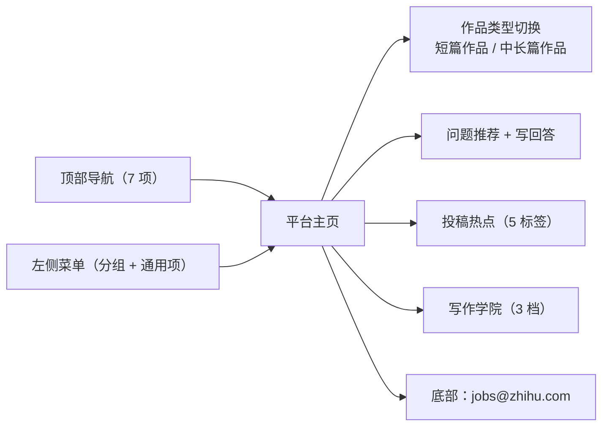

# 01 · 平台功能地图

> 本页登记的是 **2026-10-23 采集时点的界面结构**。平台改版频繁，入口路径须连同采集日期引用（见 [08](08-migration-risk.md)）。

## 一、页面骨架

盐言作者平台主页（`/author-platform/home`）呈三段式布局：**顶部导航条** + **左侧功能菜单** + **右侧内容区**。

## 二、顶部导航七项（F-091）

| 顺序 | 导航项 | 性质 |
|---|---|---|
| 1 | 知乎 | 主站入口 |
| 2 | 盐言作者平台 | 当前平台（作者工作台） |
| 3 | 作者福利 | 权益中心 |
| 4 | 作家专区 | 创作方专区 |
| 5 | 征稿活动 | 活动入口 |
| 6 | 作者维权 | 权益救济入口 |
| 7 | 长篇创作马拉松（NEW） | 长篇赛事入口，带 NEW 标记 |

> **观察**：第 7 项带 `NEW` 标记，说明长篇赛事在该采集时点属平台主推方向；但其页面各板块正文未采集到（见 [08](08-migration-risk.md) 第一节），本包不对其内容作任何断言。

## 三、左侧菜单（F-092~F-094）

### 3.1 分组一：知乎盐言创作者（官方助手）

| 条目 | 说明 |
|---|---|
| 产品公告（盐言创作升级） | 指向本包 S1 手册所述的中长篇创作模块升级（F-001~F-004） |

### 3.2 分组二：福利中心

采集时点下**无可见子项**（F-093）。进入「作者福利」页后展开为**另一套 8 分组体系**（F-100）与 3 张分类卡片（F-101）——两页的分组命名不互通，是本包 I-06 的直接证据。

### 3.3 通用菜单十项（F-094）

| 分类 | 菜单项 |
|---|---|
| 内容运营 | 主页、作品管理、社区故事管理、创作风向 |
| 商业化 | 分发上架、收益管理、合同管理 |
| 账号与规范 | 个人中心、常见问题、创作规则 |

> **未采集**：作品管理、社区故事管理、创作规则、常见问题、合同管理、收益管理六个页面需登录且与账号状态绑定，本次未采集。手册中另有两处交叉引用可作入口线索：F-026（初审通过后前往「盐选作者平台 - 作品管理」按润稿建议修正并再次提交）与 F-028（作品收益可在「收益管理」模块查看）。

## 四、右侧内容区（F-096~F-099）

| 模块 | 内容 | 事实 |
|---|---|---|
| 作品类型切换 | 短篇作品 / 中长篇作品 | F-096 |
| 问题推荐 | 若干知乎问题 + 「写回答」入口 | 采集时点可见 |
| 投稿热点 | 校园甜宠、轻熟男女、多线火葬场、热点改编、被嫌弃的 ta | F-097 |
| 写作学院 | 新人专区、进阶提升、大咖专访 | F-098 |
| 页脚 | 「想来知乎工作？请发送邮件到 jobs@zhihu.com」 | F-099 |

### 4.1 投稿热点标签的结构性观察

5 个标签的**命名维度不一致**：其中「校园甜宠」「轻熟男女」是**题材 + 人群**组合，「多线火葬场」「被嫌弃的 ta」是**叙事结构/情绪设定**，「热点改编」是**来源类型**。这说明平台侧的热度标签不是单一维度分类，而是混合了题材、套路与 IP 改编三类线索；作者按标签选题时需自行判断该标签指向的是「写什么题材」还是「用什么套路」。

### 4.2 写作学院的三档结构

| 档位 | 面向 |
|---|---|
| 新人专区 | 首次在平台创作 |
| 进阶提升 | 已有作品、寻求质量与效率改进 |
| 大咖专访 | 头部作者经验 |

平台在**功能地图层面**把「学习」做成与「创作」并列的入口，这是盐言作者平台区别于泛内容平台的一个信号：创作供给侧被当作需要持续培养的生态位，而非单纯的投稿入口。

## 五、作者福利页的分类结构（S4）

| 层级 | 内容 | 事实 |
|---|---|---|
| 左侧菜单 8 分组 | 认识我们、盐言作者福利、如何赚钱、影响力打造、创作保障、官方有话说、管理规范、联系我们 | F-100 |
| 正文 3 张分类卡片 | 作品收益、影响力打造、作者品牌 | F-101 |
| 页脚 | 「开始创作」按钮 | F-102 |

> **⚠️ 缺口**：具体权益条目的额度、门槛与发放规则**在采集时点未渲染**（F-103），本包**不含任何权益数值**。主页侧「福利中心」分组为空（F-093）与本页 8 分组体系并置，说明该入口经历过改版重排。

## 六、平台功能地图对创作者的三条含义

1. **创作链路与运营链路分离**：左菜单把「作品管理/合同管理/收益管理」并列，说明签约、履约、结算三条是**独立于内容创作的功能域**；新作者极易只关注前者而忽略后者。
2. **「创作风向」被提升为一级菜单**：选题信号不是附属功能而是核心入口（详见 [05](05-creation-direction.md)）。
3. **福利与规则分区治理**：「创作保障 / 管理规范 / 联系我们」构成一个从保障到约束的连续谱（详见 [07](07-rights-compliance.md)）。

## 关联

- 创作链路的具体操作 → [02 · 中长篇创作五步流程](02-creation-workflow.md)
- 选题信号的使用 → [05 · 创作风向与选题信号](05-creation-direction.md)
- 入口漂移与复核 → [08 · 平台演进与迁移风险](08-migration-risk.md)
