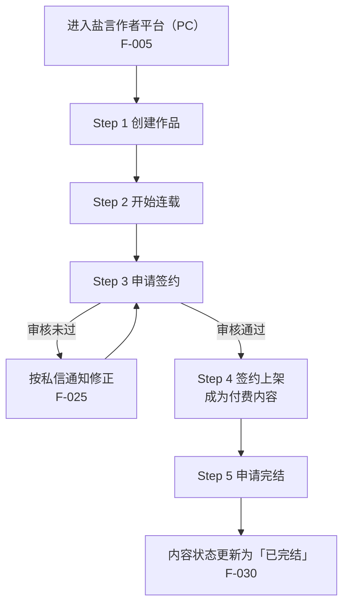
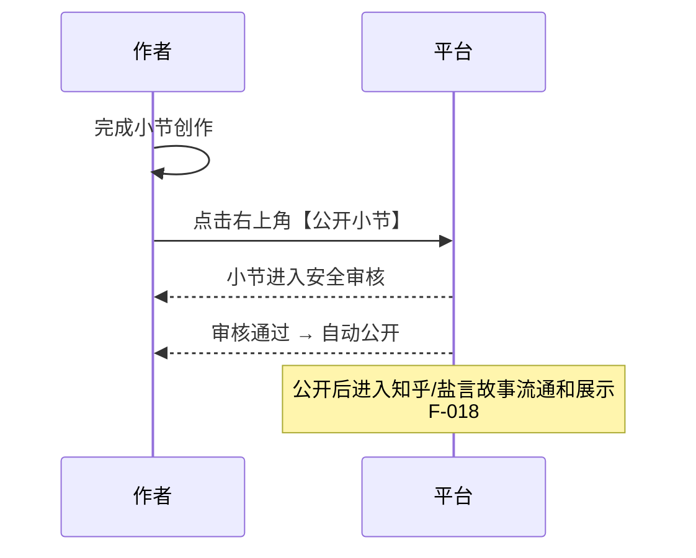

# 02 · 中长篇创作五步流程

> 本页逐步拆解官方手册（S1）给出的流程。**引号内为官方口径**，其余为流程化解读。

## 流程总览

官方表述的五步为：「创建作品 → 开始连载 → 申请签约 → 签约上架 → 申请完结」（F-006）。

---

## Step 1 · 创建作品（F-007~F-015）

### 1.1 篇幅选择

「进入 盐选作者平台 点击【创建作品】，选择【短篇/中篇/长篇】」（F-007）。三档篇幅的门槛差异见 [03](03-signing-finalization.md)。

### 1.2 信息填写：封面（本步骤新增能力，F-003）

封面有两条路径：

| 方式 | 机制 | 约束 |
|---|---|---|
| 模板封面 | 「模版封面将根据你的笔名和作品名称自动生成」（F-009） | 无自动生成约束 |
| 本地上传 | 「本地上传封面：不支持自动生成作品名等信息」（F-010） | 「请确保上传的封面/素材/资料等合法合规，满足权利需求及平台规则，如有违反，平台将删除、替换相关内容，并保留进一步追责的权利」（F-011） |

> **流程含义**：模板封面把「权利风险」转移给平台（平台用笔名与作品名自动合成），本地上传则把风险留在作者侧（F-011）。手册特别提示「为了确保你的作品封面图生成效果符合预期，请你准确填写作品信息」——封面生成质量与作品信息准确度直接挂钩。

### 1.3 信息填写：金句描述

「金句描述将在作品详情页展示，建议填写能体现作品亮点、吸引读者的句子」（F-012）。这是详情页唯一的**作者可控文案位**，是曝光转化（见 [04](04-exposure-display.md)）的最小成本抓手。

### 1.4 内容编辑：两条来源路径

| 选择 | 适用条件 | 机制 |
|---|---|---|
| 在线创作 | 「若你未在知乎站内发表过「回答」或「文章」」（F-013） | 在编辑器内新写 |
| 知乎内容投稿 | 「若你已在知乎站内以「回答」或「文章」的形式发布了作品」（F-014） | 「你的内容将自动同步至编辑器内」 |

> **流程含义**：这是把知乎站内既有内容**迁移进盐言体系**的官方通道。已发表的回答/文章可一键转为中长篇作品，无需重录。

### 1.5 AI 校对（本步骤新增能力，F-004）

「你可自行对每个小节进行校对，系统会帮你检测出需要优化的内容（例如：标点、格式、错别字等），你可按照实际情况的修改」（F-015）。

三点特征：**逐节触发**（非全书批改）、**检测范围限于表层**（标点/格式/错别字）、**修改权在作者**（系统不自动改写）。其合规边界见 [07](07-rights-compliance.md) 的 AI 红线章节。

---

## Step 2 · 开始连载（F-016~F-020）

### 2.1 小节字数

「小节字数在 2000-8000 字」（F-016）。这是**单节的硬区间**，与作品总字数门槛是两套独立参数。

### 2.2 公开小节：审核闸门

要点（F-017~F-019）：
- 点击「右上角【公开小节】」触发；
- 小节进入**安全审核**，审核通过后**自动公开**（无需二次确认）；
- 公开**之前**需完善作品信息。

### 2.3 连载节奏

「持续更新小节进行内容连载，建议按照固定的频率公开小节，这有助于培养读者的阅读习惯」（F-020）。

> **流程含义**：官方点名了更新频率（F-020，措辞为「建议」），但**平台并未表述**更新频率与频道排序或推荐位之间的因果关系（推断，无 F 支撑）。它是平台倡导，不是准入门槛。

---

## Step 3 · 申请签约（F-021~F-026）

| 维度 | 中篇 | 长篇 |
|---|---|---|
| 申签字数 | 需 > 3w 字（F-021） | 需 > 1.5w 字（F-023） |
| 完稿要求 | 「要求完稿后申请签约」（F-021） | 「支持未完结申签投稿」（F-023） |
| 审核对象 | 「平台会对作品完整性进行审核」（F-021） | 「平台会对作品进行审核」（F-023） |
| 公开节奏 | 「申签时并不强制要求对读者公开所有小节内容，作者可灵活安排公开节奏」（F-022） | 同左（F-022 位于中篇条目，长篇未单列） |

操作与反馈（F-024~F-026）：
1. 「请核实作品信息内容无误后，点击申请签约」（F-024）；
2. 「无论通过与否，你会在知乎收到私信通知」（F-025）；
3. 「如作品通过初步审核，请前往盐选作者平台-作品管理根据润稿建议进行修正后再次提交」（F-026）。

> **流程含义**：签约是一条**可回退的循环**（初审通过 → 按润稿建议修正 → 再次提交），而非一次性闸门。新作者常忽略第 3 步，把初审通过当终点。

---

## Step 4 · 签约上架（F-027~F-028）

- 「完成签约的作品将作为付费内容在知乎/盐言故事进行流通」（F-027）；
- 「作品收益可在「收益管理」模块查看」（F-028）。

> **⚠️ 零承诺**：手册未披露任何分成比例、结算周期或金额。本包不含任何收益数字。

---

## Step 5 · 申请完结（F-029~F-030）

「为了保证读者阅读体验，若你已完成全部内容连载，请及时点击「申请完结」，完结的作品将会对读者展示「已完结」」（F-029 前言）。

完结要求（F-029）：
- 中篇字数需达 **3w 字以上**；长篇字数需达 **10w 字以上**；
- **且所有小节为已公开状态**。

完结操作（F-030）：中篇与长篇点击「申请完结」后，内容自动更新为「已完结」状态。

> **⚠️ 双重条件**：「字数达标」与「全部小节已公开」是**并列**条件。只写完但留着草稿章节，会卡在完结闸门外。

---

## 五步流程的三条易错点汇总

| # | 易错点 | 官方依据 |
|---|---|---|
| 1 | 用「申签字数」当作「完结字数」 | F-021/F-023（申签 3w / 1.5w）≠ F-029（完结 3w / 10w） |
| 2 | 以为「申请签约」= 签约成功 | F-024 是申请动作；结果经私信通知（F-025）；初审通过后还要复提（F-026） |
| 3 | 以为完结只看出字数 | F-029 要求「所有小节为已公开状态」 |

## 关联

- 闸门判定与分支路线 → [03 · 签约与完结的闸门与反馈链](03-signing-finalization.md)
- 曝光与展示规则 → [04 · 曝光与作品展示渠道](04-exposure-display.md)
- 活动路径下「申请签约」的**另一种语义** → [06 · 征稿活动规则解剖](06-campaign-rules.md) 与 I-02
