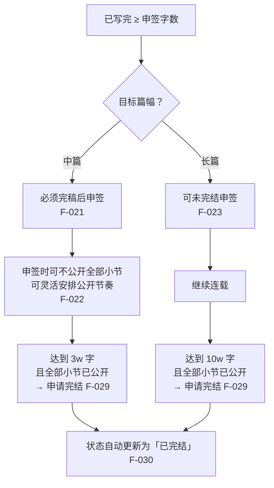
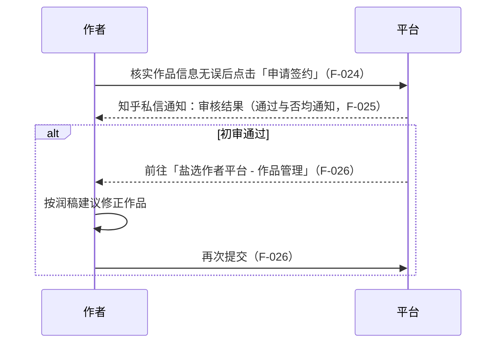
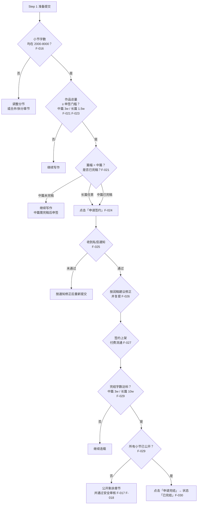

# 03 · 签约与完结的闸门与反馈链

> 本页把 [02](02-creation-workflow.md) 的流程描述转成**可判定的闸门**。所有数值均挂 F 编号。

## 一、双字数闸门对照表

| 篇幅 | 申签字数门槛 | 申签时是否要求完稿 | 完结字数门槛 | 完结附加条件 | 依据 |
|---|---|---|---|---|---|
| 中篇 | > 3w 字 | **是**（「要求完稿后申请签约」） | ≥ 3w 字 | 所有小节已公开 | F-021、F-029 |
| 长篇 | > 1.5w 字 | **否**（「支持未完结申签投稿」） | ≥ 10w 字 | 所有小节已公开 | F-023、F-029 |
| 短篇（活动口径） | 不适用 | — | 活动字数区间 8000–3w 字（参赛条件，非完结条件） | 按活动细则 | F-045 |

### 1.1 三点判读

**（1）长短篇的分歧点不在「开始」，在「收尾」。** 申签门槛上长篇（1.5w）低于中篇（3w），完结门槛上长篇（10w）远高于中篇（3w）。长篇路线允许「先上车后补票」，中篇路线要求「一气呵成」。

**（2）「申签字数」与「完结字数」是独立参数，不可互相代入。** 以长篇为例，申签只需 1.5w 字即可提交，但完结需要 10w 字且全部小节公开——中间存在 **8.5w 字的未公开运行区间**，这段区间里的作品处于「已签约、付费流通、但不可完结」的状态。

**（3）完结是双条件与条件（AND）。** F-029 的两个分句是并列的：字数达标 **且** 所有小节为已公开状态。只写完而留着未公开章节，不构成完结。

### 1.2 小节字数是第三个独立参数

| 参数 | 值 | 作用域 | 依据 |
|---|---|---|---|
| 小节字数 | 2000-8000 字 | 单个章节 | F-016 |
| 申签字数 | 中篇 >3w / 长篇 >1.5w | 作品总量 | F-021、F-023 |
| 完结字数 | 中篇 ≥3w / 长篇 ≥10w | 作品总量 | F-029 |

三者的换算关系：小节下限 2000 字意味着**最少小节数** = ⌈申签字数 ÷ 8000⌉（用上限装载最省事，语义上也是「按固定频率公开小节」F-020 的前提）。

## 二、公开节奏分支

**中篇的隐含约束**：F-021 要求完稿后申签，F-022 又允许申签时不公开全部小节，F-029 要求完结时全部小节已公开。合起来的中篇路径是：**写完全书 → 申签（可只公开部分章节）→ 逐步公开剩余章节 → 全部公开后申请完结**。作者若误以为「申签时没公开的章节可以永远不公开」，会在完结闸门处被卡住。

**长篇的隐含约束**：申签可早，但每章公开都要过安全审核（F-017、F-018）。长篇的完结风险不在字数，而在**章节审核的连续性**——任意一章审核未过，「所有小节已公开」即不成立。

## 三、审核与润稿复提循环

**循环特征**：

| 特征 | 依据 |
|---|---|
| 结果一律走知乎私信 | F-025 |
| 初审通过**不等于**完结，触发一次修正+复提 | F-026 |
| 复提入口在「作品管理」，不是「创建作品」 | F-026 |
| 手册未披露复提次数上限与时限 | —（口径缺口） |

> **⚠️ 口径缺口**：F-026 提到「根据润稿建议进行修正后再次提交」，但官方未说明**修正轮次上限、每次间隔、多次未过的后果**。本包不推测该行为，仅提示：把复提视为可能多轮的循环，排期时预留缓冲。

## 四、可执行的闸门判定流程

## 五、常见误判速查

| 误判 | 纠正 | 依据 |
|---|---|---|
| 「申签通过 = 作品已上架」 | 申签通过后仍需按润稿建议修正并复提，上架发生在 Step 4 | F-026、F-027 |
| 「长篇门槛更高，所以起步更难」 | 长篇申签门槛（1.5w）低于中篇（3w）且允许未完结投稿 | F-023 |
| 「写完就能完结」 | 完结还要求所有小节已公开 | F-029 |
| 「中篇申签时可以不公开章节，那章节可以留着」 | 完结时必须全部已公开 | F-022 + F-029 |
| 「审核结果会显示在作品管理里」 | 审核结果通过知乎私信通知 | F-025 |

## 六、未通过时的兜底动作

| 失败点 | 判定依据 | 下一步动作 | 官方未披露项（口径缺口） |
|---|---|---|---|
| 审核未通过 | 收到知乎私信通知，告知审核未通过 | 按私信通知修正作品后重新提交 | 未披露审核未通过的具体理由构成、申诉入口与重试时限（F-025） |
| 复提被再次退回 | 已按润稿建议修正并再次提交后，仍收到未通过通知 | 再次前往「盐选作者平台 - 作品管理」按最新润稿建议修正后提交 | 未披露修正轮次上限、每轮间隔与多次未过的后果（F-026） |
| 完结字数不达标 | 作品总字数未达中篇 3w / 长篇 10w | 继续连载补足字数（单节仍须 2000-8000），达标后再申请完结 | 未披露字数统计口径（是否计入标题、标点等非正文内容）（F-029、F-016） |
| 全部小节未公开 | 仍有小节未通过安全审核或未公开 | 对未公开小节逐节修正并点击「公开小节」，待其自动公开后重试完结 | 未披露安全审核标准、单节审核时效与未通过原因说明（F-017、F-018、F-029） |

> **⚠️ 口径缺口**：四类失败点的**下一步动作**均可由 F 编号推出，但**失败原因构成、次数上限、时限与申诉路径官方均未披露**。本包不推测这些行为，排期时按「可重复提交」预留缓冲。

## 关联

- 逐步操作 → [02 · 中长篇创作五步流程](02-creation-workflow.md)
- 活动路径下的参赛成立条件 → [06 · 征稿活动规则解剖](06-campaign-rules.md)
- 排期模板 → [examples/02 中长篇连载排期表](../examples/02-longform-schedule.md)
- 相关洞察 → I-01、I-02
