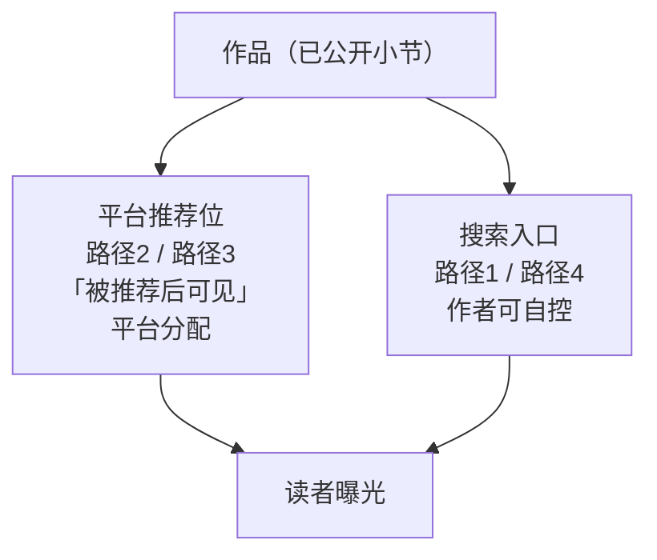
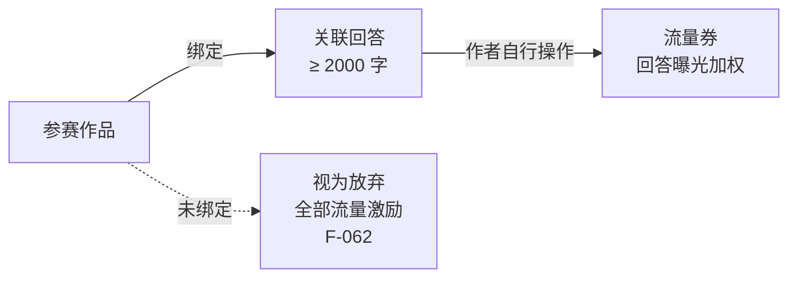

# 04 · 曝光与作品展示渠道

> 本页拆解作品的**被看见路径**。核心区分：**作者可自控的「可被搜到」** 与 **平台分配的「被推荐后可见」**。

## 一、四条展示路径（官方口径，F-031~F-034）

| # | 路径 | 可见性条件 | 依据 |
|---|---|---|---|
| 1 | 知乎 App / 盐言 App → 搜索作品名称 | 无附加条件 | F-031 |
| 2 | 知乎 App（最新版本）→ 故事 → 中长篇 → 最新更新 | **被推荐后可见** | F-032 |
| 3 | 盐言 App（最新版本）→ 发现/女频/男频 → 分类 → 中长篇 | **被推荐后可见** | F-033 |
| 4 | 盐言 App/知乎 App → 搜索作者昵称 → 作品/盐言故事 | 查看**公开作品** | F-034 |

## 二、「被推荐后可见」的三点判读

**（1）搜索是唯一的无条件入口。** F-031 与 F-034 都没有附加条件，而 F-032、F-033 明确带「被推荐后可见」。作者的行为杠杆集中在：作品名与作者昵称的**可检索性**。

**（2）路径 2 的末级菜单名为「最新更新」（F-032），F-020 建议「按照固定的频率公开小节」并称其「有助培养读者的阅读习惯」。** 平台**并未表述**更新频率与频道排序之间的因果关系（推断，无 F 支撑）。

**（3）路径 4 只展示「公开作品」。** 这与完结闸门的状态条件（F-029「所有小节为已公开状态」）是同一套公开状态在展示侧的体现——**未公开的内容不会出现在任何展示路径中**，包括作者自己的个人主页。

## 三、作者可自控的四个曝光杠杆

| 杠杆 | 官方依据 | 操作要点 |
|---|---|---|
| 作品名与作者昵称 | F-031、F-034 | 搜索命中依赖名称；昵称在个人主页路径中是检索入口 |
| 金句描述 | F-012 | 详情页唯一的作者文案位，直接影响搜索点击后的转化 |
| 固定更新频率 | F-020 | 官方建议按固定频率公开小节（有助培养读者的阅读习惯） |
| 小节字数落在 2000-8000 | F-016 | 单节过短过长的内容形态与阅读节奏 |

> **不可控项**：是否进入频道推荐位由平台分配，本包不对其做任何可预测性承诺。

## 四、活动侧的另一条曝光路径：流量券（F-061~F-064）

在征稿活动中，平台另设**流量券**机制。其规则与作品曝光是**两套体系**：

| 条款 | 内容 | 依据 |
|---|---|---|
| 作用对象 | 「流量券可用于**回答**曝光加权」 | F-061 |
| 适用条件 | 回答字数 ≥ 2000 字且内容质量达标、不违反平台规则与法律法规、不侵犯第三方权利 | F-061 |
| 强制绑定 | 「只有回答才可以使用流量券。参与活动作品未绑定回答的，则无法获得本活动内的任何流量扶持，**视为您放弃所有流量激励**」 | F-062 |
| 操作方 | 「流量券需**作者自行操作使用**」 | F-063 |
| 绑定范围 | 「仅可用于参与活动作品关联的回答」 | F-063 |
| 多回答处理 | 「如一部作品关联了多个回答，平台将选取其中一个回答进行发放」 | F-063 |
| 使用教程 | 指向《盐选速递｜10-12 月「大动作」盘点 - 02 大额流量券助力无忧创作》 | F-064 |

> **三点判读**：
> 1. 流量券加码在**回答**上，不在作品上——参赛小说本身不因此获得流量；
> 2. **绑定是前置条件而非加分项**：未绑定不是「少拿一点」，而是「全部放弃」（F-062）；
> 3. 多回答时平台只挑一个发放（F-063），因此绑定前需确定**希望流量落在哪一篇回答**上。

## 五、曝光机制的三层结构小结

| 层 | 机制 | 可控性 |
|---|---|---|
| 检索层 | 作品名/昵称搜索、作者个人主页 | **作者可控**（F-031、F-034） |
| 分发层 | 频道推荐位（知乎故事-中长篇、盐言发现/分类-中长篇） | 平台分配，需「被推荐」才可见（F-032、F-033） |
| 活动层 | 流量券 → 回答曝光加权 | 需作者主动绑定 + 自产 ≥2000 字回答（F-061~F-063） |

## 关联

- 更新频率的官方建议 → [02 · 中长篇创作五步流程](02-creation-workflow.md) Step 2
- 活动侧完整规则 → [06 · 征稿活动规则解剖](06-campaign-rules.md)
- 相关洞察 → I-03
