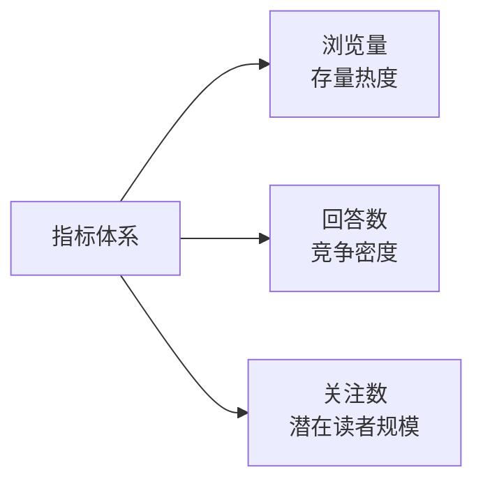

# 05 · 创作风向与选题信号

> 本页登记平台提供的**选题信号来源**及其使用纪律。

## 一、创作风向页的结构（S5）

页面地址：`https://www.zhihu.com/author-platform/home/creative-direction`（F-104）。

### 1.1 三个标签页（F-105）

| 标签页 | 采集时点的呈现 | 说明 |
|---|---|---|
| **高热问题** | 「故事领域近 7 天浏览量蹿升最快的 top50 问题打包放送」 | 平台自述的信号口径：7 天窗口 + 浏览量增速排序 + top50 截断（F-106） |
| **投稿热点** | 见 1.3 | 与主页「投稿热点」模块同名 |
| **手哥提问** | 采集时点未展开 | 「手哥」是平台官方助手形象（另见 F-035 的「联系手哥」） |

### 1.2 高热问题的三项数据指标（F-107）

每条问题附带：**浏览量、回答数、关注数**。

> **使用判读**：三个指标刻画的是**不同侧面**，不是同一件事的三次测量。
> - 「浏览量」高但「回答数」也高 → 该问题已被充分竞争，新作者进入成本高；
> - 「浏览量」高、「回答数」低 → 供需缺口相对明显；
> - 「关注数」高 → 问题本身的读者池大，但「关注」是问题级而非作品级指标。
>
> 这些是**选题层面的判断依据**，不是收益预测；本包不对任何流量或收益作承诺。

### 1.3 投稿热点标签（F-097）

平台主页「投稿热点」模块列出 5 个标签：校园甜宠、轻熟男女、多线火葬场、热点改编、被嫌弃的 ta。

**结构性观察**：这 5 个标签不在同一分类维度上——「校园甜宠」「轻熟男女」是题材×人群组合，「多线火葬场」「被嫌弃的 ta」是叙事结构/情绪设定，「热点改编」是来源类型（改编自既有 IP 或热点事件）。**标签本身不告诉你它约束的是「写什么」还是「怎么写」**，使用前需逐个回原页面确认其口径。

### 1.4 主页的其他选题相关模块

| 模块 | 内容 | 事实 |
|---|---|---|
| 作品类型切换 | 短篇作品 / 中长篇作品 | F-096 |
| 问题推荐 | 若干知乎问题 + 「写回答」入口 | 采集时点可见 |
| 写作学院 | 新人专区、进阶提升、大咖专访 | F-098 |

## 二、作者福利页与选题的关系（S4）

福利页的 8 个分组中，「如何赚钱」「影响力打造」两组（F-100）与内容侧的选题-曝光-转化链条相关；正文另有 3 张卡片式分类入口——作品收益、影响力打造、作者品牌（F-101），其中「影响力打造」「作者品牌」与投稿热点标签属同一关注面：作者个人信号的经营。

> **归因提示**：「作者品牌」是福利页正文的卡片式分类入口（F-101），**不在** 8 个菜单分组（F-100）之列。

> **⚠️ 缺口**：具体权益条目与额度未渲染（F-103），本包不含任何权益数值。

## 三、平台提供的选题信号全景

| 信号源 | 粒度 | 数据维度 | 事实 |
|---|---|---|---|
| 创作风向 · 高热问题 | 50 个问题 | 浏览量 / 回答数 / 关注数 | F-106、F-107 |
| 创作风向 · 投稿热点 | 标签级 | 无量化 | F-097 |
| 创作风向 · 手哥提问 | 未采集 | — | F-105 |
| 主页投稿热点 | 标签级 | 无量化 | F-097 |
| 写作学院 | 课程/视频级 | 无量化 | F-098 |

## 四、选题信号的使用纪律

1. **信号 ≠ 指令。** 平台给出的是「近 7 天浏览量蹿升最快」这类**已发生的需求侧统计**（F-106），它描述过去一周，不承诺未来表现。
2. **先确认标签维度。** F-097 的 5 个标签跨维度混用，套用前须逐个确认其约束对象。
3. **热问题 ≠ 中长篇入口。** 高热问题是**问题**（知乎问答的选题形态）；中长篇是**作品**形态。二者之间存在形态转换环节——这正是 [04](04-exposure-display.md) 中「问题推荐 + 写回答」与 F-014「知乎内容投稿」两条路径的分工所在。
4. **时效衰减快。** 7 天窗口的信号在一周后即失去参考价值；本包不复述 TOP50 清单（体量大且瞬时失效），只登记机制（F-106、F-107）。

## 关联

- 从问题到作品的形态转换 → [02](02-creation-workflow.md) Step 1.4（F-013、F-014）
- 作品成型后的曝光 → [04](04-exposure-display.md)
- 平台界面整体 → [01 · 平台功能地图](01-platform-map.md)
