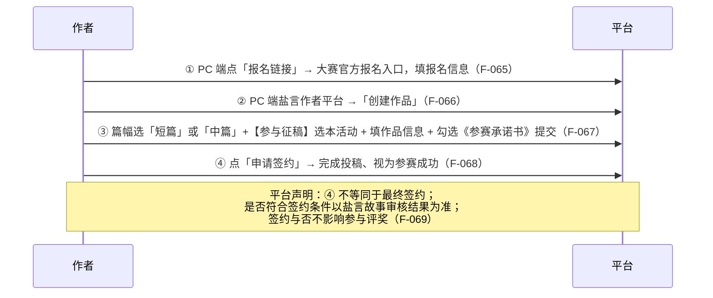

# 06 · 征稿活动规则解剖

> **样本声明**：本页以采集时点（2026-10-23）`/author-platform/home/activity` 展示的**「津派文化」主题征文活动**为样本（落地页 `zhuanlan.zhihu.com/p/2076317014629380728`）。这是**一个活动的完整解剖**，不是通用规则模板——换活动时各项数值与条款均需重新核对。活动自身截止于 **2026-10-25 24:00**（F-038），其获奖名单与奖金发放不在本包范围。

## 一、活动定位与主办结构（F-037~F-042）

| 维度 | 内容 | 事实 |
|---|---|---|
| 活动名称 | 「津派文化」主题征文活动 | F-037 |
| 所属大赛 | 「AI 上天津」网络精品共创邀请赛 **第二赛道 · 原创网络小说赛道** | F-039 |
| 时间 | 即日起 – 2026 年 10 月 25 日 24:00 | F-038 |
| 指导 | 中央网信办网络传播局、天津市委宣传部 | F-040 |
| 主办 | 天津市委网信办、天津市文化和旅游局、天津市教委、天津市科技局、天津市人社局、天津市商务局、共青团天津市委 | F-041 |
| 媒体支持 | 人民网 | F-042 |
| 平台角色 | 知乎作为大赛**协办单位**发布该赛道 | F-042 |

> **注意**：大赛主题为「AI 上天津」，但本赛道**坚持真人原创**（F-043）——赛道属性由主办方设定，平台只是发布方。规则解读时须区分「大赛主题」与「赛道要求」。

## 二、创作要求（F-045~F-049）

### 2.1 字数门槛

| 篇幅 | 区间 | 表述 |
|---|---|---|
| 短篇 | 8000 字（含）至 3 万字（不含） | F-045 |
| 中篇 | 3 万字（含）至 10 万字（不含） | F-045 |

「如不符合字数要求，无法参与评奖」（F-045）。

> **与平台闸门的关系**：本活动的字数区间与手册的申签/完结门槛是**两套参数**——活动以「参赛区间」定义资格（[03](03-signing-finalization.md)），手册以「申签门槛 / 完结门槛」定义流程。参赛区间落在两者之间并不矛盾，但作者须同时满足活动区间与手册闸门。
>
> **⚠️ 边界相冲**：活动的中篇下界为「3 万字（含）」（F-045），而手册的申签门槛为「**大于** 3w 字」（F-021）——**恰好 30000 字满足活动字数区间却不满足申签门槛**。参赛排期须在 3 万字之上留出余量。

### 2.2 八大创作方向（F-046）

「本次征文立足天津河海、红色、工商、建筑、民俗、演艺、文博、休闲八大津派文化资源，**任选方向、自由选题**。」

### 2.3 参考元素（F-047~F-049）

| 层级 | 内容 | 事实 |
|---|---|---|
| 文化维度举例 | 河海文化 / 工商文化 / 民俗文化 / 演艺文化 / 休闲文化 | F-047 |
| 代表性元素 | 三岔河口、大直沽、元明清十四仓漕运遗址、古盐滩、漕运漕船、盐商、海河摆渡船、杨柳青木版年画、泥人张彩塑、风筝魏、刻砖刘、津门姑爷节、葛沽宝辇、津派相声、京韵大鼓、天津时调、天津快板、广东会馆、津湾小剧场、古文化街相声茶馆、海河夜游、茶馆听曲、老城庙会游园、海河边垂钓、澡堂听书、天津之眼、海河城市阳台 | F-048 |
| 创作切入点 | 家族兴衰、码头情义、民国劝业场售货员、老字号新生代、年轻手艺人、葛沽宝辇庙会、茶馆相声学徒、京韵大鼓老艺人、外地青年定居天津、滨江文创街区创业者 | F-049 |

> **使用判读**：官方措辞是「可参考以下元素，**也可自行查阅相关资料**，挖掘其他真实存在的元素进行创作」——元素清单是**示例**而非**白名单**。但「所有参赛作品，均必须符合本次活动主题要求，如不包含或关联性较弱，无法参与任何评奖」（F-046 附注）——这是**关联性门槛**。

## 三、奖项结构（F-050~F-052）

| 奖项 | 名额 | 金额 | 附加定义 |
|---|---|---|---|
| 一等奖 | 1 名 | 20000 元/部 | — |
| 二等奖 | 2 名 | 10000 元/部 | — |
| 三等奖 | 3 名 | 5000 元/部 | — |
| 开发潜力奖 | 5 名 | 3000 元/部 | 「具备影视、短剧、漫剧改编落地价值的优质原创小说」 |
| 新人奖 | 5 名 | 2000 元/部 | 「活动期间，首次（带本次活动标签）投稿的作品」 |

- 名额合计 16 名；F-050 为活动方公布口径，**发放条件见 F-076、F-077**。
- 「开发潜力奖」的判定指向**改编落地价值**，与 [07](07-rights-compliance.md) 的 IP 开发池条款（F-078）相呼应。
- 「新人奖」的判定绑定**首次带该活动标签投稿**——标签机制由此成为资格凭据。

## 四、评选说明 6 条（F-053~F-059）

| # | 条款要点 | 事实 |
|---|---|---|
| 1 | 「作品数据是评选参考维度之一，但不直接决定获奖结果。天津元素的数量不等同于融合质量，评审将重点考察相关元素是否自然进入故事、是否对人物和情节产生作用」 | F-054 |
| 2 | 故事与天津存在明确关联，天津可以是故事发生地、人物家乡、职业背景、情节线索或精神归属 | F-055 |
| 3 | 相关内容应自然融入故事，不以集中罗列地名、景点或物产代替文学表达 | F-056 |
| 4 | 涉及真实历史、非遗、地理、机构及现代企业的信息，应尊重基本事实；文学虚构部分不得以确定史实的方式误导读者 | F-057 |
| 5 | 仅在标题、人物籍贯或个别段落中出现「天津」地名，可满足基础地域关联要求，但不视为充分的文化融合，在评选中不具有明显优势 | F-058 |
| 6 | 评审委员会由赛事组委会特邀央媒资深媒体人、津派文化文博专家、平台内容评审代表、文化产业投资机构代表等组成 | F-059 |

### 4.1 评审结构的四线并行（F-059）

| 委员构成 | 隐含评判维度 |
|---|---|
| 央媒资深媒体人 | 叙事质量、传播性 |
| 津派文化文博专家 | 文化准确性与融合质量 |
| 平台内容评审代表 | 平台创作规范与阅读体验 |
| 文化产业投资机构代表 | 改编落地与商业潜力 |

这解释了 F-051「开发潜力奖」的设立依据，也解释了 F-054 把「数据」降级后改用「元素是否对人物和情节产生作用」作为主判据。

## 五、六条负面情形（F-060）

「以下情况将影响文化融入维度的评价」：

| # | 情形 | 性质 |
|---|---|---|
| 1 | 只在标题或正文中简单出现「天津」地名，删除后不影响故事 | 关联性不足 |
| 2 | 集中罗列景点、美食或非遗名称，但与人物和情节无关 | 罗列代替叙事 |
| 3 | **将其他城市的通用故事直接替换为天津地名** | 套壳 |
| 4 | 虚构地方习俗、历史事件或城市数据，却未注明文学演绎 | 事实失真 |
| 5 | 使用真实企业、机构或人物名称编写违法、负面或争议情节 | 名誉与合规 |
| 6 | 对天津形成明显贬损、刻板化或事实失真的表达 | 价值导向 |

> **判读**：这 6 条是一张**反向自查表**。第 3 条最具区分度——它把「地域标签化」明确列为负面情形，与 F-058 相互印证。

## 六、流量激励（F-061~F-064）

详见 [04 · 曝光与作品展示渠道](04-exposure-display.md) 第四节。要点：作用对象是**回答**（≥2000 字）、需作者自行绑定、未绑定视为放弃全部流量激励、多回答时平台只挑一个发放。

## 七、参与方式 4 步（F-065~F-069）

**参赛成立的三个条件**（合读）：F-045（字数落在区间）+ F-067（选对篇幅与活动标签 + 勾选承诺书）+ F-068（点击「申请签约」）。

> **⚠️ 语义陷阱**：这里的「申请签约」是**投稿动作**，与手册 Step 3 的签约申请**不是同一语义**（详见 I-02）。

## 八、活动细则 8 条（F-070~F-077）

| # | 要点 | 事实 |
|---|---|---|
| 1 | 短篇与中篇小说征稿；需贴合征文主题；须为本人独立创作、未发布过、非 AI 创作 | F-071 |
| 2 | 详尽阅读《活动承诺书》，参加即视为已充分阅读并同意 | F-072 |
| 3 | 字数要求（同 F-045） | F-045 |
| 4 | 活动作品必须以简体中文写作，体裁为小说 | F-070 |
| 5 | 该活动需要报名，需按规定「参与方式」参加 | F-073 |
| 6 | 不限制参与活动作品数，一位作者可创建多部作品参与 | F-074 |
| 8 | 须符合国家法律法规与行业管理规范，内容健康向上、格调积极昂扬；不得含历史虚无主义、低俗媚俗、拜金炫富、畸形婚恋观、暴力复仇、封建迷信、软色情擦边等不良价值导向；不得侵害未成年人合法权益；不得含侵权、抄袭、洗稿等情形；题目、语言文字和表达方式须符合国家通用语言文字规范、网络文学和微短剧相关管理要求 | F-075 |
| 9 | 按要求完结并完成投稿后可参与评奖；「为免疑义，**数据不是唯一标准**」；奖金在活动结束且评奖结果公布后发放，具体日期以主办方通知为准；奖金均为**税前金额**，由组委会发放并依法办理个人所得税扣缴申报；获奖者须按要求在规定时间内提交身份及账户信息 | F-076 |
| 9（补充） | **作品未按活动要求完结并完成投稿的，组委会有权取消评选资格，不再发放奖金** | F-077 |

> **编号缺口**：原文细则编号为 1、2、3、4、5、6、8、9，**无第 7 条**（F-070）。这是源文的编号跳号，非本包转录遗漏。

> **与手册闸门的合读**：F-076/F-077 要求「按活动要求完结」，即参赛作品还须通过手册的完结闸门（字数达标 + 全部小节已公开，F-029）。**活动资格是叠加在平台流程之上的第二层**，两道闸门都要过。

## 关联

- 参赛前逐项核对 → [examples/01 投稿前合规自查表](../examples/01-pre-submission-checklist.md)
- 是否值得参赛 → [examples/03 参赛决策树](../examples/03-campaign-decision.md)
- AI 红线与授权条款 → [07 · 权利、合规与 AI 红线](07-rights-compliance.md)
- 相关洞察 → I-02、I-05
