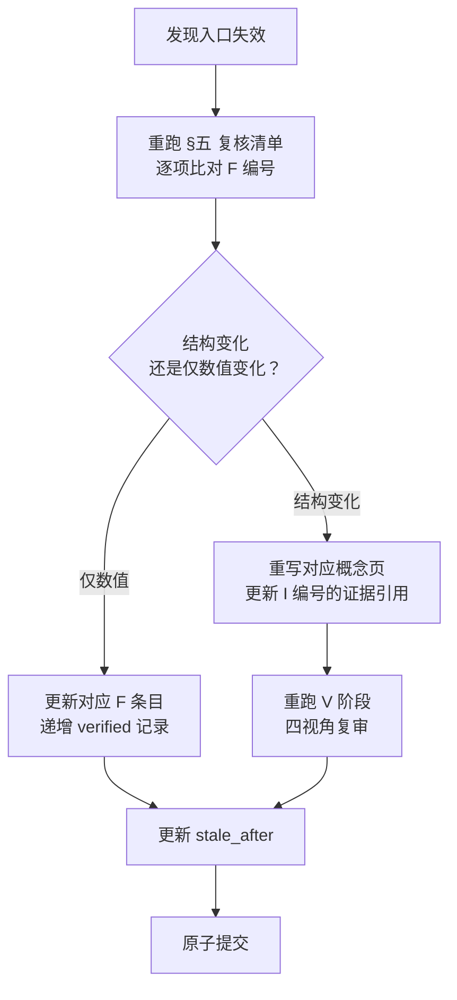

# 08 · 平台演进与迁移风险

> 本页把本包作为「快照」的失效模式显式登记，使读者知道**哪些内容最可能先过期、过期后怎么找回来**。

## 一、入口漂移的实证

采集当天（2026-10-23）观察到的两处不一致：

### 1.1 同一功能域，两套分组体系

| 页面 | 呈现 | 事实 |
|---|---|---|
| 平台主页左菜单 | 分组「知乎盐言创作者（官方助手）」（含产品公告）+「福利中心」（**无可见子项**）+ 通用十项 | F-092~F-094 |
| 作者福利页左菜单 | 8 分组：认识我们、盐言作者福利、如何赚钱、影响力打造、创作保障、官方有话说、管理规范、联系我们 | F-100 |
| 作者福利页正文 | 3 张分类卡片：作品收益、影响力打造、作者品牌 | F-101 |

> 「福利中心」在主页侧为空分组，进入福利页后展开为 8 分组——这是**入口重排**的直接证据（I-06）。

### 1.2 两个官方入口 URL 并存

| URL | 来源 |
|---|---|
| `https://www.zhihu.com/creator-salt/home/management` | 手册（S1）正文链接（F-036） |
| `https://www.zhihu.com/author-platform/home` | 用户访问入口（F-090） |
| `https://www.zhihu.com/author-platform/home/creative-direction` | 创作风向页实际地址（F-104） |

> 手册的链接指向 `creator-salt` 命名空间，而实际站点同时存在 `author-platform` 命名空间。**引用入口时应同时给出 URL 原文而非转写为文字步骤**，否则改版后无法重定位。

### 1.3 未采集到的导航目标

以下左菜单项目在采集时点**未能采集到正文**（见 [references/01 信源清单与采集边界](../references/01-source-manifest.md)）：

| 页面 | 状态 | 已知线索 |
|---|---|---|
| 作品管理 | 需登录 + 账号态 | 手册称初审通过后在此按润稿建议修正并再次提交（F-026） |
| 社区故事管理 | 需登录 + 账号态 | 无 |
| 创作规则 | 需登录 + 账号态 | 无 |
| 常见问题 | 需登录 + 账号态 | 无 |
| 合同管理 | 需登录 + 账号态 | 无 |
| 收益管理 | 需登录 + 账号态 | 手册称作品收益在此查看（F-028）；无金额口径披露 |
| 分发上架 | 指向站外 `ecom.zhihu.com` 应用市场 | 无 |
| 长篇创作马拉松各板块 | 页面顶部按钮 offscreen，无法展开 | 板块名已知（F-110）、获奖作品 Tab 部分盐气值（F-111） |

> 需登录且与账号状态绑定的页面共 **6 项**：作品管理、社区故事管理、创作规则、常见问题、合同管理、收益管理。

## 二、规则侧的演进机制

| 机制 | 条款 | 事实 | 风险 |
|---|---|---|---|
| **规则单方修订权** | 「赛事组委会有权对本大赛及相关规则进行修订或更新，一经公布即生效，您可在大赛相关页面查看，您继续参与本大赛则视为同意并遵守更新内容」 | F-084 | 已报名参赛即视为持续同意后续修订 |
| **逐篇审核闸门** | 小节公开须经安全审核，审核通过才自动公开 | F-017、F-018 | 审核标准未公开，无法预判 |
| **签约审核 + 润稿复提** | 初审通过后按润稿建议修正并再次提交 | F-026 | 修正轮次上限与时限未披露 |
| **账号态依赖** | 六个菜单页（作品管理、社区故事管理、创作规则、常见问题、合同管理、收益管理）需登录且内容随账号状态变化 | F-093、F-103 | 同一条款对不同作者呈现不同 |
| **权益条目未渲染** | 福利页仅呈现分类卡片 | F-103 | 无法取得任何权益数值 |

## 三、四级风险分级

| 级别 | 风险对象 | 失效速度 | 应对 |
|---|---|---|---|
| **P0 快速失效** | 活动类条款：字数区间、奖项金额、时限、评选标准、承诺书文本 | 天~周级 | 每次参与前**重新通读活动页原文**，本包的 [06](06-campaign-rules.md) 仅作结构索引 |
| **P1 中速失效** | 平台入口路径、菜单分组、标签集合 | 周~月级 | 引用时附采集日期；按 [08 复核清单](#五季度复核清单) 逐项比对 |
| **P2 慢速失效** | 创作流程步骤、字数闸门、作品展示路径 | 月~季级 | 以 F 编号定位；结构稳定，数值需核 |
| **P3 结构稳定** | 平台的产品分工逻辑（创作/运营/商业化/合规四域）、AI 红线的法理结构 | 年级 | 可作长期参考 |

## 四、引用纪律（本包对外使用时的强制格式）

1. **凡引用本包的数字、门槛、金额、条款**，须同时给出 F 编号与采集日期（2026-10-23）。
2. **不得将本包表述为知乎官方当前口径**——本包是平台页面在特定日期的转录，不是平台的承诺或现行规则。
3. **凡涉及活动条款**，须以活动页面原文为准；本包 [06](06-campaign-rules.md) 与 [07](07-rights-compliance.md) 只提供结构与判读。
4. **零承诺**：本包不承诺签约结果、评奖结果、曝光量或收益金额；活动金额（F-050）为活动方公布值，其发放受 F-076、F-077 约束。
5. **AI 红线按最严解释**：对 F-044「上传/输入/提供给任何 AI 模型、工具或平台」的判定从严——存在疑问时不投。

## 五、季度复核清单

复核时逐项打勾，任何一项变化须更新对应概念页并递增 `verified` 记录：

> **N/A 规则**：**页面已下线或活动已结束的条目应转 N/A，不作为复核失败**。活动类条目（字数区间、奖项表、评选说明等）在 2026-10-25 后即失效（F-038），到期后按历史样本处理，不再要求与活动页原文一致。

| # | 复核项 | 对应页 | 当前值（2026-10-23） |
|---|---|---|---|
| 1 | 平台主页左菜单分组与通用项 | [01](01-platform-map.md) | F-092~F-094 |
| 2 | 顶部导航七项及 NEW 标记 | [01](01-platform-map.md) | F-091 |
| 3 | 投稿热点标签集合 | [01](01-platform-map.md) / [05](05-creation-direction.md) | F-097 |
| 4 | 写作学院分档 | [01](01-platform-map.md) | F-098 |
| 5 | 作者福利页分组与卡片 | [01](01-platform-map.md) | F-100~F-103 |
| 6 | 创作风向页地址与标签页 | [05](05-creation-direction.md) | F-104、F-105 |
| 7 | 创作五步的步骤序列与新增能力 | [02](02-creation-workflow.md) | F-002~F-004、F-006 |
| 8 | 申签/完结字数门槛 | [03](03-signing-finalization.md) | F-021、F-023、F-029 |
| 9 | 小节字数区间 | [03](03-signing-finalization.md) | F-016 |
| 10 | 展示路径与「被推荐后可见」措辞 | [04](04-exposure-display.md) | F-031~F-034 |
| 11 | 活动字数区间与奖项表 | [06](06-campaign-rules.md) | F-045、F-050 |
| 12 | 评选说明条数与负面情形条数 | [06](06-campaign-rules.md) | F-053、F-060 |
| 13 | AI 红线三条 | [07](07-rights-compliance.md) | F-043、F-044、F-071 |
| 14 | 授权条款表述 | [07](07-rights-compliance.md) | F-078、F-079 |
| 15 | 手册链接指向的 URL | [02](02-creation-workflow.md) | F-036 |
| 16 | 长篇创作马拉松板块是否可展开 | [01](01-platform-map.md) / [facts.md](../facts.md) | F-110、F-111 |

## 六、迁移路径（若平台改版）

## 关联

- 入口全貌 → [01 · 平台功能地图](01-platform-map.md)
- 未采集部分的完整清单 → [references/01 信源清单与采集边界](../references/01-source-manifest.md)
- 相关洞察 → I-06
