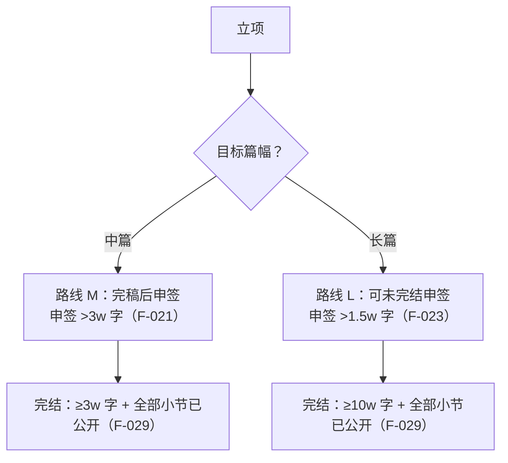
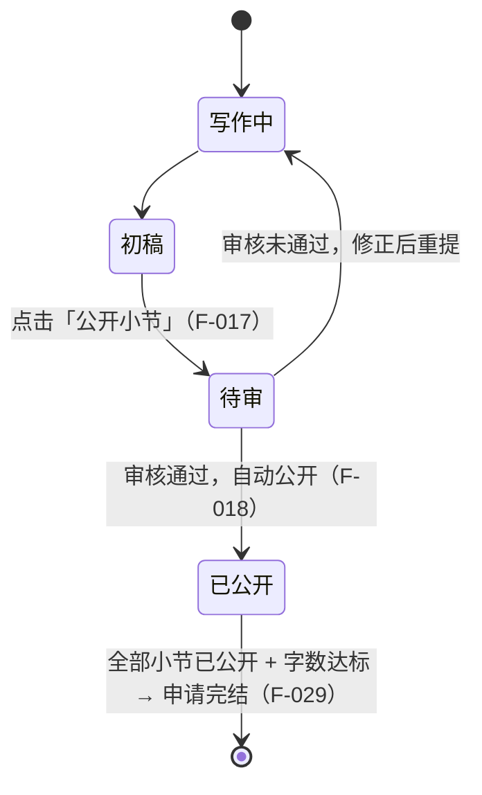

# 02 · 中长篇连载排期表

> **使用方式**：立项时填 A、B 两表；每周更新时只动 B 表的「状态」与「公开日期」两列。表内每个字段都标注了它约束哪条 F。
> **适用范围**：盐言作者平台的短篇/中篇/长篇创作（F-005、F-007）与连载（Step 2，F-016~F-020）。

## 一、路线选择（先定路线再排期）

| 路线 | 申签门槛 | 申签时是否须完稿 | 完结门槛 | 完结附加条件 |
|---|---|---|---|---|
| **M 中篇** | > 3w 字 | **是**（F-021） | ≥ 3w 字 | 所有小节已公开（F-029） |
| **L 长篇** | > 1.5w 字 | 否（F-023） | ≥ 10w 字 | 所有小节已公开（F-029） |

## 二、A 表 · 立项参数

| 参数 | 填写值 | 依据 |
|---|---|---|
| 篇幅 | ☐ 短篇　☐ 中篇　☐ 长篇 | F-007 |
| 平台入口 | `https://www.zhihu.com/author-platform/home` | F-090 |
| 手册链接（另一个命名空间） | `https://www.zhihu.com/creator-salt/home/management` | F-036 |
| 创作终端 | ☐ PC（中篇/长篇仅支持 PC） | F-005 |
| 内容来源 | ☐ 在线创作（未发过回答/文章）　☐ 知乎内容投稿（已发过，内容自动同步） | F-013、F-014 |
| 封面方式 | ☐ 模板封面（按笔名+作品名自动生成）　☐ 本地上传（不自动生成，须自担合规） | F-008~F-011 |
| 金句描述 | ______________________（展示于作品详情页） | F-012 |
| 目标总字数 | ______ 字 | F-021/F-023/F-029 |
| 计划小节数 | ______ 节 | F-016 |
| 单节目标字数 | ______ 字（须落在 2000-8000） | F-016 |

### 2.1 小节数与总字数的换算

| 目标总字数 | 最少小节数（按 8000/节上限） | 建议小节数（按 6000/节中位） | 依据 |
|---|---|---|---|
| 3w 字（中篇完结门槛） | 4 节 | 5 节 | F-029、F-016 |
| 1.5w 字（长篇申签门槛） | 2 节 | 3 节 | F-023、F-016 |
| 10w 字（长篇完结门槛） | 13 节 | 17 节 | F-029、F-016 |

> 上表仅供排期参考。**约束是单节 ∈ [2000, 8000]**，小节数由总字数与单节字数共同决定；两端都不可越界。

## 三、B 表 · 小节台账

> 每行一节。**「已公开」列只填审核通过并自动公开的日期**（F-018）——这是完结闸门的判定依据。

| # | 小节标题 | 目标字数 | 实际字数 | 状态 | 审核结果 | 已公开日期 | 备注 |
|---|---|---|---|---|---|---|---|
| 1 | | | | ☐写作中 ☐初稿 ☐待审 ☐已公开 | ☐通过 ☐未通过 | | 单节须 2000-8000（F-016） |
| 2 | | | | ☐写作中 ☐初稿 ☐待审 ☐已公开 | ☐通过 ☐未通过 | | |
| 3 | | | | ☐写作中 ☐初稿 ☐待审 ☐已公开 | ☐通过 ☐未通过 | | |
| 4 | | | | ☐写作中 ☐初稿 ☐待审 ☐已公开 | ☐通过 ☐未通过 | | |
| 5 | | | | ☐写作中 ☐初稿 ☐待审 ☐已公开 | ☐通过 ☐未通过 | | |
| … | | | | | | | |
| **合计** | | | **______** | 已公开 **__** 节 / 共 **__** 节 | | | |

**列含义与依据**

| 列 | 依据 | 说明 |
|---|---|---|
| 目标字数 / 实际字数 | F-016 | 单节须落在 2000-8000 |
| 状态 | F-017 | 「公开小节」触发后进入安全审核 |
| 审核结果 | F-017、F-018 | 通过才自动公开 |
| 已公开日期 | F-020、F-029 | 公开节奏建议固定频率；完结要求全部已公开 |

## 四、C 表 · 固定频率排期

> 官方表述：「持续更新小节进行内容连载，建议按照固定的频率公开小节，这有助于培养读者的阅读习惯」（F-020）。

| 周次 | 计划公开小节 | 累计公开字数 | 累计已公开节数 | 备注 |
|---|---|---|---|---|
| W1 | 第 __ 节 | ______ | | 首节公开通常承担「建立阅读预期」的作用 |
| W2 | 第 __ 节 | ______ | | |
| W3 | 第 __ 节 | ______ | | |
| W4 | 第 __ 节 | ______ | | |
| … | | | | |

**排期原则**（基于 F-020、F-034 的个人主页只展示公开作品、F-029 的完结条件）：

1. **宁稳勿断**：F-020 的官方表述是「建议按照固定的频率公开小节，这有助于培养读者的阅读习惯」。平台**未表述**固定频率与频道排序之间的因果关系（推断，无 F 支撑）。
2. **留缓冲**：任一节的审核未通过都会打断「全部已公开」状态（F-029），建议每周预留 1 节冗余。
3. **完结前置**：长篇路线下，距 10w 字门槛越近，越应把「全部小节已公开」作为第一优先——字数达标而不公开是无效状态。

## 五、闸门状态机（对照 B 表填写）

| 闸门 | 判定条件 | 路线 M | 路线 L | 当前状态 |
|---|---|---|---|---|
| G1 小节合规 | 每节 2000-8000 字 | ☐ | ☐ | |
| G2 申签字数 | M: >3w；L: >1.5w | ☐ | ☐ | |
| G3 申签条件 | M: 已完稿；L: 无要求 | ☐ | ☐ | |
| G4 签约上架 | 审核通过并按润稿建议修正复提后上架（F-026、F-027） | ☐ | ☐ | |
| G5 完结字数 | M: ≥3w；L: ≥10w | ☐ | ☐ | |
| G6 全部公开 | 所有小节已公开（F-029） | ☐ | ☐ | |

**G5 与 G6 是 AND 关系**，缺一不可。

## 六、活动叠加时的额外列

> 若同时参加征稿活动，追加以下列（依据 [06](../concepts/06-campaign-rules.md)）：

| 列 | 填写值 | 依据 |
|---|---|---|
| 活动字数区间 | 短篇 8000 含–3 万不含 / 中篇 3 万含–10 万不含 | F-045 |
| 活动标签 | 短篇 → 【参与征稿】选对应活动 | F-067 |
| 承诺书勾选 | ☐ 已勾选提交 | F-067、F-072 |
| 关联回答（≥2000 字） | ☐ 已规划　☐ 已绑定 | F-061~F-063 |
| AI 工具白名单 | ______________________ | F-043、F-044 |

## 关联

- 闸门判定原理 → [03 · 签约与完结的闸门与反馈链](../concepts/03-signing-finalization.md)
- 步骤细节 → [02 · 中长篇创作五步流程](../concepts/02-creation-workflow.md)
- 提交前核对 → [01 · 投稿前合规自查表](01-pre-submission-checklist.md)
