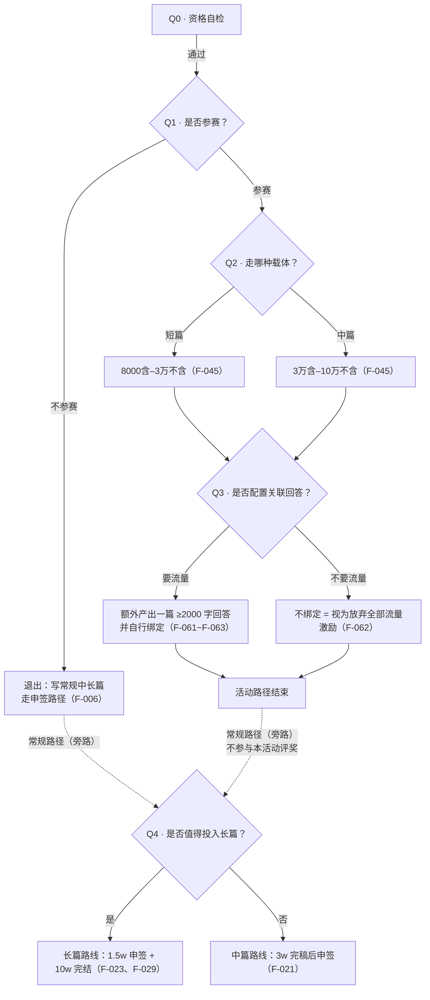
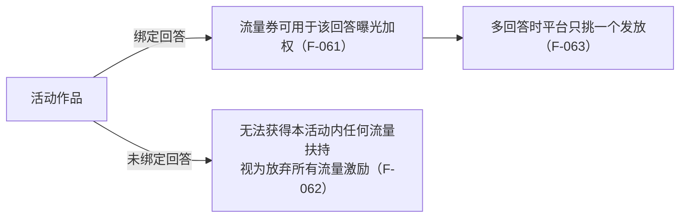

# 03 · 参赛决策树

> **使用方式**：自上而下逐问回答，任一问走到「否」即停止，不必进入后续问题。每问的判定条件均来自 [事实清单](../facts.md) 的 F 编号。
> **适用范围**：以采集时点的「津派文化」主题征文活动为样本（F-037~F-089）。**换活动时须重新核对活动页原文**，本模板的 F 编号只对本样本有效。

## 决策总览

---

## Q0 · 资格自检（任一不满足即无法参赛）

| # | 检查项 | 判定依据 | 结果 |
|---|---|---|---|
| 0-1 | 账号仅使用一个（同一手机号/设备视作同一账号） | F-080 | ☐ |
| 0-2 | 账号由**四大运营商**手机号注册（非虚拟运营商、非状态异常） | F-081 | ☐ |
| 0-3 | 作品为本人独立原创、全球范围内未发表，或已发表但已全平台删除下架 | F-086 | ☐ |
| 0-4 | 同一篇作品未重复参与活动、未一稿多投 | F-086 | ☐ |
| 0-5 | 账号无违规或异常状态 | F-087 | ☐ |
| 0-6 | 内容为**非 AI 创作**（不使用 AI 生成/续写/改写） | F-043、F-071 | ☐ |
| 0-7 | 未将作品内容上传/输入任何 AI 模型或工具 | F-044 | ☐ |
| 0-8 | 已按要求报名 | F-073、F-065 | ☐ |

> ⚠️ Q0 是**一票否决**层。0-2 与 0-6/0-7 是最易被忽略的两条：前者是技术性账号限制，后者是本次赛道特有的 AI 禁令。

---

## Q1 · 是否参赛？判定依据：投入产出 vs 门槛成本

**参与方式四步**（缺一不可，顺序即流程）：

| 步骤 | 动作 | 依据 |
|---|---|---|
| 1 | PC 端点击「报名链接」进入大赛官方报名入口，填写报名信息 | F-065 |
| 2 | 进入 PC 端盐言作者平台，点击「创建作品」 | F-066 |
| 3 | 篇幅选「短篇」或「中篇」；【参与征稿】选对应活动并填写作品信息；**勾选《参赛承诺书》并提交** | F-067 |
| 4 | 点击「申请签约」——即完成投稿并视为参赛成功 | F-068 |

**决策判据**：

| 若…… | 则 |
|---|---|
| 稿件本身已自然带天津文化元素（人物、情节、场景均有承载） | 倾向参赛（呼应 F-054、F-055 的评审口径） |
| 元素只是「可替换的地名」，删掉不影响故事 | 不参赛（F-060 第 1 种情形属负面情形） |
| 平台合规成本较高（需承诺书 + AI 流向禁令 + 完结）而收益不确定 | 不参赛（F-076 的奖金发放条件与时间均不确定） |
| 活动不限制作品数、允许多部参与 | 可同时参赛与常规创作，互不冲突（F-074） |

> **注意**：点击「申请签约」**仅代表投稿成立、参赛资格成立，不等同于最终签约**；签约与否不影响参与评奖（F-069）。做收益预期时，不要把「已参赛」折算为「已签约」。

---

## Q2 · 走哪种载体？

| 载体 | 字数区间 | 申签门槛 | 完结门槛 | 依据 |
|---|---|---|---|---|
| 短篇 | 8000 含 – 3 万 不含 | —— | 按活动要求完结 | F-045 |
| 中篇 | 3 万 含 – 10 万 不含 | > 3w 字且须完稿 | ≥ 3w 字 + 全部小节已公开 | F-021、F-029 |
| 长篇 | **活动未列长篇**（F-045 仅列短篇与中篇） | > 1.5w 字（常规路径） | ≥ 10w 字 + 全部小节已公开 | F-023、F-029 |

**决策提示**：

- 活动赛道**只收短篇与中篇**（F-045、F-071）。若你手里是长篇计划，本活动不是它的参赛通道——长篇的申签/完结规则（F-023、F-029）属于常规创作路径，见 [02 · 中长篇连载排期表](02-longform-schedule.md)。
- 中篇要求**完稿后**申签（F-021），因此中篇参赛的排期须把「完稿」放在「报名窗口关闭」之前。
- 不符合字数要求**无法参与评奖**（F-045），这是硬门槛。

---

## Q3 · 是否配置关联回答？

| 选项 | 条件 | 结果 | 依据 |
|---|---|---|---|
| **要流量** | 关联回答字数 **≥ 2000 字** 且内容质量达标、不违反平台规则与法律、不侵犯第三方权利 | 流量券可用于该回答的曝光加权 | F-061 |
| **不要流量** | 不绑定 | 视为放弃本活动内**所有**流量激励 | F-062 |

**附加约束**：

- 流量券需**作者自行操作使用**（F-063），绑定不等于到账。
- 一部作品关联多个回答时，**平台只选其中一个**发放（F-063）——绑定前先确定哪个回答是流量落点。
- 流量券使用教程指向官方文档「盐选速递｜10-12 月「大动作」盘点 - 02 大额流量券助力无忧创作」（F-064），具体额度以该文档为准。
- 注意流量券作用对象是**回答**，不是小说作品本身（呼应 [I-03](../insights.md)）。

---

## Q4 · 是否值得投入长篇？（旁路分支：常规创作路径，非本活动通道）

> **旁路说明**：本活动赛道**只收短篇与中篇**（F-045、F-071），长篇属常规中长篇创作路径，详见 [02 · 中长篇连载排期表](02-longform-schedule.md)；**其完成情况不参与本活动评奖**。
>
> 判据来自 [I-01](../insights.md) 的闸门结构：长短篇的分水岭在**收尾**而非**开始**。

| 维度 | 中篇路线（M） | 长篇路线（L） |
|---|---|---|
| 申签字数 | > 3w 字 | > 1.5w 字 |
| 申签时是否须完稿 | **是**（F-021） | 否（F-023） |
| 完结字数 | ≥ 3w 字 | ≥ 10w 字 |
| 完结附加 | 所有小节已公开（F-029） | 所有小节已公开（F-029） |
| 单节合规 | 2000-8000 字（F-016） | 2000-8000 字（F-016） |
| 连载节奏 | 可较集中公开 | 建议按固定频率公开（F-020） |
| 主要风险 | 完稿前无法申签，且需全部公开才可完结 | 10w 字门槛的爬升期长，中途断更即打断完结条件 |

**「值得」的三条判据**（同时满足才建议投入长篇）：

1. **可持续供给**：能稳定产出 2000-8000 字的小节，且愿意承担「所有小节已公开」的连载压力（F-016、F-020、F-029）。
2. **完结可达**：以当前产能推算，10w 字 + 全部小节已公开的达成时间落在**自身耐心边界之内**（完结为「字数达标 **且** 所有小节已公开」的双条件，见 F-029）。
3. **资格与收益的优先级明确**：长篇路线**不在本次活动的字数范围内**（F-045 只列短篇/中篇），所以它属于常规创作投资，不属于本次参赛收益——除非另有活动通道。

> **不参赛时的替代路径**：走常规中长篇申签路径（F-006 五步），不勾选《参赛承诺书》、不绑定回答，也不受活动字数区间与 AI 流向禁令约束。

---

## 决策结果登记

| 项 | 填写 |
|---|---|
| 是否参赛 | ☐ 是　☐ 否 |
| 载体 | ☐ 短篇　☐ 中篇　☐ 长篇（常规路径） |
| 活动标签/承诺书 | ☐ 已选活动　☐ 已勾选承诺书并提交 |
| 关联回答 | ☐ 已规划（≥2000 字）　☐ 已绑定　☐ 放弃流量激励 |
| 目标路线 | ☐ M 中篇（3w 完稿后申签）　☐ L 长篇（1.5w 申签 / 10w 完结，常规路径·不参与本活动评奖） |
| 目标完结日期 | ______ |
| 风险登记 | ______________________ |

## 关联

- 逐项合规核对 → [01 · 投稿前合规自查表](01-pre-submission-checklist.md)
- 排期与小节台账 → [02 · 中长篇连载排期表](02-longform-schedule.md)
- 活动规则原文口径 → [06 · 征稿活动规则解剖](../concepts/06-campaign-rules.md)
- AI 边界与授权条款 → [07 · 权利、合规与 AI 红线](../concepts/07-rights-compliance.md)
