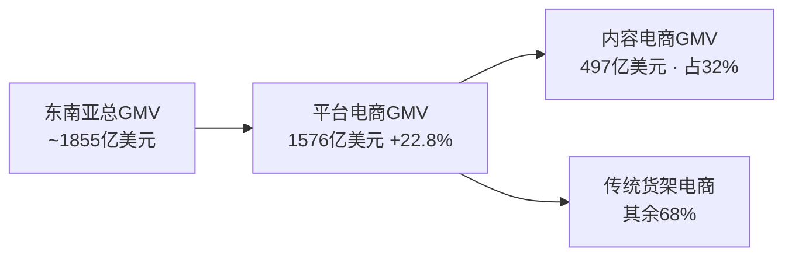

# 东南亚电商大盘：增长的数据底座

> **术语**：GMV（Gross Merchandise Value，商品交易总额）指平台成交商品的总价值，是衡量电商市场规模的核心口径；下文所有"GMV"均指该含义。

> 核心事实均来自 **Momentum Works《Ecommerce in Southeast Asia 2026》**，经官方新闻稿独立核验一致（见 [verification.md](../references/verification.md) P0-1~4）。宏观数字可信；与"厂商自宣"数据分卷呈现，勿混用。

## 1. 市场规模（独立信源 ✅）

| 指标 | 2025 值 | 来源 |
|------|--------|------|
| 平台电商总 GMV | **1576 亿美元**（F-005） | momentum-works |
| 平台电商同比增速 | **+22.8%**（F-005） | momentum-works |
| 东南亚电商总 GMV（TAM） | **约 1855 亿美元**（F-004） | dataglass |
| 近六年规模 | 较 2020 年**近三倍**（F-006 补充） | momentum-works |

相比 2024 年（增速回落），2025 年东南亚平台电商增速回升至 +22.8%，主要由泰国（+51.8%）、马来西亚（+47.6%）领涨，越南、菲律宾、新加坡增速亦在 20% 上下，印尼仍为最大单一市场（P0 核验补充）。

## 2. 内容电商（独立信源 ✅）

| 指标 | 2025 值 | 来源 |
|------|--------|------|
| 内容电商 GMV（直播/短视频/内容联盟营销） | **497 亿美元**（F-013） | momentum-works |
| 占平台电商 GMV 比例 | **32%**（F-013） | momentum-works |
| 较 2024（$25.1B）增长 | **+98%**（F-014） | heycross |

内容电商在东南亚正从"补充渠道"变为"主流流量入口"，这也支撑了文章"短视频展示、直播讲解、达人推荐成为消费者发现商品重要途径"的判断（F-037）。

## 3. 为什么宏观数字可信（而不与自宣混用）

- **Momentum Works** 是独立行业研究机构，其《Ecommerce in Southeast Asia 2026》为行业通用口径，被多个无利益相关方引用（P0-1~4）。
- 对比：文中的"近万家商家""Crying Center +9 倍"等为 **Lazada 自宣**（P0-6/8），应归入 [verification.md](../references/verification.md) 的口径分层，不作为中立事实。
- **复用纪律**：引用东南亚电商规模时，统一挂 Momentum Works 数据；引用 Lazada 项目成绩时，须注明"Lazada 披露、无第三方审计"。

## 4. 阅读提示

本节建立的是"数字底座"，用于回答"市场本身有多大、增长在哪"；至于"怎么进入、谁做出成效"，见 [03 一键轻出海机制](03-one-click-mechanism.md) 的机制拆解与厂商自宣口径声明。

