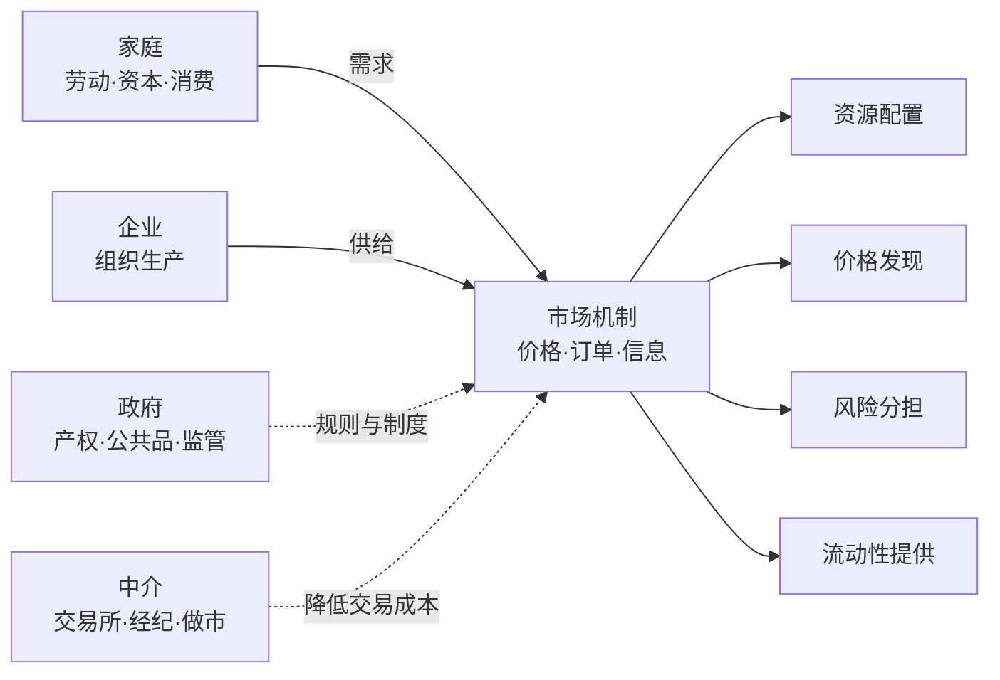

# 什么是市场：从交换到秩序

## 是什么

**市场（market）是买方与卖方为交换商品、服务或资产而相互作用的场所或机制**——但它不必是物理场所。菜市场、证券交易所、招聘网站、外汇交易系统，本质上都是市场：价格、订单与信息在其中汇集，交换在其中达成（F-001）。

经济学把市场看作一种**资源配置的机制**：通过自愿交换，资源流向出价更高（边际价值更高）的用途（F-002）。这一看似平淡的描述，是整个经济学的起点——它回答的不是「谁该得到什么」，而是「在给定的偏好、技术与禀赋下，资源如何被分配」。

> 一句话把握：**市场不是「地方」，而是「过程」——一个把分散的意愿、信息与资源汇合成价格与交换的过程。**

## 市场里有谁：四类参与者

| 参与者 | 角色 |
|---|---|
| 家庭 | 提供劳动与资本、消费商品与服务（需求侧的主体） |
| 企业 | 组织生产要素、生产并销售（供给侧的主体） |
| 政府 | 界定产权、提供公共品、征税、监管与再分配 |
| 中介 | 交易所、经纪人、做市商、评级与信息机构（降低交易成本） |

（F-003）

## 市场在做什么：四大功能

1. **配置（allocation）**——决定谁来生产、生产多少、资源流向何处；
2. **价格发现（price discovery）**——形成商品与资产之间的交换比率；
3. **风险分担（risk sharing）**——通过保险、衍生品与股权分散，把风险从不愿承担者转移给愿承担者；
4. **流动性提供（liquidity）**——让资产持有者能在需要时以可预期的成本变现。

（F-004）

这四项功能是后续所有讨论的骨架：**有效市场假说（EMH）本质上是在问——第 2 项「价格发现」做得有多好？**

## 市场的类型谱系

市场可以从两个维度分类（F-005）：

| 分类维度 | 类型举例 |
|---|---|
| 按标的 | 商品市场、劳动力市场、资本市场（股票/债券）、外汇市场、数据与数字资产市场 |
| 按竞争程度 | 完全竞争 → 垄断竞争 → 寡头 → 垄断 |

**完全竞争市场**是一组理想化假设下的模型：众多小规模买卖者、产品同质、信息完备、自由进出（F-006）。它**是分析基准，不是对现实的描述**——现实市场大多处于「垄断竞争」到「寡头」之间。理解这一点很重要：下文讲「均衡」「效率」时，若不加说明，指的都是这个基准模型下的结论。

## 市场靠什么运转：制度前提

市场不是自然发生的，它需要一套制度支撑（F-007）：

- **产权界定与保护**——不知道东西归谁，就无从交换；
- **契约执行**——承诺能被强制履行，交易才敢跨期、跨地；
- **货币与支付体系**——降低「以物易物」的双重巧合难题；
- **反欺诈与监管**——信息与保护上的底线秩序。

缺少这些制度，**交易成本上升、市场可能萎缩甚至消失**——这是理解后文「市场失灵」的伏笔：市场的有效程度，与它所嵌入的制度质量直接相关。

## 「看不见的手」：一个比喻，不是一条定律

亚当·斯密 1776 年《国富论》提出「看不见的手」比喻：个体在市场中追求自身利益时，可能「无意间」促进社会整体福利（F-002）。斯密还指出**分工受市场范围限制**——专业化程度取决于市场能吸收的产量规模（F-008）。

需要提醒两点，避免误读：

- 「看不见的手」是一个**洞察性比喻**，用来反对当时盛行的重商主义干预思维；它不是「个体逐利必然带来公共善」的严格定理——外部性、垄断、信息不对称（见 [04 市场失灵](04-market-failure.md)）都是这句话的例外。
- 斯密的论证依赖**竞争与制度**：只有当市场是竞争性的、产权与契约得到保障时，逐利行为才更可能导向有效的资源配置。

## 与后续章节的衔接

- 想要知道价格是怎么被「定」出来的 → [01 供给、需求与价格形成](01-supply-demand-price.md)
- 想知道市场如何把分散信息聚进价格 → [02 价格发现与信息](02-price-discovery-and-information.md)
- 想知道市场靠什么自我纠偏 → [03 竞争、套利与均衡](03-arbitrage-and-equilibrium.md)
- 想知道市场什么时候会「失灵」 → [04 市场失灵与效率边界](04-market-failure.md)

## 常见坑

- **把「市场」等同「场所」**：线上撮合、场外交易同样是市场；市场的本质是交换机制而非地点（F-001）。
- **把完全竞争当成现实描述**：它是基准模型，用来说明「完全竞争下会怎样」，现实市场普遍偏离它（F-006）。
- **把「看不见的手」当定理**：它是比喻＋洞察，成立条件（竞争、制度）在现实中常常不满足（F-002、F-007）。

## 相关概念

- [01 供给、需求与价格形成](01-supply-demand-price.md)：价格如何在市场上被决定。
- [04 市场失灵与效率边界](04-market-failure.md)：制度缺失或失灵时会发生什么。
- 事实依据与信源：[facts.md](../facts.md)（F-001~F-008）、[经典与学术信源](../references/01-classics-and-authorities.md)。
