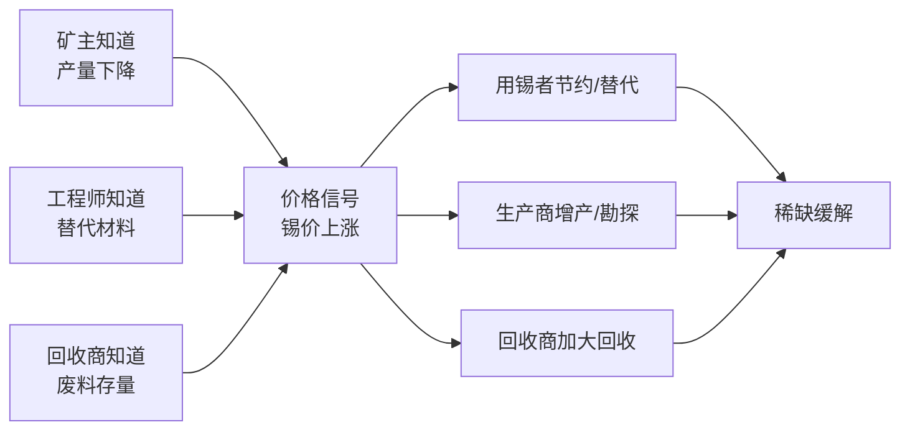

# 价格发现与信息：哈耶克的知识分工

## 是什么

上一章说「价格由供需决定」，但还没回答一个更深的问题：**社会怎么知道该生产什么、生产多少？** 现代经济中，没有任何一个人或机构掌握全部信息。这一章的核心洞见来自哈耶克：**价格本身是一种传递信息的机制**，它以极简的形式把分散在无数人手里的知识汇拢起来。

## 哈耶克的洞见：知识是分散的

弗里德里希·哈耶克 1945 年在《美国经济评论》发表《知识在社会中的运用》（*The Use of Knowledge in Society*），提出（F-019）：

- 经济中最重要的知识，是**「关于特定时空环境的知识」**——某块地今年的收成、某家工厂某台机器的状态、某个买家此刻的偏好；
- 这类知识**分散在无数个体手中**，无法被任何中央机构完整收集；
- 因此，「经济计算」的根本问题不是「该生产什么」（没有人有足够信息回答它），而是**如何让分散的知识得到最有效的利用**。

## 价格：一台「登记变化的机器」

哈耶克的核心论点（F-020）：

> 价格体系是一种**传递信息的机制**……它以简化的符号，把最重要的信息传递给需要它的人。把价格体系描述为「一种登记变化的机器」，或一套「电信系统」，并不只是比喻。

举一个经典例子：**锡突然短缺**。

- 没有人需要知道「为什么短缺」（是矿难？是禁运？是新需求？）；
- 成千上万的锡使用者只是看到**锡价上涨**，于是自动地节约用锡、寻找替代、回收废锡；
- 结果：稀缺被缓解。**数以百万计的人在没有中央指令、甚至互不相识的情况下，做出了协调一致的反应。**

这正是 [00 章](00-what-is-a-market.md) 中「看不见的手」的现代版本：价格用**极少的信息传输量**，实现了**极大的协调效果**。

## 价格发现：信息如何进入价格

**价格发现（price discovery）指市场通过交易，把分散的信息聚合进价格的过程**（F-021）。它的关键在于：价格不是某个人算出来的，而是**无数买卖决策合成的结果**。

- 掌握**私有信息**（private information）的交易者，通过**下单**把信息传递进市场；
- 随着交易发生，这些信息**逐步被价格吸收**，私有信息向公共信息转化（F-024、F-025）；
- 市场价格越高频、参与者越多、信息扩散越快，**价格对新信息的反应就越迅速**（F-033）。

## 一个必须分清的区别：信息效率 ≠ 资源配置效率

这是理解后半部（EMH）的前提（F-022、F-024、F-023）：

| 概念 | 含义 | 反例提示 |
|---|---|---|
| **信息效率** | 价格是否迅速、充分地反映可得信息 | 若价格能反映信息，它就是可靠的配置信号 |
| **资源配置效率** | 资本是否流向了社会最优用途 | 价格反映信息 ≠ 资本流向最该去的地方（可能有外部性、泡沫） |

**有效市场假说（EMH，见 [05 章](05-emh-three-forms.md)）主要讨论的是信息效率**：价格对信息的反映程度（法玛 1970，F-023）。它**不**直接断言「市场配置资源一定最优」——把这两件事混为一谈，是很多通俗讨论出错的根源。

## 为什么「完全信息有效」不可能：一个预告

信息不是免费的：搜集、分析、交易都要花成本。这就引出一个深刻的悖论——**如果价格已经反映了全部信息，就没人有动力去花成本搜集信息**（因为搭便车就好）。因此，**完全有效的市场在逻辑上不可能存在**；市场只能是**部分有效**的：效率必须「留有余地」，才能补偿那些生产信息的人。这就是**格罗斯曼—斯蒂格利茨悖论**，将在 [03 章](03-arbitrage-and-equilibrium.md) 详细展开（F-030）。

## 小结

- 知识是分散的（哈耶克），无法被中央集中；
- 价格是**传递分散信息的机制**，用极小的信息量实现巨大的协调；
- 价格发现 = 信息通过交易聚合进价格的过程；
- **信息效率 ≠ 资源配置效率**，EMH 主要讲前者；
- 因为信息有成本，**完全有效在逻辑上不可能**——市场只能是部分有效。

## 常见坑

- **把「价格反映信息」当成「价格一定正确」**：价格聚合的是**被交易的信息**，未被交易的信息（或错误共识）不会自动进入价格（F-021、F-024）。
- **拿信息效率去论证「市场万能」**：信息效率不蕴含资源配置效率，外部性与泡沫是两码事（F-024）。
- **以为「没人知道全局」就没法协调**：恰恰相反，价格让「不需要知道全局」的个体也能做出正确的局部决策（F-020）。

## 相关概念

- [01 供给、需求与价格形成](01-supply-demand-price.md)：均衡价格如何形成。
- [03 竞争、套利与均衡](03-arbitrage-and-equilibrium.md)：格罗斯曼—斯蒂格利茨悖论。
- [05 有效市场假说：三种形态](05-emh-three-forms.md)：信息效率被形式化为三种形态。
- 事实依据与信源：[facts.md](../facts.md)（F-019~F-025）、[经典与学术信源](../references/01-classics-and-authorities.md)。
