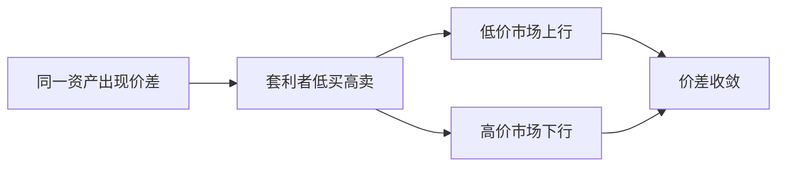

# 竞争、套利与均衡

## 是什么

如果说 [02 章](02-price-discovery-and-information.md) 回答了「价格如何承载信息」，这一章回答**「是什么力量让价格回到『正确』的位置」**。答案的核心是**套利**：当同一资产出现价差，就有人低买高卖把它抹平。而套利的成本，又决定了市场能达到多高的效率——这正是**有效市场假说最深刻的理论约束**。

## 套利：市场的「纠错力量」

**套利（arbitrage）** 指在同一或相关资产上同时买卖，以锁定无风险价差的交易（F-026）。

- **一价定律（law of one price）**：在无摩擦、可自由交易的市场中，**同一资产（或等价资产）应有同一价格**；价格偏离会被套利纠正（F-027）。
- 直观例子：若同一只股票在 A、B 两个交易所价格不同（A 便宜 B 贵），套利者会在 A 买入、B 卖出，赚取价差——这个行为本身推高 A 价、压低 B 价，直到价差消失。

## 无套利假设：现代资产定价的基石

**无套利（no-arbitrage）** 是现代金融学最核心的假设之一：**若不存在无风险套利机会，价格之间必须满足特定的关系**（F-028）。

- 期权定价的看涨看跌平价、期货与现货的持有成本关系、利率期限结构的许多约束，都是「无套利」的直接推论；
- 无套利假设的价值在于：**它不需要知道投资者的偏好**，只看价格之间是否「自洽」。

这就是为什么资产定价的第一次课上，往往先讲套利，而不是先讲「投资者想什么」。

## 竞争抹平超额收益

套利与竞争共同构成一种**收益衰减机制**（F-029）：

1. 某人发现一个可获利的价差或机会；
2. 更多资金涌入，买的人多了，价差被抹平；
3. 超额收益衰减，直到不再诱人。

因此，**「发现者」获得的超额收益，本质是其承担信息成本与风险的补偿**——它不是「市场犯错送钱」，而是对「你比别人更早、更准地承担了不确定性」的回报。

## 格罗斯曼—斯蒂格利茨悖论：完全有效不可能

这是本知识包**最重要的理论洞见之一**（F-030、F-031）。

桑福德·格罗斯曼与约瑟夫·斯蒂格利茨 1980 年在《美国经济评论》发表《论信息有效市场的不可能性》，指出一个逻辑矛盾：

> **如果价格已经反映了全部信息**（强式有效）→ **就没有人有动力花成本去搜集信息**（因为可以免费搭便车从价格里读取一切）；
> 但**若无人搜集信息** → **价格又不可能反映这些信息**。
> 因此，**完全信息有效的市场不可能存在**。

结论是：均衡一定是**「部分有效」**的——价格必须**足够有信息量以补偿信息的采集者**，但又**不能完全揭示**，才能让「生产信息」这件事有利可图。价格因而是「**有噪声的、但含信息的**」。

- **被动投资者正是这个模型里的搭便车者**：他们从不花钱研究，却享受价格的信息含量；
- 这也解释了为什么**效率有程度、有边界**，且**因市场而异**（商品市场与股票市场效率不同，因为分析成本与交易成本不同）（F-031）。

> **与后文的呼应**：这个悖论是理解 [07 章「证据之争」](07-evidence-for-and-against.md) 的关键——「市场有多有效」本身就是一个**动态、有成本约束**的问题，而不是「有效 or 无效」的二选一。

## 市场是「自适应系统」

套利、竞争、信息成本共同塑造出一个不断变化的市场（F-032）：

- **参与者的行为改变价格，价格又反过来改变参与者的机会与行为**——这是一个反馈回路；
- 因此市场不是一台「静态的自动售货机」，而是一个**参与者与规则不断相互作用的系统**；
- 这一直觉后来被罗闻全发展为**适应性市场假说（AMH）**：效率像生态系统一样随竞争演化（详见 [08 章](08-behavioral-finance-and-amh.md)，F-068）。

## 流动性：效率的「润滑剂」

**流动性与价格效率相互促进**（F-034）：

- 流动性好的市场，交易成本低、下单影响小 → 信息更容易通过交易反映进价格；
- 反过来，价格效率高的市场吸引更多参与者 → 流动性更好。

这解释了一个现实：**越成熟、越活跃的市场，往往越「接近有效」**——不是因为那里的人更聪明，而是因为那里的交易成本更低、信息扩散更快。

## 小结

- 套利与一价定律是市场的纠错力量；
- 无套利假设让资产定价不依赖投资者偏好；
- 竞争抹平超额收益，「发现者」的收益是信息成本与风险的补偿；
- **格罗斯曼—斯蒂格利茨悖论**：完全有效不可能，均衡只能是部分有效；
- 市场是自适应系统，效率随竞争与制度演化；
- 流动性与效率相互促进。

## 常见坑

- **以为「有效」＝「没有获利机会」**：恰恰相反，正是因为存在**有成本的**获利机会，才有人去生产信息、维持价格的信息含量（F-030）。
- **把无套利当成「价格一定正确」**：无套利只保证**价格之间自洽**，不保证价格等于「真实价值」（F-028）。
- **忽略套利的成本与限制**：现实中套利受资金、卖空限制、风险与流动性约束，「价差」不一定被立即抹平（F-029、F-034）。

## 相关概念

- [02 价格发现与信息](02-price-discovery-and-information.md)：价格如何承载信息。
- [04 市场失灵与效率边界](04-market-failure.md)：套利失效与信息不对称。
- [08 行为金融与适应性市场](08-behavioral-finance-and-amh.md)：AMH 如何承接「自适应系统」的直觉。
- 事实依据与信源：[facts.md](../facts.md)（F-026~F-034）、[经典与学术信源](../references/01-classics-and-authorities.md)。
