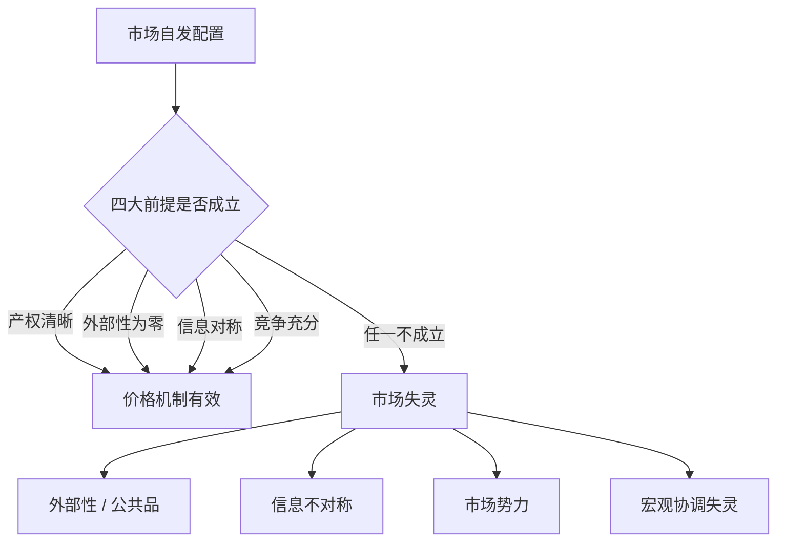

# 市场失灵与效率边界

## 是什么

前四章讲的是市场「如何运转」；这一章讲**它在哪里失灵**——以及失灵之后，「看得见的手」（政府与制度）能做什么、又会出什么问题。

**市场失灵（market failure）** 指在满足特定条件时，市场自发配置资源**无法达到帕累托最优**的情形（F-035）。它不是说「市场总是坏的」，而是说：**价格机制这台机器，在若干特定情境下会卡壳**。

## 市场失灵的五大类

教科书中常归纳为五类（F-036）：

| 类别 | 核心问题 | 本包对应 |
|---|---|---|
| **外部性** | 交易影响了未参与交易的第三方 | 庇古税、科斯定理 |
| **公共品** | 非排他 + 非竞争，私人供给不足 | 搭便车问题 |
| **信息不对称** | 一方比另一方知道得多 | 柠檬市场、道德风险 |
| **市场势力** | 垄断/寡头操纵价格 | 反垄断规制 |
| **宏观不稳定** | 总量层面的萧条与失业 | 财政/货币政策 |

> **分清「失灵」与「不完美」**：市场不完美是常态（交易成本从来不为零），关键是**失灵是否严重到需要干预**，以及**干预的收益是否大于成本**——这就是后面「政府失灵」要讲的问题（F-046）。

## 外部性：价格没算进去的成本

**外部性（externality）** 指某项经济活动对**未直接参与交易的第三方**产生的影响（F-037）：

- **负外部性**：工厂排污、噪音、拥堵——社会成本 > 私人成本，市场会**过度生产**；
- **正外部性**：疫苗接种、基础研究、教育——社会收益 > 私人收益，市场会**供给不足**。

外部性的本质是**价格信号遗漏了第三方**：价格只反映买卖双方的私人成本与收益，漏掉的那部分没有人「收费」或「付费」，于是决策被扭曲。

### 庇古税：让价格把外部成本算进来

庇古 1920 年在《福利经济学》中提出：对产生负外部性的行为**征税**（赋税税率 = 边际外部成本），对正外部性的行为**补贴**，使私人成本与社会成本重新对齐（F-038）。这类按外部成本设计的税被称为**庇古税（Pigouvian tax）**；碳税、排污费都属于这一思路。

### 科斯定理：界定产权，让双方自己谈

罗纳德·科斯 1960 年发表《社会成本问题》，提出一个反直觉的洞见（F-039）：

> **若产权清晰界定、且交易成本为零**，那么无论产权最初分给谁，双方都能通过自愿谈判把外部性「内部化」，达到有效率的结果——**政府的角色只需把产权界定清楚，而不必直接征税或管制**。

科斯定理的价值不在「真的成立」（现实交易成本很少为零），而在**它指出的条件**：当受影响的当事方人数少、谈判成本低时，私下协商往往优于政府管制（如两位邻居协商噪音赔偿）；当人多、搭便车严重时（如全城空气污染），谈判无望，才需要政府介入。

> **为什么这条定理重要？** 它把「外部性问题」从「找政府」转化为「看交易成本」——一条更有分析力的判断标准（F-039）。

## 公共品：搭便车让私人不愿供给

**公共品（public good）** 有两个特征（F-040）：

- **非排他性**：无法阻止未付费者使用（国防、路灯、灯塔）；
- **非竞争性**：多一人消费不减少他人的消费量（看天气预报的人多一个，不影响你）。

结果就是**搭便车问题（free-rider problem）**：既然不付钱也能享受，理性个体便会隐藏偏好、等待别人出钱 → **私人供给严重不足**。萨缪尔森 1954 年给出公共品的规范分析，这也是「灯塔」成为经济学经典例子的原因。公共品通常需要**税收融资的公共供给**，它同时是市场失灵的典型，也是「政府为什么必须存在」的经济学理由之一。

> **注意区分**：公共品与**公共资源（common-pool resource）** 不同——后者是「非排他但竞争」（渔场、地下水），问题不是供给不足，而是**过度使用（公地悲剧）**。两者失灵方向相反。

## 信息不对称：看不见的一方决定质量

**信息不对称（information asymmetry）** 指交易一方掌握另一方不知道的关键信息（F-041）。它是**金融市场最典型、也最深刻的一类失灵**——因为金融交易的标的常常就是「信息」本身。

### 逆向选择：柠檬市场

乔治·阿克洛夫 1970 年发表《柠檬市场》（*The Market for "Lemons"*），用二手车市场说明（F-042）：

- 卖家知道车的好坏，买家不知道；
- 买家只愿按「平均质量」出价；
- 于是好车卖家觉得亏、退出市场，只剩次品（柠檬）；
- 平均质量进一步下降 → 买家出价更低 → **市场可能萎缩甚至崩溃**。

这就是**逆向选择（adverse selection）**：**坏东西把好东西挤出市场**。金融市场的对应场景：保险（健康的人不愿买高价保险，高危者最积极）、信贷（高风险的借款人最想借钱）、股票（管理层比投资者更懂公司）。经典教科书《经济学》也是这一脉络的标准化叙述。

### 道德风险：交易后行为变了

**道德风险（moral hazard）** 指**交易达成后**，因为风险由对方承担，一方的行为变得不那么谨慎（F-043）：

- 买了全额保险的司机，停车可能更随意；
- 有存款保险或「大而不倒」预期的银行，可能冒更大风险。

道德风险是**委托—代理问题**的核心：代理人（经理、借款人）与委托人（股东、银行）利益不一致，且委托人的监督成本高昂。它与逆向选择的区别在于**时点**：逆向选择发生在**签约前**（选错了对象），道德风险发生在**签约后**（对象行为变了）。

### 信号与筛选：对付信息不对称的两条路

信息不对称不是死局，市场会自发长出对策（F-044）：

- **信号（signaling）**：信息优势方主动「自证」——斯彭斯的教育信号模型。名校文凭之所以值钱，不在于学到什么，而在于**它难以伪造**：能拿到文凭本身就是能力的可信证明；
- **筛选（screening）**：信息劣势方设计机制「试出」真相——斯蒂格利茨的保险筛选（不同免赔额对应不同风险偏好）。

阿克洛夫、斯彭斯、斯蒂格利茨三人因**对信息不对称市场的分析**共获 2001 年诺贝尔经济学奖（F-044）——一个研究「市场为何失灵」的领域拿了经济学最高奖，本身就说明这类失灵有多重要。

### 信贷配给：利率为什么不能出清市场

斯蒂格利茨与韦斯 1981 年给出一个直接冲击教科书结论的例子（F-045）：

> 银行**不**通过提高利率来出清信贷市场——因为**提高利率会赶走低风险借款人、留下高风险借款人**（逆向选择），还会激励借款人去投更高风险的项目（道德风险）。

结果：银行主动把利率定在「市场出清价」**以下**，改用**配给（credit rationing）**——不是「价高者得」，而是「按银行的标准筛」。这说明**价格不只承担配置功能，还承担筛选功能**；当两者冲突时，价格会「失灵」（F-045）。

## 市场势力与政府失灵

**市场势力（market power）**：当一家或少数几家厂商能影响价格时（垄断、寡头），产量会低于竞争水平、价格会高于边际成本，产生**无谓损失（deadweight loss）**；对策是反垄断与价格规制（F-046）。

但**干预本身也会失灵**——这就是**政府失灵（government failure）**（F-046）：

- **信息问题**：监管者不比市场更懂分散信息（回到 [02 章](02-price-discovery-and-information.md) 哈耶克的洞见）；
- **激励问题**：监管者可能被俘获（regulatory capture）、可能追求自身利益；
- **知识问题**：即使动机纯正，也可能因不了解局部情况而「好心办坏事」（如限价导致的短缺与排队）。

因此，**市场失灵的存在并不自动证明干预是对的**——理性的立场是比较「市场失灵的成本」与「政府失灵的成本」，选择相对更小的那个。这一章的价值不是「证明市场万能」或「证明管制万能」，而是提供**判断边界的两把尺子**。

## 小结

- **市场失灵** = 市场自发配置未达帕累托最优，不代表「市场总是坏的」；
- **外部性** 是价格漏算了第三方，庇古税/补贴让价格重新对齐，科斯定理指出「产权 + 低交易成本」下可私下解决；
- **公共品**（非排他 + 非竞争）导致搭便车与供给不足，常需税收融资供给；
- **信息不对称** 是金融市场最深刻的失灵：逆向选择（签约前）与道德风险（签约后），信号与筛选是市场的自愈机制；
- **信贷配给** 证明价格同时承担配置与筛选功能，两者冲突时价格失灵；
- **政府失灵** 提醒：干预也要算成本，要在两把尺子之间做比较。

## 常见坑

- **把「市场失灵」当成「市场无用」**：失灵是**边界条件**下的例外，不是常态；多数场景价格机制仍是最有效的协调工具（F-035）。
- **把科斯定理读成「产权万能」**：它以「交易成本为零」为前提，现实中当事人一多、成本一高就失效（F-039）。
- **混淆逆向选择与道德风险**：一个在**签约前**（选错人），一个在**签约后**（行为变形）——时点是区分的钥匙（F-042、F-043）。
- **用「信息不对称」为一切管制背书**：见「政府失灵」——管制者同样面临信息与激励问题（F-046）。

## 相关概念

- [02 价格发现与信息](02-price-discovery-and-information.md)：知识的分散性是政府失灵的信息根源。
- [03 竞争、套利与均衡](03-arbitrage-and-equilibrium.md)：套利失效与信息成本的联系。
- [05 有效市场假说：三种形态](05-emh-three-forms.md)：信息不对称是「强式有效不成立」的重要原因。
- 事实依据与信源：[facts.md](../facts.md)（F-035~F-046）、[经典与学术信源](../references/01-classics-and-authorities.md)。
