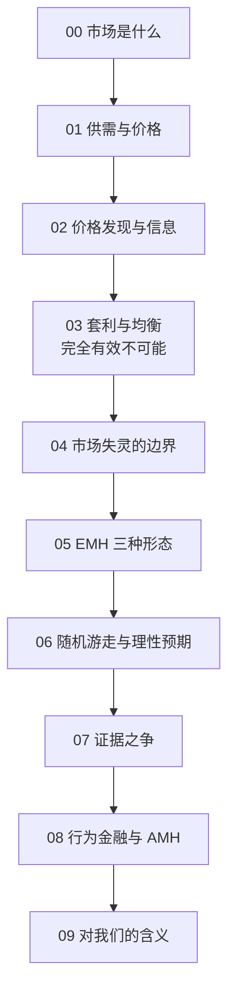

# 对我们的含义：投资、政策与治理

## 是什么

前八章讲「市场怎么运转、有多有效」；这一章讲**这些知识对我们意味着什么**——分别对**个人投资者**、**政策制定者**与**市场治理**。

> **重要前提**：本知识包是通识教育材料，**不荐产品、不预测市场、不构成投资建议**。以下内容是「理解市场之后可推导出的原则」，不是操作指令，个人决策须结合自身情况。

## 对个人投资者：三条可推导的原则

### 原则一：先看清「零和结构」

全体投资者合起来**就是市场**：主动者相互交易是**零和**的（有人跑赢必有人跑输），而主动管理还要额外扣除更高的费用与交易成本（F-074）。推论：

- **主动投资整体不可能跑赢市场**——这是一个**算术结论**，不是「努力不够」的问题；
- 少数人长期跑赢**是可能的**（[07 章](07-evidence-for-and-against.md) SPIVA 也承认存在），但**事前识别谁是那少数人**极难，且**业绩持续性弱**（F-065、F-074）。

### 原则二：费用是唯一「确定」的东西

收益不确定，但**费用确定发生**（F-075）。回顾 [05 章](05-emh-three-forms.md) 的推论：既然靠公开信息难获超额收益，那么**降低成本**就是普通投资者唯一**确定能改善结果**的动作。这就是指数基金与被动投资的理论落脚点——它不追求跑赢，只追求**不因费用与择时跑输**（F-075）。

### 原则三：认识自己的偏差

[08 章](08-behavioral-finance-and-amh.md) 的偏差清单说明：**最大的变量往往是你自己**（F-070）。可操作的对抗：

- 用**定投**对抗择时冲动与「买在最高点」；
- 用**纪律化的再平衡**对抗追涨杀跌；
- 用**长期视角**对抗近因偏差与情绪波动。

> **一句话总结个人层面**：**承认「难以持续战胜市场」，据此选择低成本、分散、长期、有纪律的参与方式**（F-074、F-075）。

## 对政策制定者：效率边界的三条启示

[04 章](04-market-failure.md) 的市场失灵清单与 [03 章](03-arbitrage-and-equilibrium.md) 的格罗斯曼—斯蒂格利茨悖论，共同给出政策设计的边界（F-077）：

1. **效率有成本，完全有效不可能**：政策目标不应是「让价格反映一切」（这在逻辑上不可达），而是**降低信息与交易成本**（降低搜集信息的成本、提升披露质量），让效率**靠近**而非**达到**上限；
2. **干预要在「市场失灵 vs 政府失灵」之间比较**：市场失灵的存在不自动证明干预正确（F-046、F-077）——关键是**实验、评估、及时退出**，而不是假定管制必然更优；
3. **干预的收益必须大于其扭曲成本**：任何税、补贴、价格管制都会带来行为的改变，设计时要问「**换来的效率提升是否值得这个扭曲**」（F-077）。

## 对市场治理：信息披露与反欺诈的经济学理由

为什么要有强制信息披露、禁止内幕交易、反财务造假？这不是道德说教，而是**针对信息不对称的制度回应**（F-076）：

- **强制信息披露**：直接针对 [04 章](04-market-failure.md) 的**信息不对称**——让公开信息**可信、可比、及时**，降低全体投资者的信息成本，提升市场效率（F-076）；
- **禁止内幕交易**：针对**信息优势的不公平利用**——若内幕者可以合法获利，普通投资者会因不信任而退出，市场流动性受损（F-076）；
- **反欺诈与注册制**：针对**逆向选择的极端形式**（造假、欺诈发行）——[04 章](04-market-failure.md) 的柠檬市场逻辑说明，若不惩罚欺诈，**好公司会被坏公司挤出市场**（F-042、F-076）。

> **制度经济学视角**：这些规则的本质是**用制度替代缺失的「零交易成本」**（回顾 [04 章](04-market-failure.md) 科斯定理 F-039）——现实中交易成本不为零，于是用**强制披露 + 法律惩罚**来近似「完全信息」的理想环境。

## 一张「该怎么参与」的自查表

**以下是通识原则，不构成投资建议**（F-078）：

| 问题 | 若答案为「否」 |
|---|---|
| 我是否理解「主动整体跑不赢市场」的算术？ | 先读 [07 章](07-evidence-for-and-against.md) |
| 我是否知道自己的综合费率是多少？ | 先去查费率（F-075） |
| 我是否有时间、能力、纪律做主动研究？ | 考虑低成本被动方式（F-074） |
| 我是否能承受下跌时不动手？（认识偏差） | 用定投与纪律对抗（F-070） |
| 我是否在用「有效市场」为懒惰找借口？ | 分清「不研究」与「战略性选择被动」 |

完整的自查工具见 [主动 vs 被动对照卡](../examples/03-active-vs-passive-scorecard.md)。

## 全包回顾：从机制到假说的一句话地图

**一句话串起来**：市场用价格**协调分散知识**（00–02）→ 套利让价格**趋向反映信息**（03）→ 但**信息有成本、外部性、不对称**，效率有边界（04）→ 这就是 **EMH 三种形态**的由来（05）→ 其数学支柱是**随机游走与理性预期**（06）→ 实证上**支持与挑战并存**（07）→ **行为金融与 AMH** 说明效率是**动态**的（08）→ 对个人与政策各有**可推导的原则**（09）。

## 小结

- **个人**：主动整体跑不赢（零和 + 费用）；费用是唯一确定项；最大变量是自己 → 低成本、分散、长期、有纪律（F-074、F-075、F-070）；
- **政策**：目标不是「让价格反映一切」（不可达），而是**降低成本、让效率靠近上限**；干预要在市场失灵与政府失灵间比较（F-077）；
- **治理**：强制披露、禁止内幕交易、反欺诈，都是**针对信息不对称的制度回应**（F-076）；
- 所有这些都建立在**「有效 ≠ 正确」「效率是程度而非开关」**的立场上（F-054、F-068）。

## 常见坑

- **把「多数主动基金跑不赢」读成「主动投资没意义」**：它是**统计结论**，不否认个体差异与少数长期成功者（F-074）。
- **用「市场有效」为不学习开脱**：战略性选择被动 ≠ 无知地跟风——前者理解零和结构与费用机制（F-078）。
- **以为「监管越多越有效」**：回顾政府失灵，制度设计也要算成本与激励（F-046、F-077）。
- **把本包当投资建议**：它是**通识与原则**，不含任何具体产品、买卖时点或收益承诺（F-078）。

## 相关概念

- [04 市场失灵与效率边界](04-market-failure.md)：政策与治理部分的失灵基础。
- [07 证据之争](07-evidence-for-and-against.md)：SPIVA 与主动/被动争论的实证。
- [08 行为金融与适应性市场](08-behavioral-finance-and-amh.md)：认识偏差后的纪律。
- 事实依据与信源：[facts.md](../facts.md)（F-074~F-078）、[经典与学术信源](../references/01-classics-and-authorities.md)。
