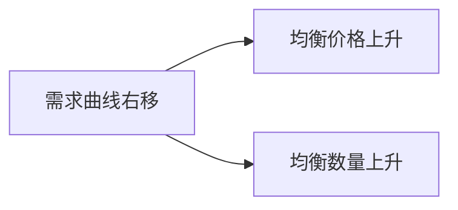

# 供需冲击算例：从曲线移动到新均衡

> **重要声明**：以下数字、商品与情景均为**教学假设**，用于演示供需模型如何工作，**不构成任何投资、经营或政策建议**。

## 一、基础设定

设某普通商品（教学用「某饮品」）的市场：

- **需求曲线**（向下倾斜）：价格越高，需求量越少（F-009）；
- **供给曲线**（向上倾斜）：价格越高，供给量越多（F-009）；
- 两线交点 = **均衡价格与均衡数量**，此时市场**出清**（F-010）。

教学假设的简化数据：

| 价格 | 需求量 | 供给量 | 状态 |
|---|---|---|---|
| 10 元 | 100 | 40 | 短缺 60 |
| 15 元 | 80 | 60 | 短缺 20 |
| **20 元** | **60** | **60** | **均衡** |
| 25 元 | 40 | 80 | 过剩 40 |
| 30 元 | 20 | 100 | 过剩 80 |

## 二、情形 A：需求冲击（曲线整体右移）

假设某年夏天异常炎热，**更多人想喝这款饮品**——这不是价格变化引起的需求量变化，而是**需求曲线整体右移**（F-011）。

| 变量 | 变化 |
|---|---|
| 均衡价格 | **上升**（如 20 元 → 25 元） |
| 均衡数量 | **上升**（如 60 → 80） |

**关键区分**：天气变化导致的是**曲线移动**（move of the curve），不是**沿曲线移动**（movement along the curve）。后者是「**只有价格变**、其他条件不变」时需求量的变化（F-011）。

## 三、情形 B：供给冲击（曲线整体左移）

假设原材料涨价，**生产商成本上升**，供给曲线整体左移（F-011）。

| 变量 | 变化 |
|---|---|
| 均衡价格 | **上升**（如 20 元 → 26 元） |
| 均衡数量 | **下降**（如 60 → 45） |

这与 [02 章](../concepts/02-price-discovery-and-information.md) 的**锡短缺**例子同构：供给减少 → 价格上升 → 用者节约、生产者增产 → **稀缺被缓解**（F-020）。**没有人需要知道「为什么涨价」，价格完成了协调**。

## 四、弹性如何改变结果

同样的冲击，**结果的大小取决于需求弹性**（F-012）：

| 弹性 | 含义 | 供给减少时的价格反应 |
|---|---|---|
| **弹性小（刚需）** | 价格上涨也照买（如药品） | **价格大幅上涨**，数量微降 |
| **弹性大（可选）** | 稍贵就不买（如某种零食） | 价格小幅上涨，**数量大幅下降** |

这解释了一个现实：**越是刚需、越缺乏替代品的商品，供给冲击越容易表现为「价格暴涨」**（F-012）。

## 五、过剩与短缺如何自我修正

当价格高于均衡（如 25 元）→ 出现**过剩**（80 − 40 = 40）→ 卖方降价促销 → 价格下行 → 回到均衡（F-010、F-015）。

- **过剩**：供给 > 需求 → 价格有下行压力；
- **短缺**：需求 > 供给 → 价格有上行压力。

这是 [01 章](../concepts/01-supply-demand-price.md) 所说的**自我修正倾向**（F-015）。⚠️ **但注意边界**：若价格被**管制**（限价）或存在**市场势力**，自我修正会被阻断，短缺/过剩会长期存在——这属于 [04 章](../concepts/04-market-failure.md) 的市场失灵（F-046）。

## 六、要点回顾

| 结论 | 对应事实 |
|---|---|
| 均衡由供需交点决定，是市场出清状态 | F-010 |
| 需求/供给**曲线移动** ≠ **沿曲线移动** | F-011 |
| 弹性决定价格与数量变化的相对幅度 | F-012 |
| 过剩与短缺具有自我修正倾向（无价格管制时） | F-015 |
| 价格同时承担**信息**与**激励**双重功能 | F-017 |

> **练习**：若某商品同时遇到「需求右移」与「供给左移」，均衡价格一定上升吗？均衡数量的方向确定吗？（答案提示：价格几乎必然上升，**数量方向不确定**，取决于两种冲击的相对强弱——这正是「单一方向推断」的常见陷阱。）
