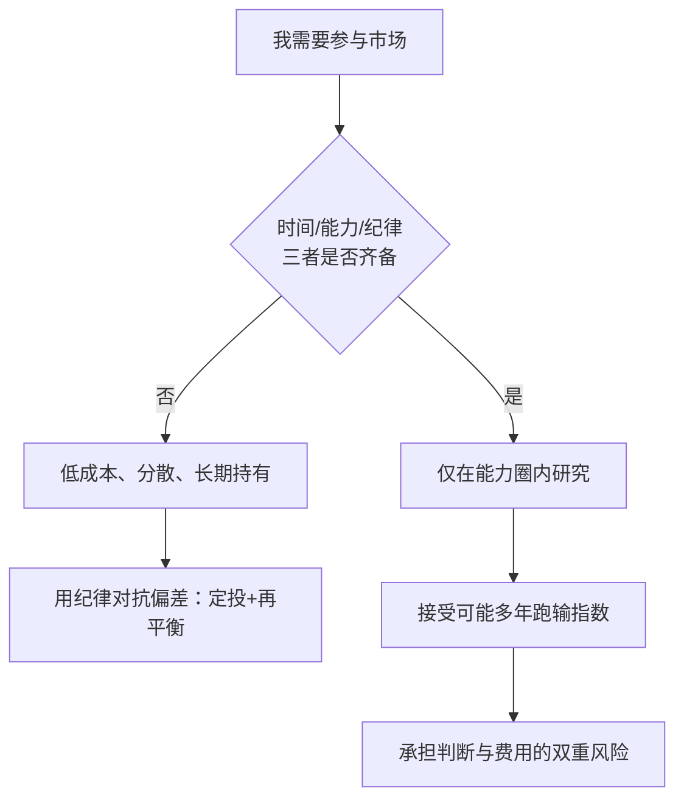

# 主动 vs 被动对照卡

> **重要声明**：本对照卡是**通识教育工具**，用于梳理两条路线的结构性差异，**不构成投资建议、不荐产品、不预测市场**。个人决策须结合自身情况并考虑风险。

## 一、12 项特性对照

| # | 特性 | 主动投资 | 被动投资 | 事实依据 |
|---|---|---|---|---|
| 1 | **目标** | 跑赢市场基准 | 获取市场平均收益 | F-074 |
| 2 | **依赖** | 选股、择时能力 | 纪律与低成本 | F-075 |
| 3 | **费用结构** | 管理费通常更高 | 通常显著更低 | F-075 |
| 4 | **零和结构中的地位** | 主动者相互交易是零和，整体扣费后落后 | 不参与零和，直接拿平均 | F-074 |
| 5 | **复杂度** | 高（研究、估值、跟踪） | 低（买入持有） | F-074 |
| 6 | **时间投入** | 大 | 小 | F-078 |
| 7 | **业绩持续性** | 弱（去年赢家≠今年赢家） | 不适用（不追求超额） | F-065 |
| 8 | **长期胜率（统计）** | 少数人长期跑赢 | 长期跑赢多数主动基金 | F-065 |
| 9 | **对偏差的暴露** | 高（过度自信、处置效应） | 较低（规则化执行） | F-070 |
| 10 | **主要风险来源** | 判断错误 + 费用 | 市场系统性风险 | F-075 |
| 11 | **适合人群** | 有时间/能力/纪律的少数人 | 绝大多数普通参与者 | F-074、F-078 |
| 12 | **与 EMH 的关系** | 假设市场存在可利用的低效 | 承认难以持续战胜市场 | F-054、F-074 |

## 二、自我评估清单

**逐条自问，如实回答（通识自查，非投资建议）**：

- [ ] 我知道「主动整体必然落后于市场平均」是一个**算术结论**吗？（F-074）
- [ ] 我知道自己投资工具的综合费率是多少吗？（F-075）
- [ ] 我是否有**时间**持续阅读财报、跟踪行业？（F-078）
- [ ] 我是否有**能力**做估值判断（而非凭感觉）？（F-078）
- [ ] 我是否有**纪律**在连续多年跑输时仍坚持自己的方法？（F-070）
- [ ] 我能否承受组合下跌 30% 以上而不恐慌割肉？（F-070）
- [ ] 我是否清楚「有效 ≠ 价格正确」，因而不在泡沫中盲目追高？（F-054）
- [ ] 我选择被动，是因为**理解零和结构与费用机制**，还是因为「懒得研究」？（F-078）

前六题若有「否」，**被动路线是更符合逻辑的起点**（F-074）；全部为「是」的人，方可考虑在**能力圈**内做有限度的主动尝试，并接受其不确定性（F-078）。

## 三、决策流程

## 四、常见误读纠正

| 误读 | 纠正 | 依据 |
|---|---|---|
| 「SPIVA 说明没人能跑赢」 | SPIVA 说明**多数、长期**跑不赢，不否认少数成功者 | F-065 |
| 「被动=躺平不学习」 | 战略性被动**要求**理解零和结构与费用机制 | F-074、F-078 |
| 「市场有效所以价格永远对」 | 有效 ≠ 正确，泡沫可以在有效市场中形成 | F-054 |
| 「费用小，无所谓」 | 长期复利下费率差异会显著放大 | F-075 |
| 「我比大多数人聪明，能战胜偏差」 | 偏差是**人类默认设置**，专业者同样中招 | F-070 |
| 「动量/价值异象证明该主动」 | 异象需过**样本外 + 成本 + 风险补偿**三重检验 | F-066、F-067 |

## 五、一句话总结

> **被动不是「放弃」，而是「承认算术」；主动不是「勇敢」，而是「承担可验证的风险」。两条路都成立，关键是知道自己为什么选它。**（F-074、F-075、F-078）

> 延伸阅读：[09 对我们的含义](../concepts/09-implications.md)、[07 证据之争](../concepts/07-evidence-for-and-against.md)、[08 行为金融与 AMH](../concepts/08-behavioral-finance-and-amh.md)。
