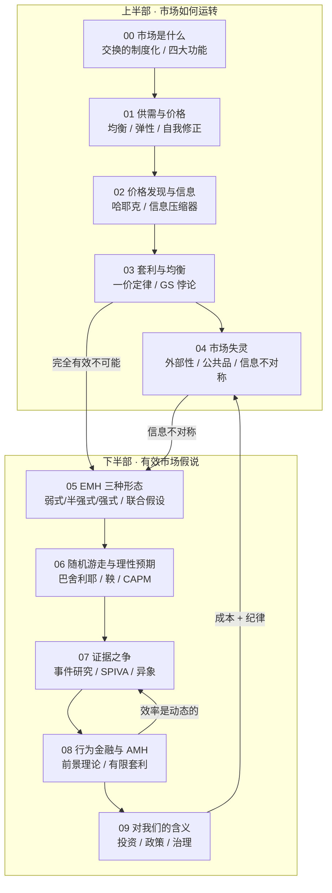

# 架构洞察（Architecture Insights）

> 基于 [事实清单](facts.md) 提炼。每条洞察按「**陈述 / 证据 / 反常识点 / 行动启示**」四元组组织；事实以 F 编号溯源，洞察为**解释性判断**，不构成投资建议。理论争议处并置两侧（F-066、F-067），不替读者站队。

## 洞察 1：价格是一台「信息压缩器」——协调不需要中央知识

| 四元组 | 内容 |
|--------|------|
| **陈述** | 市场最深刻的机制不是「买卖东西」，而是**用价格把分散在无数人手里的知识压缩成单一信号**；个体无需知道全局，只依据价格做局部决策，就能实现社会层面的协调。 |
| **证据** | F-001（市场是交换的制度化）、F-017（价格的双重功能：信息+激励）、F-019/F-020（哈耶克「特定时空的知识」与锡短缺例）、F-021（价格发现）。 |
| **反常识点** | 直觉认为「要协调就得有个总指挥」，而价格机制恰恰**以「无人掌握全局」为前提**运转得更好：锡价上涨时，数百万用户不需要知道短缺原因、互不相识、无中央指令，却一致地节约、替代、回收（F-020）。反过来说，**任何试图「集中计算一切」的方案都会遭遇哈耶克的信息瓶颈**——这是理解 [04 章](concepts/04-market-failure.md) 政府失灵的信息根源。 |
| **行动启示** | 分析任何市场/组织问题时，先问「**信息是怎么流动的、价格（或替代信号）在传递什么**」；评价一项干预时，警惕「设计者以为自己比分散信息更懂」的幻觉（F-046、F-077）。 |

## 洞察 2：效率不是一个「开关」，而是一个「程度」——且存在理论硬上限

| 四元组 | 内容 |
|--------|------|
| **陈述** | 「市场是否有效」是个伪二元问题。效率**有程度、有边界、因市场而异、随时间演化**；更关键的是，完全信息有效在**逻辑上不可能**。 |
| **证据** | F-030/F-031（格罗斯曼—斯蒂格利茨悖论：完全有效不可能，均衡只能是部分有效）、F-033（信息扩散速度决定反应速度）、F-034（流动性与效率互相促进）、F-068（AMH：效率是随竞争演化的动态状态）。 |
| **反常识点** | 直觉上「越有效越好」，逻辑上却相反：**若价格真的反映一切信息，就没人有动力花成本去搜集信息，价格反而会失去信息含量**（F-030）。因此**「有噪声但含信息」才是可持续的均衡**——效率必须「留有余地」以补偿信息的采集者。这也解释了为什么套利机会不会被那一点成本差完全消灭。 |
| **行动启示** | 停止问「这个市场有效吗」，改问「**这个市场在什么时候、什么尺度上更接近有效？我的信息与交易成本够低吗？**」——AMH 的提问方式（F-068）。评估策略时，先算清自己的成本与相对信息优势。 |

## 洞察 3：「有效」 ≠ 「正确」——两个效率必须分开

| 四元组 | 内容 |
|--------|------|
| **陈述** | 价格「反映了可得信息」与「价格等于真实价值」是**两件事**；EMH 只讲前者（信息效率），它不蕴含「资本流向最优用途」（资源配置效率）。 |
| **证据** | F-022/F-023/F-024（信息效率 vs 资源配置效率，EMH 只谈前者）、F-054（有效≠正确；泡沫可在有效市场中形成）、F-071（席勒：价格波动超基本面所能解释）。 |
| **反常识点** | 「有效市场」这个词让多数人以为它说「**价格永远对**」，而它的真实含义是「**价格里没有免费的信息可捡**」。若**所有人同时错了**（如泡沫中的集体乐观），价格反映的是**「错误的共识」**——市场在「信息已被充分反映」的意义上依然有效，但价格离真相很远（F-054）。这是最常被误读的一点。 |
| **行动启示** | 两句话防身：① **看到「市场是有效的」别理解成「价格是对的」**；② **看到「价格涨了」别理解成「信息支持它」**——它可能只是反映了更多人的相同的错（F-054、F-071）。 |

## 洞察 4：市场失灵是「边界条件」，干预失灵也是

| 四元组 | 内容 |
|--------|------|
| **陈述** | 市场失灵的五大类（外部性、公共品、信息不对称、市场势力、宏观不稳定）都是**特定前提被破坏**时的结果，不是常态；而**纠正失灵的干预本身也会失灵**。理性立场是比较两把尺子。 |
| **证据** | F-035/F-036（市场失灵是例外）、F-037~F-040（外部性、庇古税、科斯定理、公共品）、F-041~F-045（信息不对称四件套 + 信贷配给）、F-046（政府失灵）。 |
| **反常识点** | 两个直觉都会翻车：① 「有失灵就必须管」——错，科斯定理说**产权清晰 + 低交易成本**时私下协商更优（F-039）；② 「产权定了就万事大吉」——也错，现实交易成本很少为零（F-039）。更反直觉的是**信贷配给**：利率不承担出清功能、反而承担筛选功能，所以银行主动把利率定在出清价**下面**（F-045）——「价高者得」这个教科书直觉在这里失效。 |
| **行动启示** | 遇到「要不要干预」的问题，执行**两把尺子**流程：先识别失灵类型与严重程度，再比较干预成本与政府失灵风险；能靠界定产权与降低交易成本解决的，优先于直接管制（F-039、F-046、F-077）。 |

## 洞察 5：EMH 的争论是「方法论之争」，不是「站队之争」

| 四元组 | 内容 |
|--------|------|
| **陈述** | EMH 与行为金融的长期对峙，很大一部分分歧源于**方法论**：EMH 无法单独被检验（联合假设），而异象证据又有数据挖掘与成本扣除的风险。因此**两侧证据都必须过同一套安检**。 |
| **证据** | F-053（联合假设问题：分不清「市场无效」还是「模型错」）、F-063/F-064（事件研究：支持与公告后漂移并存）、F-065（SPIVA 支持侧）、F-066/F-067（异象挑战侧 + 数据挖掘警戒 + 2013 诺奖同授对立双方）。 |
| **反常识点** | 「同一个数据、两种解释」不是和稀泥，而是**结构性的**：价值/规模异象既可以是**风险补偿**（市场有效），也可以是**定价错误**（市场无效），而**你无法用数据本身判定是哪个**——因为你必须预设一个定价模型，而模型的正确性同样无法独立验证（F-053、F-066）。所以「市场有效吗」这个问题的答案部分取决于**你用什么尺子量**。 |
| **行动启示** | 评估任何「某策略/因子跑赢市场」的宣称时，先过**三道安检**：① **样本外**还能成立吗？② 扣掉**交易成本**后还剩多少？③ 这因子被**挖掘**过多少次（t 值门槛）？（F-067、F-064） |

## 洞察 6：对个人，「算术」与「确定性」比「预测」更重要

| 四元组 | 内容 |
|--------|------|
| **陈述** | 把前五条洞察落到个人身上，得到三个不依赖预测的结论：主动整体跑不赢（算术）、费用确定发生（确定性）、最大变量是自己（行为）。三者共同指向「低成本、分散、长期、有纪律」。 |
| **证据** | F-074（零和结构 + 费用 → 主动整体必然落后）、F-075（费用是唯一确定的负担）、F-070（偏差是人类默认设置）、F-054（有效≠正确）、F-065（SPIVA 支持侧）。 |
| **反常识点** | 投资内容充斥「预测」（下个月涨还是跌、该不该买某只），但**普通人能确定的只有两件事：自己付多少费用、自己能不能守住纪律**（F-075、F-070）。**「不预测」不是放弃，而是把决策建立在可确定的东西上**——这是 EMH 与行为金融**罕见的一致结论**：你既跑不过有效定价，也战胜不了自己的情绪。 |
| **行动启示** | 用三条自查替代预测：① 我知道自己付的**综合费率**吗？② 我能在下跌 30% 时**不动手**吗？③ 我选被动是因为**理解算术**，还是因为**懒得研究**？（详见 [主动 vs 被动对照卡](examples/03-active-vs-passive-scorecard.md)，F-078） |

## 知识地图

> **一句话读图**：上半部回答「市场怎么运转」（00–04），下半部回答「它有多有效」（05–09）；两条链通过**格罗斯曼—斯蒂格利茨悖论**（完全有效不可能）与**信息不对称**（强式不成立）在中间咬合。全包结论可压成一句：**效率是程度与边界，不是开关；有效不等于正确；对个人，可确定的是成本与纪律。**
