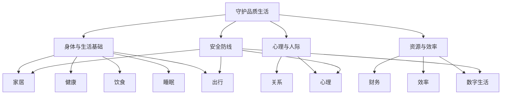

# 11 域总览与导航

> 本篇是**导航层**：全包被组织成 11 个域，这里给你一张域图。想解决哪一块，就进哪一块的分域篇。域清单对应网站 `apps/guard-quality-life-site` 的 11 域名（home/health/diet/sleep/efficiency/finance/relation/mind/travel/digital/safety），两者同源（F-012、F-035）。

## 1. 11 域总览表

每个域：id、中文名、一句话简介、代表条目（标 F 编号与证据级）。代表条目覆盖 F-014~F-034。

| id | 中文名 | 一句话简介 | 代表条目（证据级） |
|---|---|---|---|
| home | 家居 | 家庭环境的安全与秩序——检查隐患、收纳、清洁频率 | 家庭安全检查（B，F-014） |
| health | 健康 | 以常规筛查与活动习惯守护身体底线 | 常规筛查、久坐打断（A/B，F-016/017） |
| diet | 饮食 | 吃得更均衡、储得更卫生 | 膳食均衡（A，F-018）、储存分区（B，F-019） |
| sleep | 睡眠 | 用固定作息与睡前习惯换一夜好眠 | 睡眠时长、睡眠卫生（A/B，F-011/020） |
| efficiency | 效率 | 减少启动阻力、减少数字噪音，把事做完 | 任务拆小（B，F-021）、数字减负（B，F-022） |
| finance | 财务 | 先有缓冲、再防被坑 | 应急基金、反诈警惕（B，F-023/024） |
| relation | 关系 | 更走心的沟通与更健康的边界 | 倾听复述、健康边界（B，F-025/026） |
| mind | 心理 | 允许情绪、必要时求援 | 情绪识别、专业求助边界（B，F-027/028） |
| travel | 出行 | 让每一次出行更安全 | 安全带/头盔（A，F-029）、天气路况（B，F-030） |
| digital | 数字生活 | 账号更稳、信息更安全 | 两步验证、信息安全（B，F-031/032） |
| safety | 安全 | 突发危机下救命的知识与动作 | 家庭急救、燃气用电（B，F-033/034） |

## 2. 11 域关系图

下面这张 Mermaid 流程图示意 11 域如何围绕"守护日常品质生活"分为四组、又互相支撑（F-001、F-012）：

> 图读法：中心和四组是"守护品质生活"的骨架；**安全防线**横跨家居/出行/数字生活/心理四个域，因为"保命/防损"是跨域的主题。

## 3. 域与文件导航

概念层的分域篇与对应域（F-012）：

| 分域篇 | 覆盖域 | 代表 F 编号 |
|---|---|---|
| [02-home.md](02-home.md) | 家居 | F-014/015/034 |
| [03-health.md](03-health.md) | 健康、睡眠 | F-016/017、F-011/020 |
| [04-efficiency.md](04-efficiency.md) | 效率、数字生活 | F-021/022、F-031/032 |
| [05-finance-relations-mind.md](05-finance-relations-mind.md) | 财务、关系、心理 | F-023~F-028 |
| [06-how-to-use.md](06-how-to-use.md) | 使用与迁移 | F-035~F-046 |

> 注：饮食（diet，F-018/019）与出行（travel，F-029/030）两个域在概念层未单独立篇，其代表条目已在本文 11 域表中列出并标注 F 编号，完整条目见网站 knowledge.py 与 references（F-012、F-035）。

## 4. 阅读提示

- **按需进入**：本包是方案库，不是任务清单——挑你想解决的域，不需要全读（F-001，与框架篇"备选单"姿态一致）。
- **配合框架**：本包强调"按证据级判断用力程度"——A 级敢照做、B 级方向可信、C 级当经验参考（F-003、F-042）。
- **网站同源**：域结构在网站 `apps/guard-quality-life-site` 上一一对应，可直接按域浏览/检索（F-035~F-038，见 [06-how-to-use.md](06-how-to-use.md)）。

---
下一篇 [02-home.md](02-home.md) 进入家居域，给出可执行方案。