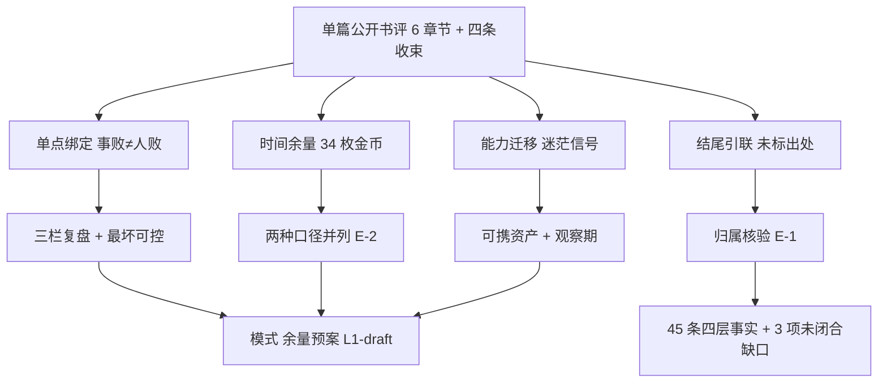

# 人生的 84000 种可能：把「可能性」做成可执行的备选方案

> **状态：draft · 路线：`chaptered-summary`（深度摘要 + 原创改写）。** 源材料是一篇 **2026-11-03 发布的公开书评**，评论对象为艾力 2017 年出版的自我成长类图书（F-001/F-031）。本包不是图书转录、不是书摘集、不提供可替代原书的阅读捷径，也不提供任何方法的效果保证。

## ⚠️ 勘误提示（读任何一篇之前先看）

| # | 页面说法 | 核验值 |
|---|---|---|
| **E-1** | 结尾引「无迹方知流光逝，有梦不觉人生寒」，未标出处，写「放在这本书里」（F-007） | 该联为 **于丹自创**，系其 2015 年《有梦不觉人生寒》书名来源（S09/S10/S11，F-039）。页面未标注出处；本包未取得原书文本，不推测原书是否引用 |
| **E-2** | 34 枚金币「回归本质」＝不压榨的资源盘点工具（F-019/F-022） | 一手口径为 7:00–24:00 共 17 小时按半小时切 34 枚、含红黄绿价值标记的时间记账法（S03/S07/S08，F-037）。书评说法是**再诠释**，不是方法定义 |

两项勘误的完整裁决见[P0 核验与勘误](references/verification.md) §3；语义边界另见「84000 不是路径计数器」（F-034/F-044）。

## 按用途选择路径

| 我想…… | 去读哪一篇 |
|---|---|
| 先搞清书评里哪句话能当事实、哪句只是主张 | [00 阅读与证据](concepts/00-reading-and-evidence.md) |
| 理解「一环断了整个人塌掉」的结构，拿到三栏复盘格式 | [01 单一路径风险](concepts/01-single-path-risk.md) |
| 把「多一种可能」落到可支配余量，并看清两种口径 | [02 时间余量与 34 枚金币](concepts/02-time-residual-audit.md) |
| 盘点换环境后仍能带走的能力 | [03 能力迁移](concepts/03-transferable-capability.md) |
| 迷茫时先做什么、哪几条主张不能当判据 | [04 迷茫作为信号](concepts/04-muddle-as-signal.md) |
| 查勘误、单源清单、缺口与复核条件 | [05 边界与主张](concepts/05-boundaries-and-claims.md) |
| 看 3 条洞察与「余量预案」模式 | [知识地图](knowledge-map.md) |
| 核查每条事实、信源与审查记录 | [来源、事实、核验与审查](references/index.md) |

只想取方法的读者可直接读 01～03；但每篇末尾的「本包不覆盖」才是这套方法的真实边界。

## 三条主线



## 证据怎样使用

F-001~F-045 共 **45 条**，是本包唯一的事实台账：A 组 9 条页面事实、B 组 21 条作者主张、C 组 10 条独立核验、D 组 5 条负向与边界。事实表只回答「页面写了什么」「一手信源写了什么」，**不认证任何方法的有效性、不把单源主张升级为研究结论**。

三条负向事实值得先记住：页面未提供所评图书的出版信息、参考文献与章节目录（F-008）；页面无统计来源、案例样本、效果数据与利益披露（F-009）；页面未提供可复现的记录模板、周期、分类标准或步骤序列（F-043）。因此本包对「方法有没有效」「怎么做才算对」保持空白，不用常识补写。

> **表格 ≠ 原书表格。** 本包所有表格均为依据源文陈述或核验信源整理的原创改述，不是图书原表，也不是书评原表。

## 文档清单

本包共 **15 篇 Markdown**：1 篇根索引、6 篇教程、1 篇教程目录、1 篇知识地图、4 篇参考正文、1 篇参考目录与 1 篇更新日志。**不建 `examples/`**：源文没有可照做的配置、调用或发布流程，操作可复现性两问皆否（F-043），理由见[知识地图](knowledge-map.md) §2。也不建 `.trae/specs/` 公共规划副本，事实台账只有 `references/facts.md` 一份，双份一致性转化为「台账连续 + 全包 F 引用 ⊆ 台账」两条机械判据（见 `log.md`）。

## 主题关联

- [确定性误区与福格行为模型](../wechat-certainty-fogg-prompt/index.md)：同组微信博文转化先例，同样处理「源文转述偏差」并显式勘误；本包处理的是人生预案而非行为设计，两包 F 编号独立。
- [心理学能解释什么](../wechat-psychology-value-and-bias/index.md)：同为单源长文的证据分层样本，可对照「什么样的事实值得逐条回源」。
- [纳瓦尔「学造连」对勘](../naval-learn-build-link/index.md)：二手财富励志内容的可信边界与阅读纪律；本包 E-1/E-2 是同类问题的两个新案例。
- [高性价比人生指南精读](../how-to-live-better/index.md)：多信源核验型知识包，与本包「单源书评」形成证据密度对照。
- [守护品质生活方案库](../guard-quality-life/index.md)：自有主题的可执行方案库；本包不提供可复现步骤，两者定位不同。

## 更新边界

`2027-11-17` 为复核期限，**不是自动巡检任务**。触发复核：取得原书章节文本、页面被删改或出现新的权威出处、出现可复核的第三方效果数据、或「余量预案」在第二个非同谱系领域完成一次完整应用。完整覆盖清单见[来源清单](references/source-manifest.md) §5，执行记录见[更新日志](log.md)。

```{toctree}
:hidden:
:maxdepth: 3

concepts/index
knowledge-map
references/index
log
```

```
[CMD-LOG] | level=INFO | cmd=seven-concepts | step=S0 | event=CMD_START | session=sc-20261117-life-84000-backup-plan | msg=方法论编排开始：公众号书评转 OKF 教程知识包 | ctx={"scenario":"knowledge","topic":"life-84000-backup-plan","depth":"deep"}
[CMD-LOG] | level=INFO | cmd=seven-concepts | step=S1 | event=SCENARIO_DETECTED | session=sc-20261117-life-84000-backup-plan | msg=场景4知识沉淀：全面学习+生成教程 | ctx={"matched":["全面学习","生成教程","沉淀知识"]}
[CMD-LOG] | level=INFO | cmd=seven-concepts | step=S2 | event=CHAIN_SELECTED | session=sc-20261117-life-84000-backup-plan | msg=R→I→E→V→C 入库，depth=deep 不裁剪 | ctx={"chain":["R","I","E","V","C"],"depth":"deep"}
[CMD-LOG] | level=INFO | cmd=seven-concepts | step=R | event=CONCEPT_COMPLETED | session=sc-20261117-life-84000-backup-plan | msg=R阶段完成：45条四层事实+11信源+10项P0核验+2项勘误 | ctx={"facts":"F-001~F-045","sources":"S01~S11","p0":10,"errata":2}
[CMD-LOG] | level=INFO | cmd=seven-concepts | step=G1 | event=GATE_PASSED | session=sc-20261117-life-84000-backup-plan | msg=45条事实无因果词，页面/权威口径并列 | ctx={"facts":45}
[CMD-LOG] | level=INFO | cmd=seven-concepts | step=I | event=CONCEPT_COMPLETED | session=sc-20261117-life-84000-backup-plan | msg=I阶段完成：3条四元组洞察 | ctx={"insights":["I-1","I-2","I-3"]}
[CMD-LOG] | level=INFO | cmd=seven-concepts | step=G2 | event=GATE_PASSED | session=sc-20261117-life-84000-backup-plan | msg=3条洞察四元组完整、维度独立 | ctx={"insights":3}
[CMD-LOG] | level=INFO | cmd=seven-concepts | step=E | event=CONCEPT_COMPLETED | session=sc-20261117-life-84000-backup-plan | msg=E阶段完成：余量预案模式L1-draft | ctx={"pattern":"residual-capacity-plan"}
[CMD-LOG] | level=INFO | cmd=seven-concepts | step=G3 | event=GATE_PASSED | session=sc-20261117-life-84000-backup-plan | msg=六步五反模式，附边界/检验/跨域/成熟度 | ctx={"steps":6,"anti_patterns":5}
[CMD-LOG] | level=INFO | cmd=seven-concepts | step=V | event=GATE_PASSED | session=sc-20261117-life-84000-backup-plan | msg=4视角8意见，7采纳1部分采纳，回归关闭 | ctx={"opinions":8,"adopted":7,"partial":1}
[CMD-LOG] | level=INFO | cmd=seven-concepts | step=G4 | event=GATE_PASSED | session=sc-20261117-life-84000-backup-plan | msg=15原子md+四级索引接入，机械门禁结果见log.md | ctx={"md":15}
[CMD-LOG] | level=INFO | cmd=seven-concepts | step=S99 | event=CHAIN_COMPLETED | session=sc-20261117-life-84000-backup-plan | msg=45事实/3洞察/1模式/2勘误/4视角8意见/15原子文件 | ctx={"gates":["G1","G2","G3","V","G4"],"deliverable":"doc/bundles/sheke/personal-growth/life-84000-backup-plan/"}
```
